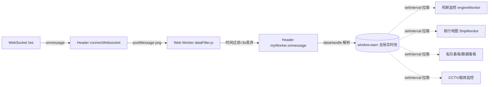
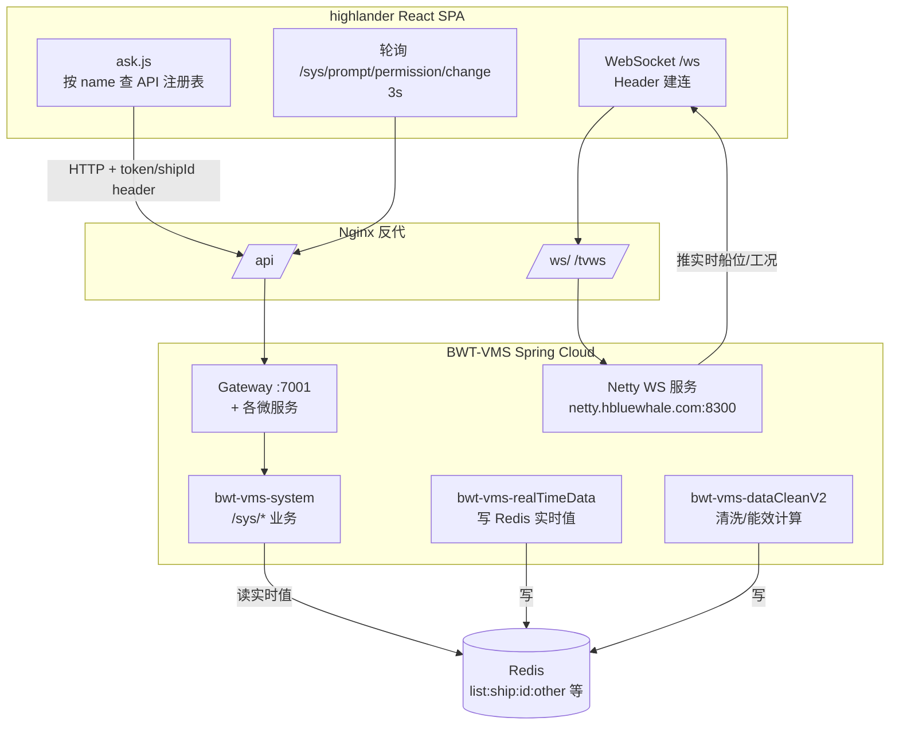
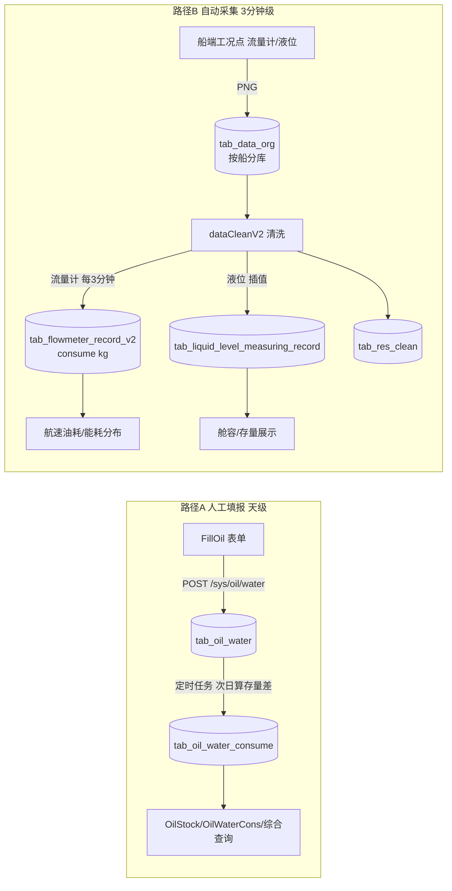

# BWT-VMS 前端架构知识库(icommander-web-feature / highlander)

> 更新日期:2026-09-04②(修正 12.3/12.5:device_type 实为 0报警/1数值/2开关;示例 device_key 改为真实数字型;早期探索稿已标注)(修改本文档后请同步更新此日期,并到 Dify 知识库重新上传该文件)

> 配套文档:同目录 `BWT-VMS架构知识库.md`(后端)。两份合起来是整套系统的全景。
>
> 本文面向**新接手的开发者**。覆盖:前端架构、前后端数据对接关系、能效可视化的端到端实现、油水填报功能与数据库填写指南。
>
> 全部结论基于实际源码梳理,关键处附源文件路径作为证据锚点。含 Mermaid 图,GitLab/VS Code(Typora)可直接渲染。

---

## 目录

1. [一分钟理解前端](#1-一分钟理解前端)
2. [技术栈](#2-技术栈)
3. [工程结构](#3-工程结构)
4. [路由与页面地图](#4-路由与页面地图)
5. [状态管理(MobX)](#5-状态管理mobx)
6. [HTTP/REST 对接层(ask.js)](#6-httprest-对接层askjs)
7. [实时数据机制(WebSocket + Worker + window.warn)](#7-实时数据机制)
8. [权限与环境(deploymentEnv / 权限树 / 登录态)](#8-权限与环境)
9. [构建与部署](#9-构建与部署)
10. [前后端数据对接全景](#10-前后端数据对接全景)
11. [能效可视化深入(端到端)](#11-能效可视化深入)
12. [油水填报与数据库填写指南](#12-油水填报与数据库填写指南)
13. [上手指南](#13-上手指南)
14. [已知风险与坑](#14-已知风险与坑)
15. [名词表](#15-名词表)

---

## 1. 一分钟理解前端

**这是什么**:一个名为 **highlander** 的 React 单页应用,是 BWT-VMS 船舶管理系统的全部 Web 前端,涵盖船队看板、航行监控地图、机舱 SVG 可视化、能效分析、油水填报、CCTV 视频等 40+ 页面。同一套代码同时部署在**船端**和**岸端**,通过 `deploymentEnv` 切换。

**三条数据命脉**(理解前端的关键):
- **REST 业务请求**:统一走 `src/lib/ask.js` 的 `ask(name, opt)` 封装,接口名集中注册在 `src/config/*Api.js`。token 走 header。
- **WebSocket 实时推送**:Header 组件建连 `/ws`,消息经 Web Worker 过滤后写入**全局变量 `window.warn`**,页面用定时器从全局变量拉数渲染(不是直接进 React state)。
- **HTTP 轮询**:只有一处全局轮询——每 3 秒调 `/sys/prompt/permission/change` 检测权限变更;另有报表页(如能耗分布监控)5 秒轮询业务接口。

**心智模型**:菜单/路由/功能开关**全部由后端下发的权限树驱动**(前端无硬编码菜单)。能效等业务的实时数据走 Redis → 后端接口 → 前端轮询;机舱 SVG 监控走 WebSocket。

---

## 2. 技术栈

| 维度 | 选型 | 版本 |
|---|---|---|
| 框架 | React | 17.0.2 |
| 路由 | react-router-dom | 4.2.2 |
| 状态管理 | **MobX** + mobx-react(`enforceActions`) | 4 / 5 |
| UI 组件 | Ant Design(antd)+ @ant-design/icons | 3.26 |
| 图表 | ECharts + echarts-for-react | 4.2 |
| 地图 | **OpenLayers**(ol)+ Turf + proj4 | 5.3 |
| 构建 | Webpack 3 + Babel 6 + Sass/Less | 3.8 |
| HTTP | axios | 0.18 |
| 国际化 | i18next + react-i18next(中/英) | — |
| SVG 机舱图 | react-svg + @iconfu/svg-inject | — |
| 视频 | 海康 CCTV SDK(HCWebSDKPlugin + flv.js + NVRVideo) | — |
| 实时通信 | ws(WebSocket) | 7.0 |
| 拖拽/布局 | react-beautiful-dnd / react-dnd / react-grid-layout | — |
| 其他 | crypto-js、wangeditor、xlsx、moment、lodash、numeral、swiper、qrcode.react | — |
| 应用名 | highlander(package.json `name`) | — |

> 证据:`icommander-web-feature/package.json`。

---

## 3. 工程结构

### 3.1 `src/` 目录组织

| 目录 | 职责 |
|---|---|
| `src/index.js` | 应用入口:mobx `Provider` 注入 store + `BrowserRouter`(basename `/`,支持 `/:lang` 前缀) |
| `src/App.js` | 根组件:40+ 平铺 `Route`(单 `Switch`,无嵌套)+ 30 分钟登录超时 + Helmet SEO |
| `src/containers/` | **页面级容器**(按业务域分子目录,约 60+):Header、map、em、eh、analyticalStatement、fillForm、engineMonitor、engineHealth、cctv、fleetBoard、databoard、energyMonitor、Login、ConfigurationManagement 等。页面文件多为 `.jsx` 或 `.js` |
| `src/components/` | 通用展示组件(图表封装 Donut/ScoreCircle、按钮、视频、语言切换等) |
| `src/lib/` | 基础设施:`ask.js`(HTTP)、`Socket/`(WS)、`utils.js`、`const.js`、`rem.js` |
| `src/store/` | MobX 全局状态(9 个 store) |
| `src/config/` | **集中式 API 注册表**(10 个分域文件 `Object.assign` 合并) |
| `src/constants.js` | 站点常量、页面类型映射 |
| `src/theme/` | 全局 SCSS(base.scss、common.scss 经 sass-resources-loader 全局注入) |
| `src/assets/` | 图片/字体/音频 |
| `public/` | 不经 webpack 的静态资源 + **运行时配置**(部署后可改) |

### 3.2 运行时入口 `public/index.html`(关键)

React 挂载前通过 `<script>` 注入一批 **window 全局变量**,这些是部署后改环境的核心:

| 脚本 | 注入全局 | 作用 |
|---|---|---|
| `config/urlConfig/urlConfig.js` | `window.urlConfig`(systemInfor/es 地址)、`window.cctvHK`(视频方案 1/2/3)、`window.front_uuid_url`、**`window.getStateTime=3000`**(权限轮询间隔) | 外链与全局开关 |
| `config/engine_config/engineConfig.js` + `12.js` + `default.js` | `window.EngineConfig` → 写入 `localStorage.EngineConfigs` | **每艘船的机舱工况点配置** |
| `global.js` | `window.GLOBAL`(如 ECertification 认证开关) | 全局开关 |
| `flv.min.js` / `jquery` / `jsencrypt` / `web-control` / `codebase/webVideoCtrl.js`(cctvHK==3 时) | — | 海康 CCTV 插件依赖 |
| `vendors.dll.js` | — | DLL 预编译第三方库,加速构建 |

---

## 4. 路由与页面地图

- **react-router v4**,BrowserRouter。`App.js` 的 `Switch` 内**全部平铺 Route,无嵌套子路由**。
- `AnalyticalStatement`(`/Statement`)看起来是报表聚合入口,实际是**报表列表页 + `history.push` 跳转**,内部没有 Route。
- 登录页与 ConfigurationManagement 不渲染 Header。

### 4.1 页面按业务域

| 业务域 | 主要路由 |
|---|---|
| 登录/看板 | `/login`、`/`(FleetKanBan 船队看板)、`/Databoard`、`/SingleExc`(单船)、`/Conning`(罗经) |
| 航行监控 | `/NavigateMonitor`(按权限 `containMap` 切 NavigateMonitor/ShipMonitor)、`/Conning` |
| 机舱监控(EM 电力推进) | `/EngineMonitor` + 12 子页:`emnav`、`emeletricPropulsion`、`emballastSystem`、`emgeneratoreset`、`empropulsionBearing`、`emairSystem`、`emboilerFuel/Steam`、`emservooil`、`emcoolsystem`、`emlubricating`、`emfuelSystem` |
| 机舱健康(EH 主推柴油机) | `/EngineHealth` + 15 子页(EHMain/EHGenset/EHGeneratorSet/...) |
| 分析报表 | `/Statement`(列表)+ 20+ 报表页(见下文能效/油水章节) |
| 能效监控 | `/EnergyMonitor`、`/EnergyEfficiencyAnalysis` |
| 视频监控 | `/cctv` |
| 填报 | `/fillForm`、`/fillFlight`、`/fillOil`、`/standardMileage` |
| 系统配置 | `/ConfigurationManagement`(独立窗口,带 token+deploymentEnv 参数打开) |

### 4.2 Header(`src/containers/Header/index.jsx`,~2900 行)——应用心脏

Header 在 `componentDidMount` 完成:建 WS、初始化 Web Worker、绑定 WS 消息回调、启动权限轮询、拉权限树。**菜单是动态生成的**:登录返回 `menus`(按 roleId 的权限树),前端用 `identification` 筛选可见菜单。级联导航 4 级(船队 → 船 → 模块 → 设备),选中项持久化到 localStorage(`d1/d2/d3/d4`)。

---

## 5. 状态管理(MobX)

`src/store/index.js` 定义根 `Store` 类,构造时实例化 9 个子 store 并互相持有 `rootStore` 引用;`configure({ enforceActions: true })`。`src/index.js` 用 `<Provider {...new Store()}>` 注入,组件用 `@inject('userStore',...)` + `@observer` 消费。

| Store | 存什么 |
|---|---|
| **UserStore** | 登录信息、userInfo、`roleListALL`(全部船权限树)、`roleSingle`(当前船)、船舶列表、defaultShipId、导航激活项、机舱/健康左侧菜单数据、行为识别/信息发布开关、验证码;封装 login/exit/permissionByToken/getState |
| **MapStore**(最大) | OL map 实例、中心/缩放/图层、船舶列表、级联菜单数据、当前船 shipInfo、viewMode、周围船、航次/航段/挂靠/船员 |
| **EngineStore** | 机舱工况参数 `EngineParams`、`db`(实时数据缓存)、uuid、currentEMItem |
| 其余 | SystemStore / SailorStore / ShipStore / HomeStore / SuggestStore / DefaultStore |

**localStorage 持久化**:登录成功后写入 `token`、`shipId`(默认 `'all'`)、`deploymentEnv`、`privilegeLevel`、`i18nextLng`、`USERINFO`、`roleShips`、`menus`、`shoplist`、`d1/d2/d3` 等;store 优先读 localStorage 实现刷新恢复。

---

## 6. HTTP/REST 对接层(ask.js)

核心文件 `src/lib/ask.js`,函数签名 `ask(name, opt={}, isExit={}, fileType)`:

- 按 `name` 去 `src/config/index.js` 查 `{method, url}`(集中式注册表)
- **每次请求新建 axios 实例**,拦截器挂在临时 instance 上(无全局单例)
- **baseURL**(`src/lib/const.js` 的 `BaseURL`):
  - 开发:硬编码 IP(如 `http://192.168.7.68:8081/api`,文件里有 30+ 注释掉的历史 IP)
  - 生产:`'/api'`(**走 nginx 反向代理**)
- **请求头**(每请求自动加):`Content-Type: application/json`、`Accept-Language`(i18nextLng)、`token`、`shipId`
- **GET** 走 `params`;**非 GET** 把 `params` 赋给 `data`(业务代码统一传 `params`)
- URL 带 `?token=` 时,`const.js` 顶部会先写入 localStorage(支持报表/配置页免登直开)

### 集中式 API 注册表(`src/config/`)

| 文件 | 业务域 | 示例 |
|---|---|---|
| `userApi.js` | 用户/权限/菜单 | `login`→`POST /sys/vms/login`、`permissionByToken`→`GET /sys/vms/permissionMenu`、`getState`→`GET /sys/prompt/permission/change` |
| `energyApi.js` | 能效(含 `GET /sys/otherConfig/deploymentEnv`) | 能效相关接口 |
| `reportApi.js` | 报表/填报 | 油水填报、报表导出 |
| `mapApi.js` | 海图/航次/船员 | 大屏、航速油耗 |
| 其他 | baseApi/homeApi/auxApi/ShipApi/SystemUserApi/SystemSailorApi/comprehensiveSearch | — |

### 响应拦截器(统一 Result 处理)

后端统一返回 `{code, message, data}`。`ask.js` 逻辑:
- HTTP 200 且 `data.code===401` → 跳 `/login` + 清 token
- HTTP 200 其他 → `return data`(业务层自判 `code===200`)
- **402/其他 code 无专门处理**,业务层各自判断
- HTTP 错误(网络/超时)→ reject,业务层 try/catch 打 console
- **无统一 toast**,错误提示各页面自理

### 其他 HTTP 途径

- **直接 fetch**:`utils.js`、`Header`(`getHeaders()` 拼 Token/Accept-Language)、部分 SVG 配置加载
- **独立 baseURL**:`weatherBaseURL`(气象)、`cctvBaseURL`(视频)、**`energyBaseURL`(`http://192.168.7.209:18888/` 能效,硬编码未走网关)**、`mapBaseURL`、`reportBaseURL`(go 报表子系统)

---

## 7. 实时数据机制

系统有**两条实时通道**:WebSocket(主)+ HTTP 轮询(辅)。

### 7.1 WebSocket 连接(`src/lib/Socket/`)

**地址**(`WsApi.js`):
- 开发:`ws://192.168.7.61:8081/ws?language=<lng>`(注释里有 10+ 历史地址)
- 生产:`wss://<当前域名>/ws?language=<lng>`(走 nginx 反代)
- 视频:`wss://<域名>/tvws`
- **token 作为 WebSocket 子协议**传入:`new WebSocket(uri, token)`(注意 `TOKEN` 变量是 `[token]` 数组)

**连接管理**(`Socket.js`):
- 全局单例 `window.WS`(挂在 window 上,全应用共享)
- `Socket(param)`:若 `window.WS` 不存在则创建;`onopen` 发首次订阅
- `window.WS.setter(arg)`:重新订阅(arg 缺省发 `empty` 取消推送)
- `window.WS.reStart()`:重连(但**重连逻辑已被注释**——目前不自动重连)
- **`onmessage`/`onclose`/`onerror` 在 Socket.js 里全被注释**,真正的消息接收在 **Header** 里重新绑定

**订阅消息格式** `{a, t, p}`:

| 字段 | 取值 |
|---|---|
| `a` | `'subscribe'` |
| `t` | `'topic'`(按船+数据类型)/ `'over_all'`(全关注)/ `'focus'`(专注单船) |
| `p` | `{shipIDs:[...], t:['data-org-realtime']}`(topic) 或 `{shipIDs:[id]}`(focus) |

### 7.2 消息分发:Header + Web Worker(`public/dataFilter.js`)

这是实时数据流的中枢,在 Header `componentDidMount` 建立:



- **Web Worker 做时间过滤**:`dataFilter.js` 比较数据时间戳与本地时间,丢弃超时(>3s)的陈旧数据
- **`window.warn` 是全局实时数据池**:结构 `{ [shipId]: { navigation, other, jcjk, ... } }`。Header 的 `dataHandle` 把 navigation 拆成 HDG/COG/SOG/经纬度/吃水/主机转速功率;`type==2` 合并到 `jcjk`(机舱)
- **页面消费模式**:`setInterval` 定时从 `window.warn[shipId]` 取数刷新(典型在 engineMonitor `requestDb`)。这是"WS 推全局池 + 页面定时拉"的混合模式(性能妥协,避免高频 setState)

### 7.3 HTTP 轮询(change 接口)

- **唯一全局轮询**:`Header.pollFn()` → `setInterval(getState, window.getStateTime=3000)` → `GET /sys/prompt/permission/change`
- **用途是检测权限变更**,不是数据轮询。返回 `{flag, prompt}`,`flag===true` 弹"您的权限发生变化"
- **页面内定时器**(engineMonitor 的 renderID、Conning 重绘等)是从 `window.warn` 拉数据,**不发 HTTP**

### 7.4 用 WS 的页面(15 处)

Header(建连分发中枢)、engineMonitor、engineHealth、map/ShipMonitor、map/index、map/Conning、map/SingleExc、fleetBoard、databoard、cctv、energyMonitor、App.js(仅 import)、UserStore(建连已注释)。

---

## 8. 权限与环境

### 8.1 deploymentEnv(船端 shipSide / 岸端 shoreSide)

- 来源:登录接口返回 `data.deploymentEnv`,存 `localStorage.deploymentEnv`;也可 `GET /sys/otherConfig/deploymentEnv` 查询
- 使用:登录跳转分流(`shoreSide`→`/FleetKanBan`;`shipSide`→`/Conning`);打开配置页带 `?deploymentEnv=` 参数
- **趋势**:新代码倾向用权限标识 `containMap` 替代 deploymentEnv 做功能开关

### 8.2 权限树与功能开关

- 登录返回 `menus[roleId]`(树形),每节点有 `identification`(功能标识,如 `NavigationMonitoring`、`EngineRoomMonitoring`、`containMap`、`FullAttentionMode`)、`permission`(布尔)、`actionPath`(路由)、`resourceName/En`(i18n)、`children`
- **每艘船权限独立**:`roleListALL = utils.getTransRoleListAll()` 结构 `{[shipId]: [扁平权限节点]}`
- **三个权限判断函数**(`src/lib/utils.js`):
  - `isShowModel0(id)` — 默认 false,**严格版**,匹配到且 permission===true 才 true
  - `isShowModel(id)` — 默认 true(无权限数据时放行)
  - `isShowModel2(id, shipId)` — 同 isShowModel
- 用法:`App.js` `utils.isShowModel0('containMap') ? NavigateMonitor : ShipMonitor`;Header 大量 identification 分支控制菜单

### 8.3 登录态与超时

- token 存 localStorage;WS 用作子协议,HTTP 放 header
- **30 分钟超时**(`App.js`):监听 mousemove/click/scroll/keyup 等 7 种事件更新 lastTime,每 10 秒检查,超时 `localStorage.clear()`(注意:只清 storage,**不主动跳 login**,依赖后续请求触发 401)
- **单设备登录**:login 检测旧 token 与新 token 不同时调 `exit` 踢旧会话
- **URL 带 token 免登**:URL 有 `?token=` 直接写 localStorage(报表/配置页直开)

---

## 9. 构建与部署

### npm scripts

| 命令 | 作用 |
|---|---|
| `npm start` | dev server(**端口 4000**,HOST 0.0.0.0) |
| `npm run local` | 同 start,传 local 参数 |
| `npm run dll` | 预编译第三方库(antd/axios/echarts/mobx/react/react-router 等)到 `dll/vendors.dll.js` |
| `npm run cp` | 把 dll 拷到 public 供 index.html 引用 |
| `npm run build` | 生产构建 + cp dll |
| `npm run allbuild` | `dll && build` 一条龙 |
| `npm run pack` | 打包独立组件库(UMD,输出 `build/lib/pack.js`) |

### webpack 配置矩阵(`config/`)

base / dev / prod / dll / pack 五套。prod 关键:`bail:true`、ExtractTextPlugin 抽 CSS、DllReferencePlugin 引用 vendors.manifest、SWPrecacheWebpackPlugin 生成 service-worker、IgnorePlugin 砍 moment locales、sass-resources-loader 全局注入 `theme/common.scss`。

### 部署(`deploy.sh`)

`deploy.sh [env]`(`--prod`/`--pre`/`--dev`):淘宝源 install → `npm run allbuild`。**构建产物在 `build/`,部署时把 `build/` + `public/config/`(运行时配置)交给 nginx**。

### 运行时配置(部署后可改,无需重新构建)

`public/config/urlConfig/urlConfig.js`(外链/视频方案/轮询间隔)、`public/config/engine_config/*`(每船机舱工况点配置)、`public/global.js`(全局开关)。

---

## 10. 前后端数据对接全景

### 10.1 对接架构图



> **端口说明(重要)**:后端 gateway 服务自身监听 **7001**(见 `bwt-vms-gateway/bootstrap.yml`);但前端 baseURL 开发环境用 **8081**、生产用 `/api`。两者经 **nginx 反向代理**衔接。接手时请确认 nginx 配置(`/api`→gateway 7001、`/ws`→Netty 8300 或 gateway)。

### 10.2 数据获取途径全景表

| 途径 | 协议 | 端点(生产) | 用途 | 后端 | 触发方 |
|---|---|---|---|---|---|
| **REST 经网关** | HTTP | `/api/...` | 绝大多数业务(登录/权限/菜单/报表/配置/填报/查询) | gateway → 各微服务(`/sys/...`、`/mmha/...`) | `ask(name,{params})` |
| **WebSocket 实时** | WS | `wss://<域名>/ws` | 船位/航向/主机/机舱工况/报警推送 | Netty WS 服务,topic 订阅 | Header → Worker → `window.warn` |
| **视频 WS** | WS | `wss://<域名>/tvws` | CCTV 视频流 | 视频服务 | cctv 页面 |
| **HTTP 轮询(权限)** | HTTP | `/api/sys/prompt/permission/change` | 3 秒检测权限变更 | `/sys` 服务 | Header `pollFn` |
| **气象** | HTTP | `weatherBaseURL` | 风/浪/流/温/压 | 气象服务 | map 页面 |
| **能效(独立)** | HTTP | `http://192.168.7.209:18888/` | 能效数据(**硬编码 IP,未走网关**) | 能效服务 | energy 页面 |
| **报表子系统(go)** | HTTP | `reportBaseURL`(`report.hbluewhale.com:8081`) | 跳转外部 go 报表系统,带 token | 报表服务 | Header 跳转 |

### 10.3 后端服务前缀(从 API url 推断)

| 前缀 | 业务域 | 示例 |
|---|---|---|
| `/sys/...` | 系统主服务(登录/权限/菜单/用户/机舱菜单/能效/油水/统计) | `/sys/vms/login`、`/sys/energy/*`、`/sys/oil/water/*` |
| `/mmha/...` | 机舱健康 v2 | `/mmha/mmha/front_uuid` |
| `/api/usercenter/...` | 用户中心 | `/api/usercenter/user/info` |

### 10.4 关键架构特征

1. **REST + WS 共用后端端口 8081(对前端)**,生产经 nginx 按路径分发(`/api`→gateway、`/ws`→Netty)
2. **token 三用**:HTTP header、WS 子协议、URL query(免登)
3. **WS 全局单例 + Worker 过滤 + window.warn 全局池**:实时数据不直接进 React state,页面定时器拉取(性能妥协,数据流难追踪)
4. **集中式 API 注册表**:`src/config/*Api.js` 统一定义,`ask(name)` 调用,新增接口只需加一行
5. **权限驱动 UI**:菜单/路由组件/功能开关全由后端权限树 identification 决定

---

## 11. 能效可视化深入(端到端)

> 能效功能横跨 realTimeData / dataCleanV2(实时计算)+ system(查询/配置)+ 前端(11 个页面)。

### 11.1 前端能效页面清单(11 个)

| 页面 | 组件 | 图表 | 数据来源 |
|---|---|---|---|
| EnergyMonitor 能效监控 | `containers/energyMonitor/` + `FMOverview/` + `FuelRob/` | SVG 概览 + 折线(油舱液位) | **WebSocket** + `GET /sys/liquidLevel/trend` |
| EnergyEfficiencyAnalysis 能耗分析 | `containers/EnergyEfficiencyAnalysis/` | 无(导航页) | `POST /sys/export/file/mrvDcsReport`(MRV 导出) |
| 能耗分布分析 | `analyticalStatement/energyDistributionAnalysis/` | 折线(油耗趋势)+ 折线(利用率) | `/sys/energy/consumeDistribution/chart` + `/list` |
| 能耗分布监控 | `analyticalStatement/energyDistributionMonitor/` | 饼图 + 柱图(带平均线)+ 环形 + 饼图 | `GET /sys/energy/realTimeData` **5 秒轮询** |
| 能效报告 | `analyticalStatement/energyEfficiencyReport/` | 柱状(多系列油耗)+ 折线(阈值)+ 双轴折线 | `/sys/energy/energyEfficiencyReport/chartData` + `/list` |
| 主机性能 | `analyticalStatement/preformance/` | 散点热力图(HotChart) | `GET /sys/statistics/engine/performance` |
| 主机负荷 | `analyticalStatement/LoadAnalyse/` | scatter + 二次拟合曲线 + 折线 | `/sys/energy/SFOC/chartData` + `/list` |
| 航速油耗 | `analyticalStatement/SpeedFuelAnalyse/` | 轨迹图(Guiji)+ 折线散点 | `/sys/energy/speedFuelAnalyze/chart` + `/table` |
| 辅机分析 | `analyticalStatement/AuxiliaryEquipmentAnalysis/` | 多系列折线(发电机)+ 双折线(锅炉) | `/sys/energy/auxiliaryEnginesAnalyze/chartData` + `/list` |
| 排放报告 | `analyticalStatement/EmissionReport/` | 折线(排放趋势)+ 折线(每运输功排放) | `/sys/energy/emissionReport/chartData` + `/tableData` |
| 主机排烟温度 | `analyticalStatement/SmokeAnalysis/` | 多系列折线(每缸一条)+ 维修计划虚线 + markLine 报警 | `GET /sys/statistics/gasTemperature/list` |

**实时页只有 2 处**:EnergyMonitor(WebSocket + 1s 渲染,给 SVG 概览)+ energyDistributionMonitor(HTTP 5s 轮询,给 4 个能效图表)。其他全是用户触发的报表查询。

### 11.2 后端能效接口

**业务接口**(`bwt-vms-system/.../controller/energy/EnergyController.java`,Service 是 `EnergyV2ServiceImpl`,3868 行,本地 Bean):

| HTTP | 路径 | 用途 | 前端页面 |
|---|---|---|---|
| GET | `/energy/realTimeData` | 实时能耗(读 Redis) | 能耗分布监控(5s 轮询) |
| GET | `/energy/SFOC/chartData` + `/list` | 主机负荷 SFOC | 主机负荷 |
| GET | `/energy/speedFuelAnalyze/chart` + `/table` | 航速油耗 | 航速油耗 |
| GET | `/energy/consumeDistribution/chart` + `/list` | 能耗分布 | 能耗分布分析 |
| GET | `/energy/energyEfficiencyReport/chartData` + `/list` | 能效报告 | 能效报告 |
| GET | `/energy/emissionReport/chartData` + `/tableData` | 排放报告(含 EEOD) | 排放报告 |
| GET | `/energy/auxiliaryEnginesAnalyze/chartData` + `/list` | 辅机分析 | 辅机分析 |

其他:`GET /sys/statistics/engine/performance`(主机性能热力图)、`GET /sys/statistics/gasTemperature/list`(排烟温度)、`GET /sys/liquidLevel/trend`(油舱液位趋势)、`POST /sys/export/file/*`(7 个导出 moduleCode)。

**配置接口**(`EnergyEfficiencyConfigController`,`/config/visual/energyefficiency/*`):

| HTTP | 路径 | 用途 | 写入表 |
|---|---|---|---|
| POST | `/device` | 配置能效设备(主机/发电机/锅炉 + 工况点) | `tab_equipment` + `tab_statistics_param` |
| GET | `/device` | 查设备配置 | 读 `tab_equipment` |
| GET/POST | `/config` | 查/配特殊参数(SOG deviceKey / SFOC 三参数 a,b,c) | `tab_statistics_param` / `tab_ship_info_extend` |

### 11.3 核心计算逻辑

**SFOC(主机燃油消耗率,最核心)**(`EnergyV2ServiceImpl` L449-757):
1. 取主机功率(优先 `me_power` type=1;若无用 `me_rpm` type=2 + 额定参数按转速³估算)
2. 总输出功 `sumWork = sumPower × (endUtc - startUtc) / 3600` (kWh)
3. 总油耗 `sumConsume` = Σ 流量计记录(转克)
4. **`SFOC = sumConsume / sumWork`** (g/kWh)
5. 负荷率 `meLoadRatio = sumPower / (ratedPower × 主机数) × 100` (%)
6. 理论 SFOC(二次多项式,a,b,c 来自 `tab_ship_info_extend` param_id=104):`sfocTheory = a × meLoadRatio² + b × meLoadRatio + c`
7. 偏差率 `sfocBaisRatio = (sfoc - sfocTheory) / sfocTheory × 100`

**设备功率——无功率时用转速³比例估算(螺旋桨定律)**:
`P_inst = P_rated × (rpm / rpm_rated)³`(realTimeData 的 `EnergyServiceImpl` 和 system 的 `EnergyV2ServiceImpl` 两处实现一致)

**能耗分布(能量利用率)**:`energyEfficiency = outputWork / inputWork × 100`(input=ratedPower×时长,output=avgPower×时长)

**其他**:每运输功油耗 `g/(T·nm)` = consume/(distance×cargo);滑失率;Attained EEXI;CII 评级(A-F 五级)。

### 11.4 数据链路(端到端)

```mermaid
flowchart TB
    subgraph 采集[船端采集]
        PNG[PNG 二进制工况图]
    end
    PNG -->|Kafka ship-id-data-org-makeup| DCV2[dataCleanV2\nCollectedDataListener]
    DCV2 -->|parsePng + transData + cleanAnalogRange| EVT[OtherDataEvent @Async]
    EVT --> RT[RealTimeDataListener\nhandleEnergyDistributionMonitoring]
    RT --> E1[updateDevicePower\n主机/发电机/锅炉功率+负荷率]
    RT --> E2[updateExhaustGasTempareture\n各缸排温+均值+告警]
    DCV2 -.->|@Scheduled 每3分钟\nFlowmeterRecordStatistics| E3[updateDeviceConsume\n油耗占比]
    E1 --> R1[(Redis energy:ship:device_power)]
    E2 --> R2[(Redis energy:ship:cylinder_exhaust_temperature)]
    E3 --> R3[(Redis energy:ship:device_consume)]
    R1 & R2 & R3 -->|GET /energy/realTimeData\n前端 5s 轮询| FE1[能耗分布监控\n4 个 ECharts]
    DCV2 -->|落库| DB1[(tab_res_clean\n功率/转速/SOG)]
    DCV2 -->|落库| DB2[(tab_flow_meter_record\n油耗)]
    DB1 & DB2 -->|EnergyV2ServiceImpl\n内存按 interval 聚合| FE2[报表页\nSFOC/能效报告/排放等]
```

**关键认知(3 个)**:
1. **新老链路并存**:realTimeData 和 dataCleanV2 **都算能效并写同一批 Redis key**。dataCleanV2 是升级版(自带 PNG 解析管道),realTimeData 消费已清洗 JSON。**部署时只应启用一个**,否则互相覆盖。建议以 dataCleanV2 为主线。
2. **报表几乎不做预聚合**:`tab_speed_oil_statistics` 已基本弃用,新报表(`EnergyV2ServiceImpl`)**直接查 `tab_res_clean` + `tab_flow_meter_record`,在 Service 层按 interval 内存聚合**。报表慢的瓶颈在内存聚合,不在 SQL。
3. **配置驱动**:能效计算强依赖 `tab_statistics_param`(信号路由:device_key→语义类型)+ `tab_ship_info_extend`(额定参数)。配置不正确,能效全算不出或降级走转速推算。

### 11.5 能效计算依赖的配置表

| 表 | 作用 | 关键字段 |
|---|---|---|
| `tab_statistics_param` | **能效信号路由表** | ship_id, device_key, **device_type**(语义:1主机功率/2主机转速/3航速SOG/4排温/13发电机功率/16轴发功率/40燃油密度/41流量计), equipment_uuid |
| `tab_equipment` | 船舶设备定义 | ship_id, uuid, type(mainframe/dynamo/boiler), number |
| `tab_ship_info_extend` | 船舶额定参数(key-value) | param_id: 27主机额定功率/28额定转速/70发电机额定功率/107轴发额定功率/**104 SFOC POPT a,b,c**/15设计航速/98 DWT |

---

## 12. 油水填报与数据库填写指南

### 12.1 前端油水填报页面(FillOil)

入口:`containers/fillForm/fillOil/index.js`(注意是 `.js`)。表单是"父子两层舱":每个主舱(轻油舱/重油舱/淡水舱/滑油舱)下挂多个子舱,主舱填"加量类",子舱填"存量"。

| 字段 | 适用舱 | 单位 | 落库列 |
|---|---|---|---|
| 时间 oilTime | 全部 | YYYY/MM/DD | `tab_oil_water.time`(当天零点 UTC 秒) |
| 加量 add | 轻油/重油/淡水/滑油 | m³ | `add` |
| 粘度/密度/热值/型号 | 燃油/滑油 | — | `viscosity`/`density`/`calorific`/`oil_signal` |
| 存量 stock | 全部子舱 | m³ | `stock` |
| 舱容上限 maximum | 只读 | — | 来自 `tab_tank_device.maximum` |

**校验**:正则必须正数;`value > maximum` 标红禁提交;必须选时间;编辑受剩余次数 `modify_count` 限制。

**调用的接口**:

| 前端 name | method | url | 用途 |
|---|---|---|---|
| Oilwater | GET | `/sys/oil/water` | 取今日待填模板(舱列表+昨日值) |
| AddOil | POST | `/sys/oil/water` | 提交新增填报 |
| EditOil | PUT | `/sys/oil/water` | 编辑当日填报 |
| OilWaterList | GET | `/sys/oil/water/list` | 历史填报表 |
| OilHistory | POST | `/sys/oil/water/history` | 某日详情 |
| OilWaterSaved | GET | `/sys/oil/water/isSaved` | 当日是否已填 |
| OilResidue | GET | `/sys/oil/water/residue` | 剩余修改次数 |
| — | POST | `/file/upload` | 油水附件上传(FileController) |

提交体:
```json
{ "oilWaterList": [{"oilCompartmentId":..., "add":..., "stock":..., "child":[...]}],
  "shipId": 16007001, "time": 1720483200 }
```

### 12.2 后端油水接口(5 个 Controller,均在 `bwt-vms-system/.../controller/navigation/`)

**OilWaterController `/oil/water`**:POST 添加 / PUT 修改 / GET 今日模板 / POST history / GET isSaved / GET missing/dates / GET residue / GET list / GET sum。
**OilwaterConsumeController `/consume`**:GET 年季月油耗(timeType 1年2季3月)/ POST flight 航次油耗 / GET oilWaterConsumeJobRefresh 手动触发消耗定时任务。
**OilWaterComprehensiveController**:GET oilType(类型下拉)/ GET oil/comprehensive(综合查询)/ GET oil/stocks(存量)/ GET download。
**OilWaterExceptionController**:GET /exception(异常监控)。
**FileController `/file`**:POST upload / GET download / GET list / GET delete。

### 12.3 油水相关数据库表结构

> DDL 主文件:`bwt-vms-system/src/main/resources/db/migration/version/20230810/V2.1.0.20230810__vms-sys-db.sql`(3400+ 行)。补充:`20230814/V2.1.2`、`20240725/V2.2.15`。
>
> **关键约定**:时间字段全为 **UTC 秒级 unix 时间戳**(非毫秒、非 datetime);entity 在 core/system/dataCleanV2 多份拷贝,以 dataCleanV2 版本(带 @TableName)最权威;新老表并存(`tab_oil_water` 新用 `tank_id bigint` 生效,`tab_oilwater` 老的已废弃)。

**tab_oil_water(人工填报主表)★**

| 列 | 类型 | 含义 |
|---|---|---|
| id | int AI | 主键 |
| ship_id | int | 船舶 ID |
| tank_id | bigint | 油水舱 ID(关联 tab_tank_device.tank_id;entity 里叫 oilCompartmentId) |
| add | decimal(15,5) | 加油量(m³,看 unit) |
| stock | decimal(15,5) | 存量(m³) |
| unit | varchar(10) | 单位(V2.1.2 后加) |
| modify_count | int | 修改次数 |
| time | int | 当天零点 UTC 秒(业务主时间轴) |
| viscosity/density/calorific | decimal(15,5) | 粘度/密度/热值 |
| oil_signal | varchar(50) | 油品牌号 |
| update_user_id/create_user_id | int | 操作人 |
| utc_time | int | 创建时间 unix 秒 |

**tab_oil_water_consume(消耗表)**:id/ship_id/tank_device_type(油种编码)/tank_id/consume/time(UTC 秒)/density/unit。由 `/consume/oilWaterConsumeJobRefresh` 定时任务基于存量差计算写入。

**tab_oil_water_file(附件表)**:id/ship_id/file_name/file_suffix/date(天)/real_time/file_size/upload_user/binding/file_id(UUID)/download_url/status。

**tab_flowmeter_record_v2(流量计清洗统计)★**:id/ship_id/start_utc/end_utc(UTC 秒,end=start+180)/**consume(单位 kg)**/density_avg_value/oil_type(油种编码)/device_type(mainframe/dynamo/boiler)/device_num/is_delete。消耗算法:`consume = 进口流量计 - 出口流量计`(累计式 max-min,瞬时式 avg×时长,体积式 × 密度)。

**tab_liquid_level_measuring_record(液位遥测)★**:id/ship_id/device_key/start_utc/end_utc/min/max/avg_value/liquid_level_height(**m**)/liquid_level_cube(**m³**)/liquid_level_liter(**L**)/cnt/quality_value/tank_device_type。液位→舱容用 tab_height_cabin 插值。

**tab_height_cabin(高度↔舱容对照)**:id/height(m)/cabin(m³)/tank_id/ship_id。每舱一条"液位高度-容积"曲线。

**tab_tank_device(油水舱设备配置)★**:id/ship_id/**tank_id(业务主键)**/tank_device_type(油种)/tank_menu_id/tank_name(En)/device_key(关联工况点)/maximum/minimum/density/unit/sort/status。

**tab_tank_device_menu(分类)**:id/ship_id/tank_menu_id/tank_menu_father_id/tank_name(En)/tank_type(1淡水2轻油3重油4压载5滑油6防横摇7其他)/unit/sort/status。FillOil 的"主舱+子舱"两层结构来源(主舱=menu,子舱=device)。

**tab_engine_param(工况点配置)★**:id/ship_id/device_name(En)/node_type(0主菜单1子菜单2叶子)/device_type(**0报警/1数值/2开关**,已按实际 DDL 核实)/**device_key(通道号,核心关联键,实际为数字如 41021,来自 AMS 清单;order_id 与 iscu.hldkeymap.orderkey 一一对应)**/min_value/max_value/low/low_low/high/high_high(报警阈值)/unit/trans_data(运算表达式如 x*0.1)/device_id(UUID)/status。

**tab_statistics_param(统计配置)★**:id/ship_id/device_key(=engine_param.device_key)/**device_type**(**40=流量计密度,41=流量计**;其他:1主机功率2主机转速3航速13发电机功率)/**group_desc**(格式 `{设备}_{编号}_{油种}_{IN/OUT}`,如 `mainframe_1_2_IN`)。

**tab_data_org(原始 PNG 二进制)★**:id/utc_time/bin_value(longblob)。**按船分库 `vms_{shipId}_base_db`**(不在主库)。手动填意义不大,通常船端自动写。

**tab_res_clean(清洗结果)★**:ship_id/device_name(=device_key)/start_utc/end_utc/max/min/avg_value/quant_25/50/75/cnt/quality_value。**主键 (id, start_utc) 联合,按 start_utc RANGE 分区(月级,2022-01~2030+)**。手动插要注意分区是否已存在。

**油种编码字典**(tab_sys_dict,type=tank_device_type):1淡水/2轻油/3重油/4压载/5滑油/6防横摇/7其他/9 LNG/15低硫。

### 12.4 油水数据流(两条路径)



### 12.5 数据库填写指南(通用)

**按"想达到什么效果"选填哪些表**:

| 目标 | 必填表 |
|---|---|
| 让前端看到人工填报存量/加量 | tab_oil_water、tab_tank_device |
| 让前端看到某天消耗 | tab_oil_water_consume |
| 让流量计消耗图有数据 | tab_flowmeter_record_v2 |
| 让液位/舱容图有数据 | tab_liquid_level_measuring_record、tab_height_cabin |
| 补历史清洗结果 | tab_res_clean(注意分区) |
| **配一艘新船(完整链路)** | tab_tank_device_menu → tab_tank_device → tab_engine_param → tab_statistics_param → tab_height_cabin |
| 让自动清洗 pipeline 跑起来 | tab_engine_param + tab_statistics_param + tab_data_org(按船分库) |

**示例 SQL**(⚠️ 本节为早期探索阶段的示意稿,**device_key 实际为数字型**(如 41021,取自 AMS 清单/iscu hldkeymap,详见《ISCU采集配置关系文档》);下例中字符串风格 device_key 仅作字段位置示意。新船配置请以《BWT-VMS-新船能效配置操作手册》和 skill 流程为准):

```sql
-- ① 配一条工况点(tab_engine_param):主机进油流量计通道
-- device_type: 0=报警 1=数值 2=开关(以实际 DDL 为准)
INSERT INTO tab_engine_param
  (ship_id, device_name, device_name_en, node_type, device_type, father_id,
   device_key, unit, min_value, max_value, trans_data, unify_device_key, status)
VALUES
  (16007001, '主机进油流量计', 'ME Fuel Flowmeter IN', '2', '1', 0,
   '40257', 'kg', 0, 100000, 'x*1.0', '40257', '1');
   -- device_key 用真实通道号(此例 40257=XT GLORY 主机进油流量计)

-- ② 填一条流量计清洗结果(tab_flowmeter_record_v2)
INSERT INTO tab_flowmeter_record_v2
  (ship_id, start_utc, end_utc, consume, density_avg_value, oil_type,
   device_type, device_num, is_delete)
VALUES
  (16007001, 1720483200, 1720483380, 12.50000, 0.98500, '2',
   'mainframe', '1', '0');   -- consume 单位 kg;oil_type=2 轻油;3 分钟一段

-- ③ 填一条清洗结果(tab_res_clean,注意分区)
-- 若分区不存在先加:ALTER TABLE tab_res_clean ADD PARTITION (PARTITION p202507 VALUES LESS THAN (1753977600));
INSERT INTO tab_res_clean
  (ship_id, device_name, start_utc, end_utc, max_value, min_value, avg_value, cnt, quality_value)
VALUES
  (16007001, '40257', 1720483200, 1720483380, 50123.0, 50000.0, 50060.5, 180, 98.5);

-- ④ 补一条人工填报(tab_oil_water)
INSERT INTO tab_oil_water
  (ship_id, tank_id, `add`, stock, unit, modify_count, `time`,
   viscosity, density, calorific, oil_signal, utc_time)
VALUES
  (16007001, 1001, 5.00000, 85.50000, 'm³', 0, 1720483200,
   120.00000, 0.98500, 42700.00000, 'IFO380', UNIX_TIMESTAMP());
```

**注意事项(10 条)**:

1. **关联顺序**:配新船必须 `tab_tank_device_menu → tab_tank_device → tab_engine_param → tab_statistics_param → tab_height_cabin` 依次填,`tab_oil_water.tank_id` 必须先在 `tab_tank_device` 存在。
2. **时区**:time/utc_time/start_utc/end_utc **全是 UTC 秒级时间戳**(不是毫秒)。用 `UNIX_TIMESTAMP('2024-07-09 00:00:00')` 注意服务器时区。
3. **单位换算**:`tab_oil_water.add/stock` 看 unit 列(通常 m³);`tab_flowmeter_record_v2.consume` **固定 kg**;`tab_liquid_level_measuring_record` 的 height=m、cube=m³、liter=L。
4. **油种编码**:统一用 tab_sys_dict value(1淡水/2轻油/3重油/4压载/5滑油/9 LNG/15低硫)。
5. **tab_res_clean 分区**:start_utc 是 RANGE 分区键,只能插已存在分区(2022-01~2030+);插未来数据先 `ALTER TABLE ... ADD PARTITION`;联合主键 (id, start_utc) 跨分区 id 不连续。
6. **tab_data_org 分库**:在 `vms_{shipId}_base_db`(不是主库 vms_sys_db),手动插要切库。
7. **MySQL 保留字反引号**:`add`、`stock`、`time` 是保留字,INSERT 必须用反引号。
8. **device_key 一致性**:tab_engine_param / tab_tank_device / tab_statistics_param / tab_liquid_level_measuring_record / tab_res_clean(device_name) 的 device_key 必须完全一致(建议统一小写)。
9. **group_desc 格式**(tab_statistics_param):严格 `{设备}_{编号}_{油种}_{IN/OUT}`,如 `mainframe_1_2_IN`。算法靠 `split("_")` 解析,格式错会抛 NumberFormatException。
10. **清洗触发**:tab_data_org 原始数据要等 `@Scheduled(cron="0 2/3 * * * ?")` 跑才进 tab_res_clean / tab_flowmeter_record_v2。想立即触发调 `/consume/oilWaterConsumeJobRefresh?dateTime=yyyy-MM-dd`。

---

## 13. 上手指南

### 13.1 环境与启动

```bash
cd icommander-web-feature
npm install              # 用淘宝源(deploy.sh 里默认)
npm run dll && npm run cp # 先预编译 vendor DLL 并拷到 public(首次或升级依赖后)
npm start                # dev server,端口 4000
# 生产构建
npm run allbuild         # = dll + build,产物在 build/
```

- **Node 版本**:Webpack 3 + node-sass 4.14,建议 Node 12-14(高版本 Node 装_node-sass 4 会失败)。
- **改后端地址**:开发改 `src/lib/const.js` 的 `BaseURL`(取消注释对应 IP);生产改 `public/config/urlConfig/urlConfig.js` + nginx。
- **改某船机舱工况点配置**:`public/config/engine_config/`(部署后可改,无需重新构建)。

### 13.2 改东西去哪改(速查)

| 要改什么 | 去哪 |
|---|---|
| 某页面 UI/逻辑 | `src/containers/<业务域>/` |
| 新增/修改后端接口调用 | `src/config/*Api.js` 加一行 `{name:{method,url}}`,页面 `ask('name',{params})` |
| 请求拦截/token/baseURL | `src/lib/ask.js` + `src/lib/const.js` |
| WebSocket 订阅/消息处理 | `src/lib/Socket/`(地址) + `src/containers/Header/index.jsx`(分发) |
| 全局状态(用户/船舶/权限) | `src/store/UserStore.js` / `MapStore.js` |
| 菜单/导航/级联 | `src/containers/Header/index.jsx` |
| 路由 | `src/App.js` |
| 权限判断 | `src/lib/utils.js`(isShowModel0/isShowModel) |
| 能效页面 | `src/containers/energyMonitor/`、`analyticalStatement/{energyDistribution*,preformance,LoadAnalyse,SpeedFuelAnalyse,AuxiliaryEquipmentAnalysis,EmissionReport,SmokeAnalysis,energyEfficiencyReport}/` |
| 油水填报 | `src/containers/fillForm/fillOil/index.js` |
| 运行时配置(部署后) | `public/config/urlConfig/`、`public/config/engine_config/`、`public/global.js` |

### 13.3 调试技巧

- **看实时数据池**:浏览器 console 输入 `window.warn`(看所有船实时值)、`window.WS`(看 WS 连接状态)
- **看登录态**:`localStorage`(token、shipId、deploymentEnv、menus、roleShips)
- **找接口真实路径**:页面里 `ask('xxx')` 的 xxx → 去 `src/config/*Api.js` 反查,不要在 jsx 里找 axios
- **能效数据不通**:先查后端 `tab_statistics_param`(信号路由)+ `tab_ship_info_extend`(额定参数 param_id 27/28/104)是否配齐
- **Swagger**:后端各服务 `http://host:{port}/swagger-ui.html`(需 swagger.enable=true)

---

## 14. 已知风险与坑

1. **端口认知差**:后端 gateway 服务监听 **7001**,但前端连 **8081**(生产 `/api` 经 nginx)。接手务必确认 nginx 配置,否则请求/WS 连不上。
2. **WS 不自动重连**:`Socket.js` 的 `reStart` 重连逻辑被注释,网络抖动后 WS 不会自己恢复,需手动刷新页面。`onmessage/onclose/onerror` 也被注释,真实处理在 Header。
3. **实时数据走全局变量**:`window.warn` 是性能妥协(避免高频 setState),但导致数据流难追踪、不利于排查"为什么图表不更新"。
4. **30 分钟超时只清 storage 不跳转**:依赖后续请求触发 401 才跳 login,用户可能停在空白页。
5. **能效新老链路并存**:realTimeData 和 dataCleanV2 写同一批 Redis key,部署只能启用一个。判断方法:看哪个微服务在跑、上游 Kafka 往哪个 topic 发。
6. **报表无预聚合**:慢查询瓶颈在 `EnergyV2ServiceImpl`(3868 行)内存聚合,不是 SQL,加索引解决不了。
7. **能效配置驱动**:设备/工况点没配好,功率/排温/SFOC 全部算不出或降级走转速³推算。
8. **方法名 typo**:`updateExhaustGasTempareture`(少 t),搜索注意。
9. **能效独立 baseURL**:`energyBaseURL=http://192.168.7.209:18888/` 硬编码,未走网关,改环境要改代码。
10. **API 注册表与页面脱节**:页面用 `ask('name')`,真实 URL 在 `src/config/*Api.js`,新人容易在 jsx 里找不到接口定义。
11. **Node/依赖版本**:Webpack 3 + node-sass 4.14 对高版本 Node 不友好,建议 Node 12-14。
12. **tab_res_clean 分区**:手动补数据超出分区范围会报错,需先 ADD PARTITION。
13. **新老表并存**:`tab_oil_water`(新,tank_id bigint,生效)vs `tab_oilwater`(老,废弃);entity 多份拷贝(core/system/dataCleanV2),以 dataCleanV2 版本最权威。
14. **油水附件上传接口混淆**:FillOil 里 `uploadfile` name 指向 `/sys/shipConfig/upload`(船配置导入),真正的油水附件上传在子组件直接调 `/file/upload`。

---

## 15. 名词表

| 术语 | 含义 |
|---|---|
| highlander | 前端应用名(package.json name) |
| ask | 前端统一 HTTP 封装(`src/lib/ask.js`),按接口名查注册表 |
| deploymentEnv | 部署环境标识,shipSide 船端 / shoreSide 岸端 |
| identification | 权限树节点功能标识,驱动菜单/路由/功能开关 |
| window.warn | 全局实时数据池(WS 经 Worker 过滤后写入,页面定时器拉取) |
| dataFilter.js | Web Worker,过滤超时(>3s)的实时数据 |
| EngineConfig | 每船机舱工况点配置(window.EngineConfig / localStorage.EngineConfigs) |
| SFOC | Specific Fuel Oil Consumption,主机燃油消耗率(g/kWh) |
| 螺旋桨定律 | 无功率时 P = P_rated × (rpm/rpm_rated)³ |
| tab_statistics_param | 能效信号路由表(device_key → 语义类型) |
| group_desc | 统计参数分组描述,格式 `{设备}_{编号}_{油种}_{IN/OUT}` |
| mimic | 机舱 SVG 模拟图 |
| EH / EM | 机舱健康(主推柴油机)/ 机舱监控(电力推进)两大页面系列 |
| MRV/DCS | 海事能效报告类型(EnergyEfficiencyAnalysis 导出) |
| cctvHK | 视频方案(1公司CCTV/2海康综合安防/3海康开放平台直连NVR) |

---

> **维护建议**:本文基于当前代码快照梳理,与代码不符时以代码为准并回填本文档。建议与 `BWT-VMS架构知识库.md`(后端)一起提交到仓库,作为团队 wiki 起点。
