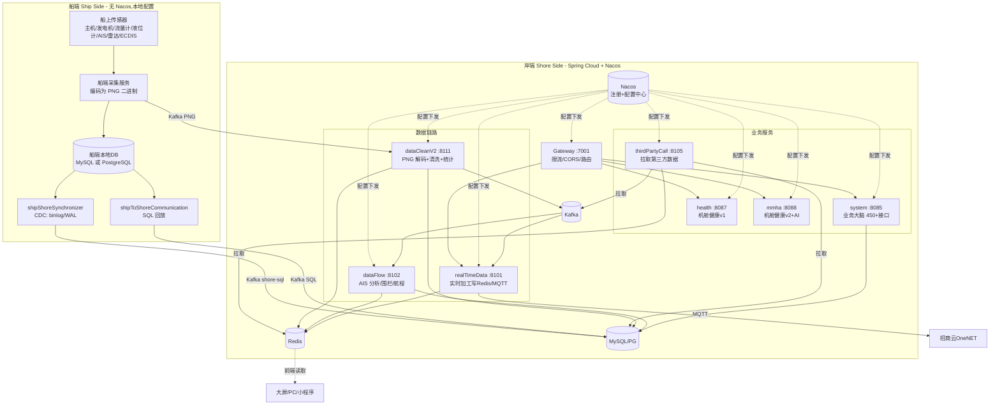
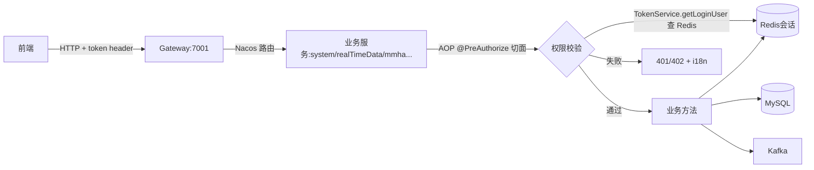
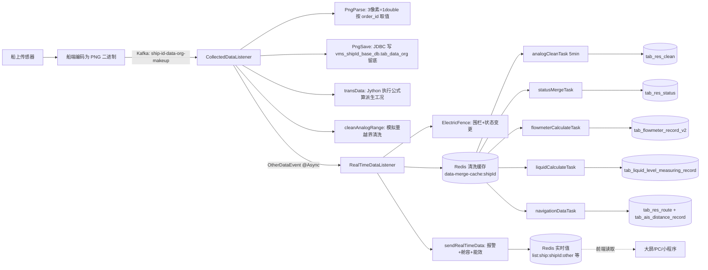
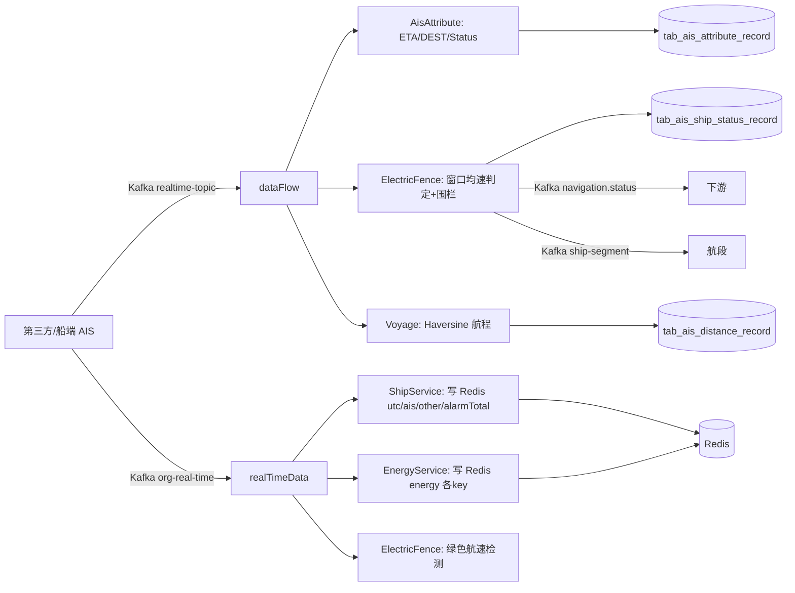
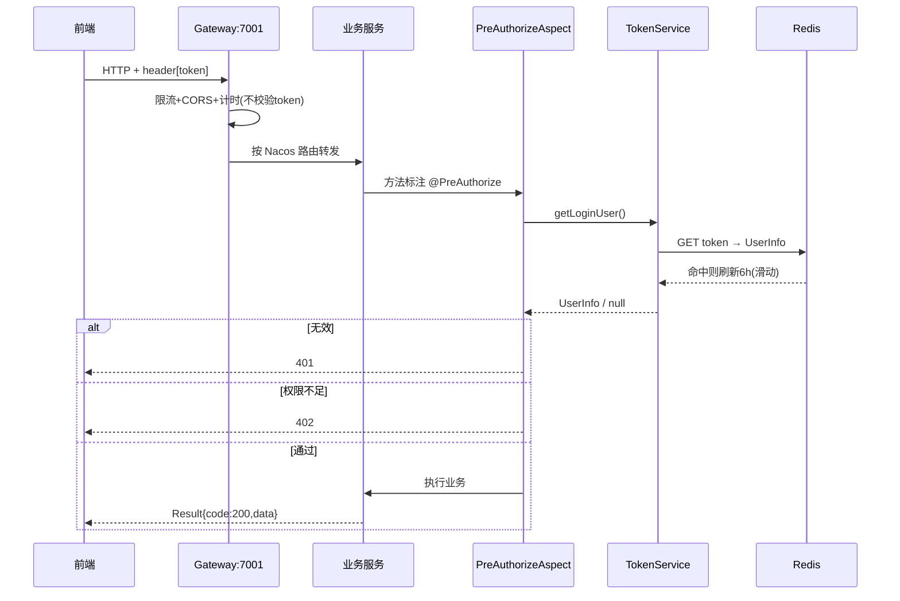
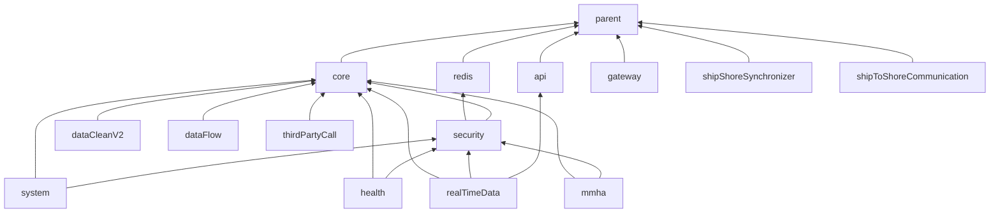

# BWT-VMS 内河船舶管理系统 · 架构知识库

> 更新日期:2026-09-04(修改本文档后请同步更新此日期,并到 Dify 知识库重新上传该文件)

> 本文档面向**新接手的开发者**——前任研发已离职且未留任何资料。目的:让你在 1 小时内建立对整个系统的全局认知,知道"是什么、怎么跑起来、数据怎么流、改东西去哪改"。
>
> 全部结论基于实际源码梳理,关键处附源文件路径作为证据锚点。
>
> **如何查看图**:本文含大量 Mermaid 流程图/架构图。GitLab/GitHub 网页、VS Code(装 Markdown Preview Mermaid Support 插件)、Typora 等均可直接渲染。

---

## 目录

1. [一分钟理解这个系统](#1-一分钟理解这个系统)
2. [技术栈总览](#2-技术栈总览)
3. [整体架构图](#3-整体架构图)
4. [模块全景与端口速查表](#4-模块全景与端口速查表)
5. [基础设施层详解](#5-基础设施层详解)
6. [数据处理核心链路详解](#6-数据处理核心链路详解)
7. [业务与船岸通信详解](#7-业务与船岸通信详解)
8. [核心业务数据流(端到端)](#8-核心业务数据流端到端)
9. [模块间依赖关系](#9-模块间依赖关系)
10. [中间件与外部依赖拓扑](#10-中间件与外部依赖拓扑)
11. [鉴权机制详解](#11-鉴权机制详解)
12. [数据库与表分布](#12-数据库与表分布)
13. [Kafka Topic 字典](#13-kafka-topic-字典)
14. [Redis Key 字典](#14-redis-key-字典)
15. [上手指南](#15-上手指南)
16. [已知风险与技术债](#16-已知风险与技术债)
17. [名词表](#17-名词表)

---

## 1. 一分钟理解这个系统

**这是什么**:一套部署在内河船舶(船端)+ 岸基数据中心(岸端)的**船舶机舱工况监测与能效管理平台**,公司为武汉蓝鲸科技(BWT)。它把船上各种传感器(主机、发电机、流量计、液位计、AIS 船位、雷达、电子海图)的数据实时采集上来,经过清洗、统计、分析后,在岸端大屏/PC/微信小程序上展示船舶位置、航行状态、油耗、能效、机舱健康度和告警。

**最独特的设计**:船端把**所有传感器数据编码进一张 PNG 图片**的二进制流发送(每 3 个像素 = 1 个 IEEE 754 双精度浮点数),岸端 `bwt-vms-dataCleanV2` 负责把图片"反编码"回工况数值。这是整个系统理解的钥匙。

**部署形态**:船端有一套本地服务 + 本地数据库(无 Nacos),通过两条同步链路(准实时 CDC / 分钟级 SQL 回放)把数据同步到岸端;岸端是一组 Spring Cloud 微服务,注册到 Nacos,通过 Kafka 传递实时消息、Redis 缓存实时值供前端读、MySQL/PG 落库历史数据。

**系统心智模型(3 条主线)**:
- **工况主线**:船端 PNG → dataCleanV2 解码 → 实时写 Redis + 离线统计落库 → realTimeData 加工 → 前端读 Redis 展示
- **AIS 主线**:第三方/船端 AIS → dataFlow 分析(航程/围栏/状态)→ 落库 + 推实时
- **船岸同步主线**:shipShoreSynchronizer(CDC,船→岸准实时)/ shipToShoreCommunication(SQL 回放,双向分钟级)

---

## 2. 技术栈总览

| 维度 | 选型 | 版本 |
|---|---|---|
| 语言 | Java | 1.8 |
| 基础框架 | Spring Boot | 2.1.3.RELEASE |
| 微服务 | Spring Cloud | Greenwich.RELEASE |
| 注册/配置中心 | **Nacos** | 2.1.3 |
| 服务间调用 | OpenFeign + Hystrix 熔断 | — |
| 网关 | Spring Cloud Gateway(响应式) | — |
| ORM | MyBatis / MyBatis-Plus | 2.0.0 / 3.3.2 |
| 连接池 | Druid | 1.1.23 |
| 消息中间件 | **Kafka**(手动提交 offset) | — |
| 缓存 | **Redis**(自定义 FastJson 序列化) | — |
| 数据库 | **MySQL** + **PostgreSQL**(双数据库,按模块/profile 选择) | — |
| 数据库迁移 | Flyway(system 模块) | — |
| 分布式任务调度 | **XXL-Job**(iCommander) | — |
| 实时推送通道 | **Netty**(`netty.hbluewhale.com:8300`) | — |
| 物联网对接 | **MQTT**(招商云 OneNET,`mqtt.iot.cmft.com`) | — |
| 鉴权 | 自研 JWT(jjwt 0.9.0 + java-jwt 3.7.0)+ Redis 会话 | — |
| 日志 | log4j2(替换默认 logback) | 2.20.0 |
| 序列化 | FastJSON(全栈统一) | 1.2.56 |
| 工具库 | Hutool / Guava / commons-lang3 | 4.1.19 / 20.0 / — |
| 脚本引擎 | **Jython**(Python 解释器,执行工况换算公式) | — |
| AI 能力 | **阿里通义千问**(dashscope,mmha 缺陷诊断) | — |
| CDC | 自研框架(shyiko mysql-binlog-connector / PG 逻辑复制) | — |
| 私服 | Nexus(`192.168.7.227:9081`) | — |
| 包前缀 | `com.bwt.vms`,groupId `com.bwt.vms`,version `1.0.0-SNAPSHOT` | — |

> 证据:`bwt-vms-parent/pom.xml`、各模块 `bootstrap.yml`。

---

## 3. 整体架构图

### 3.1 逻辑架构(分层)



### 3.2 请求调用链(前端 → 后端)



---

## 4. 模块全景与端口速查表

| 模块 | 应用名(spring.application.name) | 端口 | 是否接入Nacos | profile | 一句话职责 |
|---|---|---|---|---|---|
| bwt-vms-parent | —(pom) | — | — | — | 父工程,统一版本管理 |
| bwt-vms-core | —(starter 库) | — | — | — | 通用代码:统一返回/异常/i18n/工具/常量/共享PO |
| bwt-vms-redis | —(starter 库) | — | — | — | RedisTemplate 封装 + FastJson 序列化 |
| bwt-vms-api | —(starter 库) | — | — | — | Feign 接口声明 + 请求头透传拦截器 |
| bwt-vms-security | —(starter 库) | — | — | — | JWT+Redis 鉴权 + @PreAuthorize AOP |
| bwt-vms-gateway | bwt-vms-gateway | **7001** | ✅ | dev | API 网关:CORS/限流/路由 |
| bwt-vms-system | bwt-vms-system | **8085** | ✅ | dev | 业务大脑:450+ REST 接口 |
| bwt-vms-dataCleanV2 | bwt-vms-dataCleanV2 | **8111** | ✅ | dev | PNG 解码+实时清洗+5分钟统计 |
| bwt-vms-dataFlow | bwt-vms-dataFlow | **8102** | ✅ | loc | AIS 分析:围栏/航程/状态/油耗/液位 |
| bwt-vms-realTimeData | bwt-vms-realTimeData | **8101** | ✅ | prod | 实时数据加工写 Redis + 招商云 MQTT |
| bwt-vms-thirdPartyCall | bwt-vms-thirdPartyCall | **8105** | ✅ | test | 定时拉取第三方数据(航道/AIS/气象/水情/流量) |
| bwt-vms-health | bwt-vms-health | **8087** | ✅ | test | 机舱健康 v1:接收海大推送+报警监控 |
| bwt-vms-mmha | bwt-vms-mmha | **8088** | ✅ | prod | 机舱健康 v2:健康分计算+通义千问AI诊断 |
| bwt-vms-shipShoreSynchronizer | (无应用名,本地) | **18104** | ❌ | pg | 自研 CDC 框架,船→岸准实时同步 |
| bwt-vms-shipToShoreCommunication | bwt-vms-shipToShoreCommunication | **8104** | ❌ | mysql | 时间水位线 SQL 回放,船↔岸双向同步 |

> 5 个库模块(parent/core/redis/api/security)不可独立运行,作为 starter 被业务模块依赖后通过 `spring.factories` 自动装配。

---

## 5. 基础设施层详解

### 5.1 bwt-vms-parent(父工程)

**职责**:Maven 版本管理中心,自身 `<packaging>pom</packaging>` 不产代码。通过 `dependencyManagement` 导入 Spring Boot / Spring Cloud BOM 并锁定 jwt/hutool/druid/mybatis/pagehelper/fastjson/log4j2 版本;通过 `dependencies` 强制全栈用 log4j2(并排除其传递依赖再用统一版本回填)+ 全局 lombok。

**关键配置**(`bwt-vms-parent/pom.xml`):
- 私服:`distributionManagement` 指向 Nexus `http://192.168.7.227:9081/repository/{snapshots,releases}/`,id=`bwtvms`
- 编译插件:maven-compiler-plugin 3.5.1,source/target=1.8

**依赖关系**:所有 14 个业务/基础设施模块的 `<parent>`。

### 5.2 bwt-vms-core(通用代码)

**职责**:全公司内河项目的通用基础库,starter 风格自动装配。被几乎所有业务模块依赖。

**自动装配**(`resources/META-INF/spring.factories` 注册):`GlobalDefultExceptionHandler`、`I18NConfigurer`、`SwaggerConfig`。

**关键类**:

| 包 | 类 | 作用 |
|---|---|---|
| config | `GlobalDefultExceptionHandler` | `@ControllerAdvice` 全局异常。分流 ServiceException→500、参数类型错→502、缺参→503,统一用 ResultGenerator 包装 |
| config | `I18NConfigurer` | 注册 LocaleResolver,读请求头 `Accept-Language`(含"en"→英文,否则中文) |
| config | `SwaggerConfig` | `@EnableSwagger2`,UI 注入 `token`/`Accept-Language` header 参数;开关 `${swagger.enable:false}` |
| core.result | `Result<T>` | 统一响应体 `{code, message, data}`,setCode 自动按 Locale 查文案 |
| core.result | `ResultCode` | 错误码枚举:200/401/402/500/502/503/504 + 业务码(11xxx用户、12xxx校验、8083xxx航行、8085xxx船舶、8097xxx AIS 等) |
| core.result | `ResultGenerator` | 静态工厂:genSuccessResult/genResult/genResultFail 等 |
| core.service | `ServiceException` | 自定义业务异常,被全局处理器接住 |
| core.constant | `CommonConstant` | 请求头名、语言、过期时间、**权限级别**(0 spadmin/1 admin/2系统/3岸基/4船端)、油舱类型(淡水1/轻油2/重油3/滑油5)、流量计标志等 |
| core.constant | `RedisKeysConstant` | Redis key 前缀:`login_token_`、`login_count_`、`prompt:user:`、`report:standard:*`、`thirdpartycall:*` 等 |
| core.constant | `ShipParamModelConstant` | 船舶参数字段 ID 常量(1~202):BASE_INFO=1、主机ME=3、总长=16、IMO=30、电池容量=200 等 |
| en | `UnitEnum` | 质量/体积/长度单位枚举,带换算系数 |
| utils | `BigDecimalUtils` | 高精度运算(保留N位/四则/科学计数法/会计格式) |
| utils | `DateUtils` | 日期工具(~820 行),海量 FastDateFormat、时间戳↔字符串互转、加减、月首月末、区间计算 |
| utils | `LanguageUtil` | 取当前语言 |
| utils | `UnitConversionUtil` | 单位换算 v2(基于 UnitEnum,体积↔质量按密度) |
| entity.po.sys | `UserInfo` | **核心用户对象**(鉴权用):id/loginName/passwd/userName/privilegeLevel/shipIds/roleId/**permissions:Set**/**roles:Set**/isLogin 等 |
| entity.po.sys | `TabUserPermanentToken` | 用户永久 token |
| entity.po.sys | `ShipInfoParamDict` | 船舶参数字典 |
| entity.po.sys | `TabTankDevice` / `TabTankDeviceMenu` | 油水舱设备 / 油水舱分类 |
| entity.po.sys | `TabFlowMeterRecord` / `TabLiquidLevelRecord` | 流量计记录 / 液位记录 |
| entity.po.sys | `TabSpeedOilStatistics` | 航速油耗统计 |
| entity.po.sys | `ResClean` | 清洗结果(device_name/utc/max/min/avg/cnt) |

**资源**:`codeMessage_zh.properties` / `codeMessage_en.properties`(错误码→中英文文案)。

### 5.3 bwt-vms-redis(Redis 封装)

**职责**:RedisTemplate Bean 定义 + FastJson 序列化策略 + 工具型 RedisService(覆盖 String/Hash/Set/List 全类型 + pipeline)。无 yml,连接信息由调用方 bootstrap 引用 Nacos 共享配置 `reids.yml`。

**关键类**:

| 类 | 作用 |
|---|---|
| `redis/configure/RedisConfigure` | 定义 `RedisTemplate<String,Object>`:key 用 StringRedisSerializer,value 用自定义 FastJson2JsonRedisSerializer |
| `redis/configure/FastJson2JsonRedisSerializer` | serialize 用 `JSON.toJSONString(t, PrettyFormat)`;deserialize 用 `JSON.parseObject(str, clazz)` |
| `redis/service/RedisService` | 工具类(~730 行):expire/get/set/incr、Hash 全套、Set 全套、List 全套、pipeline。注意:所有方法 try-catch 吞异常返回 false/空(排障时易静默失败) |

### 5.4 bwt-vms-api(Feign 远程调用)

**职责**:集中声明跨服务 Feign 接口 + 请求头透传拦截器。

| 类 | 作用 |
|---|---|
| `api/service/RealTimeDataFeignService` | `@FeignClient(name="bwt-vms-realTimeData")`,方法 `GET /electricFence/reload` |
| `api/Hysitrix/RealTimeDataFeignServiceHysitrixFallbackImpl` | 熔断降级(空实现,静默吞) |
| `api/configure/FeignConfiguration` | `RequestInterceptor`,把当前请求所有 header + `lang` 参数透传到下游( token/Accept-Language 跨服务传递的关键) |

> 注:其他 Feign 客户端(system 内的 MmhaClient/DataFlowClient、health/mmha 内的 SystemClient)定义在各自业务模块里,不在本公共模块。

### 5.5 bwt-vms-gateway(微服务网关)

**职责**:Spring Cloud Gateway 响应式 API 网关,负责 CORS、限流(令牌桶+Redis)、请求计时日志,按 Nacos 配置的路由转发。

**关键类**:

| 类 | 作用 |
|---|---|
| `gateway/GatewayApplication` | 启动类 `@EnableDiscoveryClient`;声明 `ipKeyResolver` KeyResolver **按请求 URI 路径限流** |
| `gateway/configure/CorsConfig` | `CorsWebFilter`:允许所有 Method/Origin/Header,匹配 `/**` |
| `gateway/configure/CustomRequestRateLimiter` | 自定义限流过滤器,被限流返回 `{code:429, message:"访问已限流..."}` |
| `gateway/filter/TokenFilter` | `GlobalFilter(order=0)`,**当前只做请求计时日志**;token 校验逻辑被注释(鉴权下沉到业务服务) |

**⚠️ 重要**:仓库内**没有** RouteLocator Bean,也没有 `application.yml` 里的 `spring.cloud.gateway.routes`。**所有 path → serviceId 路由表存在 Nacos 配置中心**(namespace `bcb3b25a-82a9-455e-b6d8-2187aa113afe`,data-id 推测为 `bwt-vms-gateway.yml` 或 `bwt-vms-gateway-dev.yml`)。要看完整路由需登录 Nacos 控制台。

**bootstrap.yml**:`server.port=7001`,应用名 `bwt-vms-gateway`,共享配置 `reids.yml`。

### 5.6 bwt-vms-security(鉴权)

**职责**:JWT+Redis 会话管理 + 基于 AOP 注解的方法级权限校验,作为 starter 被业务服务依赖后自动装配。**本项目未用 Spring Security 的 FilterChain**,是一套自实现的"JWT 当票据 + Redis 当会话 + AOP 注解鉴权"轻量方案。

**关键类**:

| 类 | 作用 |
|---|---|
| `security/service/TokenService` | 核心:`createToken(UserInfo)` 生成 HS256 JWT(claims 含 id/username/password),Redis 写两条记录(`login_token_{loginName}→jwt` 和 `jwt→UserInfo`),过期 **6 小时**;`getLoginUser()` 命中则**刷新有效期(滑动过期)** |
| `security/annotation/PreAuthorize` | **自定义注解**(非 Spring Security 同名注解),属性 hasPermi/hasAnyPermi/hasRole/hasAnyRoles |
| `security/aspect/PreAuthorizeAspect` | `@Around` 环绕切面:取 loginUser→校验权限/角色,不通过抛 ServiceException(402)。`*:*:*` 通配,admin/spadmin 直通 |

> 完整鉴权链路见 [第 11 节](#11-鉴权机制详解)。

**安全要点**:`SIGNKEY` 硬编码在源码;JWT claims 里含 password(即便 base64 可逆);过期管理交给 Redis 而非 JWT 本身。

---

## 6. 数据处理核心链路详解

> 这是整个项目的业务核心。三个模块构成"采集 → 清洗 → 实时加工"的主链路。

### 6.1 bwt-vms-dataCleanV2(数据清洗服务 V2)— 最核心

**职责**:消费船端 PNG 二进制工况图,解码为工况数值,做实时清洗 + 5 分钟离线统计,产出清洗结果表。是整个系统所有工况数据的**唯一入口**。

**启动类**:`bwt-vms-dataCleanV2/src/main/java/com/bwt/vms/dataClean/DataCleanApplication.java`
`@SpringBootApplication(exclude=DataSourceAutoConfiguration) + @EnableDiscoveryClient + @EnableScheduling`(作者 LuoMingrui 2024-01-03,排除自动数据源改用自研多数据源)

**bootstrap.yml**:端口 8111,Nacos ns `bcb3b25a-...`,共享 `reids.yml`/`dataselist.yml`;Kafka `kafka.hbluewhale.com:9092`(手动提交,concurrency=1,max-poll.records=5)。

#### 6.1.1 数据入口(MQ 监听器)

| 监听器 | topic | 数据类型 | 下游 |
|---|---|---|---|
| `mq/CollectedDataListener` | `ship-[0-9]+-data-org-makeup` | **PNG 二进制工况图(Hex)** | PngParse→PngSave→transData→cleanAnalogRange→发 OtherDataEvent |
| `mq/EcdisListener` | `ship-[0-9]+-data-ecdis` | ECDIS 海图截图(Base64) | Redis `list:ship:{shipId}:ecdis` |
| `mq/RadarListener` | `ship-[0-9]+-data-radar` | 雷达截图(Base64) | Redis `list:ship:{shipId}:radar` |

**⚠️ `CollectedDataListener` 是系统所有工况数据的入口**。topic 按船分主题 `ship-{shipId}-data-org-makeup`。
**风险点**:`acknowledge()` 在方法第一行就调用(先提交 offset 再处理),"至多一次"语义,处理异常会丢数据。

#### 6.1.2 PNG 解码原理(系统最独特之处)

`service/impl/PngParseServiceImpl`:
- 每 **3 个像素(9 字节 RGB)= 1 个 IEEE 754 double**
- 按 `tab_engine_param.order_id` 从图片对应像素位置提取每个工况值
- orderId<0 = 字符串(底部 ASCII);=0 = UTC long;>0 = double
- `parseBytes2Image`、`parseUtcFromPng`、`parsePng`

#### 6.1.3 事件机制

| 事件 | 发布者 | 监听者 | 状态 |
|---|---|---|---|
| `OtherDataEvent`(shipId/utc/data Map) | CollectedDataListener | `event/listener/RealTimeDataListener`(`@Async`) | ✅ 生效 |
| `CollectedDataReceivedEvent` | 无人 | — | 遗留 |
| `NavigationDataEvent` | 无人 | — | 预留 |
| — | — | `event/listener/CleanDataListener` | ❌ 整类被注释,功能并入 RealTimeDataListener |

**RealTimeDataListener**(唯一生效):parseNavigation → ElectricFenceService.process → 写 Redis 清洗缓存 → sendRealTimeData。

#### 6.1.4 核心 Service(按业务线)

| 业务线 | Service | 文件 | 核心算法 |
|---|---|---|---|
| **PNG 解析** | `PngParseServiceImpl` | service/impl/ | 3 像素=1 double,按 order_id 取值 |
| **原始留底** | `PngSaveServiceImpl` | service/impl/ | JDBC 直写**按船分库** `vms_{shipId}_base_db.tab_data_org(utc_time, bin_value)` |
| **实时数据中枢** | `RealTimeDataServiceImpl` | service/impl/ | transData 用 **Jython(PythonInterpreter)** 执行 `tab_engine_param.trans_data` 公式算派生工况;sendRealTimeData 做报警映射+舱容+能效后写 Redis |
| **模拟量清洗(5min)** | `AnalogProcessServiceImpl` | service/impl/ | 实时 cleanAnalogRange 越界清洗;定时 `cron 0 1/3` 统计 min/max/avg/分位数 → `tab_res_clean` |
| **状态量** | `StatusProcessServiceImpl` | service/impl/ | 定时 `cron 0 2/3` 状态变化检测 → `tab_res_status` |
| **流量计统计(油耗)** | `FlowmeterRecordStatisticsServiceImpl` | service/impl/ | 配置 `tab_statistics_param`;累计型 consume=max-min,瞬时型 consume=avg×秒数;体积↔质量按密度(默认 0.852 T/m³,≥0.95 判重油);落库 `tab_flowmeter_record_v2` + Redis `energy:{shipId}:device_consume` |
| **液位遥测(舱容)** | `LiquidRecordStatisticsServiceImpl` | service/impl/ | 配置 `tab_tank_device`+`tab_height_cabin`;高度型用 **线性插值查表** heightConvertCubic → 体积;落库 `tab_liquid_level_measuring_record` |
| **导航/航迹** | `NavigationDataServiceImpl` | service/impl/ | 定时 `cron 0 1/3`;5 步清洗:过滤无经纬度→thresholdCheck→**DBSCAN 密度聚类(自适应 epsilon)**→multiplePointsSogCheck(航速打分,样本 100)→**Douglas-Peucker 抽稀**;落库 `tab_res_route`+`tab_ais_distance_record` |
| **电子围栏** | `ElectricFenceServiceImpl` | service/impl/ | 实时匹配(圆形/多边形,取 grade 最高);状态变更发 Kafka `ship-{id}-data-ais-segment` |
| **工况点配置缓存** | `EngineParamServiceImpl` | service/impl/ | @PostConstruct 按 shipId 分组加载 `tab_engine_param` |

#### 6.1.5 Controller

`controller/CalCabinByLiquidLevelController`:`GET /calCabin/byLiquidLevel?shipId=&deviceId=&high=` 根据液位高度查表插值返回舱容体积(m³)。**全模块唯一 REST 接口**。

#### 6.1.6 多数据源(自研,AOP+ThreadLocal+AbstractRoutingDataSource)

| 组件 | 作用 |
|---|---|
| `dynamicdb/multiple/MultipleDataSource` | 继承 AbstractRoutingDataSource |
| `dynamicdb/multiple/DataSourceContextHolder` | InheritableThreadLocal 持有数据源 key |
| `dynamicdb/aop/DataSourceAspect`(@Order(-1)) | **按 Mapper 包路径切换**:mapper.db1.*→db1,mapper.db2.*→db2 |
| `dynamicdb/config/MyBatiesPlusConfiguration` | 两个 Druid DataSource(db1 默认 / db2 预留) |
| `config/JdbcDataSourceManager` | 动态分库:按船创建连接池,库名 `vms_{shipId}_base_db` |

> 现状:所有 Mapper 都在 db1 包下,db2 全预留未用。

#### 6.1.7 数据表清单

| PO 类 | 表名 | 用途 |
|---|---|---|
| TabResClean | `tab_res_clean` | 模拟量清洗结果(min/max/avg/分位数/cnt/quality) |
| TabResStatus | `tab_res_status` | 状态量变化记录 |
| TabFlowmeterRecordV2 | `tab_flowmeter_record_v2` | 流量计消耗统计 |
| TabLiquidLevelMeasuringRecord | `tab_liquid_level_measuring_record` | 液位遥测 |
| TabTankDevice | `tab_tank_device` | 液位设备配置 |
| TabHeightCabin | `tab_height_cabin` | 液位高度↔舱容体积对照表 |
| TabAisElectricFence(+Info/Extend) | `tab_ais_electric_fence` 等 | 电子围栏 |
| TabAisDistanceRecord | `tab_ais_distance_record` | AIS 航程记录 |
| TabAisShipStatusRecord | `tab_ais_ship_status_record` | 航行状态变更 |
| (JDBC 直写) | `tab_data_org` | PNG 原始二进制(按船分库) |
| TabEngineParam | `tab_engine_param` | 工况点配置(device_key/type/min/max/unit/order_id/trans_data) |
| TabStatisticsParam | `tab_statistics_param` | 统计参数配置 |
| TabShipInfo / TabShipInfoExtend | `tab_ship_info` / `tab_ship_info_extend` | 船舶基础/扩展信息 |
| TabResRoute | `tab_res_route` | 轨迹压缩结果 |
| TabSysDict | `tab_sys_dict` | 字典表 |
| TabAlarmMapping | `tab_alarm_mapping` | 报警量值映射 |

#### 6.1.8 关键常量

`constant/CommonConstant.java`:`MERGE_TIME_RANGE=300`(5分钟窗口)、`SHIP_OFFLINE_INTERVAL=600`(10分钟判离线)、`KNOT_FACTOR=1.852`(km/h↔节)、`SEGMENT_TOPIC_NAME_TEMPLATE="ship-{id}-data-ais-segment"`、`DEFAULT_PNG_DB_NAME_PATTERN="vms_%s_base_db"`。
`constant/SystemConstant.java`:油舱类型 1=淡水/2=轻油/3=重油/4=压载水/5=滑油/9=LNG。

### 6.2 bwt-vms-dataFlow(数据流处理服务)

**职责**:消费 AIS 实时/5 分钟清洗数据,做电子围栏匹配、航程累加、船舶状态判定、油耗/液位计算。

**启动类**:`bwt-vms-dataFlow/src/main/java/com/bwt/vms/DataFlowApplication.java`(包名 `com.bwt.vms`,无 dataClean)。`@SpringBootApplication + @EnableDiscoveryClient + @EnableScheduling`。
**bootstrap.yml**:端口 8102,**profile=loc(本地!)**,共享 `kafka.yml`,ns `25351428-...`(与另两模块不同)。

#### 6.2.1 MQ 监听器(三路并行消费同一 AIS topic)

| 监听器 | topic | 下游 |
|---|---|---|
| `AisAttributeListener` | `${vms.ais-analysis.topic.realtime-topic-pattern}` | ETA/DEST/Status 变化 → `tab_ais_attribute_record` |
| `ElectricFenceListener` | 同上 | 围栏匹配+状态判定 → `tab_ais_ship_status_record` + Kafka navigation.status |
| `VoyageListener` | 同上 | Haversine 航程累加 → `tab_ais_distance_record` |
| `FuelFiveMinutersCleanListener` | `${mq.topic.five-minutes-topic-pattern}` | `List<ResClean>` → FuelFactory → `tab_speed_oil_statistics` |
| `LiquidFiveMinutersCleanDataListener` | 同上 | `List<ResClean>` → ILiquidLevelConverter → `tab_liquid_level_record` |
| `BehaviorRecognitionListener` | 硬编码 `behavior_detection` | batchInsert `tab_behavior_recognition` + Redis 报警(+WebSocket,**当前未接通**) |

**关键设计**(`mq/ais/BaseListener.java`):实现 `ConsumerSeekAware`,分区分配时 **seekToEnd(只消费最新)**;每船维护内存 `ConcurrentHashMap<Integer,Pos>`,首次从 `tab_ais_record` 恢复;补齐链路(makeupMessageListener)**全部被注释**。

#### 6.2.2 AIS 业务线 Service

| Service | 算法 |
|---|---|
| `AlgorithmServiceImpl` | Haversine 球面距离、射线法点在多边形内 |
| `ElectricFenceServiceImpl` | sog 阈值判定启航/靠锚泊(sailingSogThreshold) |
| `ShipStatusServiceImpl` | 状态变更入库 + 发 Kafka + 补齐修正 |
| `AisAttributeServiceImpl` | AIS 属性变化记录 CRUD |

#### 6.2.3 燃油业务线(工厂模式)

`FuelConsumeServiceImpl` → `FuelFactory.calFuelConsume` → Redis 字典查 `flowmeter_type` → `InOutFlowMeter`(@Component("flow_type_1"),唯一实现):**进口差 - 出口差 = 净油耗**(diff<0 或 >500 视异常)。落库 `tab_speed_oil_statistics`。

#### 6.2.4 液位业务线(策略模式)

| 转换器 | Bean 名 | 算法 |
|---|---|---|
| `LiquidLevelConverterType1` | `liquid_level_type_1` | 基线船:液位高度原样返回 |
| `LiquidLevelConverterType2` | `liquid_level_type_2` | 招商大湾区:**分段线性插值**(Redis 取 HeightCabin 对照表) |

选择:Redis 字典查 `liquid_level_type` → 转换器 → `cube*1000=liquidLevelLiter` → `tab_liquid_level_record`。

#### 6.2.5 Controller(内部业务编排器,非 HTTP)

`BaseAisMsgController`(抽象模板方法)、`ElectricFenceController`(核心:窗口平均航速判定+围栏+发 Kafka ship-segment)、`AisAttributeController`、`VoyageController`。这些是被 BaseListener 调用的业务编排器。

#### 6.2.6 WebSocket

`config/WebSocketConfig`:`@EnableWebSocket`,路径 `/websocket/behaviorRecognition/{mmsi}`,Handler `BehaviorRecognitionWebSocketHandler`,按 mmsi 维护 session。**实际状态**:`webSocketSend` 方法无调用点(被注释/重构中),推送功能当前未接通。

#### 6.2.7 数据表

`tab_ais_record`(断点恢复)、`tab_record_ais_persist`、`tab_ais_distance_record`、`tab_ais_electric_fence*`、`tab_ais_ship_status_record`、`tab_ais_attribute_record`、`tab_behavior_recognition`、`tab_speed_oil_statistics`、`tab_liquid_level_record`、`tab_device`。

### 6.3 bwt-vms-realTimeData(实时数据推送服务)

**职责**:消费实时 AIS+工况点,加工后**写 Redis 供前端读取**,并通过 MQTT 推招商云 OneNET。

**启动类**:`RealTimeDataApplication.java`(**最老的模块**,作者 zhoujunli 2021/3/4)。`@EnableFeignClients`(唯一开启 Feign 的模块,调 BWT-VMS-OILWATER)+ `@EnableDiscoveryClient` + `@EnableScheduling`。
**bootstrap.yml**:端口 8101,**profile=prod(生产主线)**,共享 `kafka.yml`。

#### 6.3.1 ⚠️ 关键澄清:本模块不直接推前端

Grep 搜索 `@ServerEndpoint`/`SseEmitter`/`WebSocket`/`Netty` 均**无匹配**。真实架构:
```
dataFlow → Kafka → realTimeData → 写 Redis → 其他服务(system/api)读 Redis → HTTP/WebSocket 推前端
```
本模块是**数据加工中枢**,所有实时值写 Redis,前端由其他模块读取展示。

#### 6.3.2 MQ 监听器

| 监听器 | topic | 下游 |
|---|---|---|
| `ShipListener` | `${vms.electric-fence.input.org-real-time.topic-pattern}` | AisMessage(AIS+工况点) → ShipInfoController |
| `AroundListener` | `${...around.topic-pattern}` | 周边船舶 List<AisAround> → Redis `vms.ship.key-around`(Hash,5min过期) |
| `EcdisListener`/`RadarListener` | `ship-[0-9]+-data-ecdis/-radar` | Base64 图 → Redis |
| `EngineAlarmListener` | `${vms.alarm.mq.input.engine-alarm-topicPattern}` | 工况报警检测 + 发 Kafka `engineImportantAlarm` |

#### 6.3.3 MQTT 推招商云

`MqttReportService`(@ConditionalOnProperty `cmc.job.report-cron`):
- Broker `tcp://mqtt.iot.cmft.com:30001`(招商云 OneNET)
- 定时 `syncToCmc`:加载 `cmc_device` 映射 → 建子设备拓扑 → **从 Redis 读 `list:ship:{shipId}:other`** → 按物模型字段发布到 `$sys/{gpid}/{gdid}/{pid}/{did}/thing/sub/property/post`
- 注:MQTT 只用于招商云对接,**不是船岸通信**

#### 6.3.4 核心 Service

| Service | 核心逻辑 |
|---|---|
| `ShipServiceImpl`(~1041 行) | `updateShipInfoV2`:updateTimestamp→补齐未采集工况为 null→吃水计算→**瞬时油耗=进口流量计-出口流量计**→报警映射→**handleCabin 液位→体积→质量线性插值**→写 Redis `list:ship:{shipId}:other`+`:alarmTotal` |
| `EnergyServiceImpl`(~533 行) | updateExhaustGasTempareture(气缸排烟温度均值标记)→updateDevicePower(主机/发电机功率与负荷率,**无功率时用转速³比例估算**)→updateDeviceConsume(油耗占比)→写 Redis `energy:*` |
| `ElectricFenceController` | 围栏匹配+**绿色航速检测**(围栏内 sog≥greenSpeedConfig 设报警)→发 Kafka electric-fence.output |

#### 6.3.5 定时任务

| 方法 | cron | 作用 |
|---|---|---|
| `ShipServiceImpl.job` | `${...off-line-detector-corn}` | **离线检测**(扫 Redis 时间戳超阈值设 online=0) |
| reloadShipInfoExtends / reloadEngineParamList | `0 0/5` / `0 1/5` | 重载船舶扩展参数/工况点 |
| `MqttReportService.syncToCmc` | `${cmc.job.report-cron}` | 推招商云 |

### 6.4 三模块横向对比

| 业务线 | dataCleanV2 | dataFlow | realTimeData |
|---|---|---|---|
| PNG 解码 | ✅(唯一入口) | ❌ | ❌ |
| AIS 分析 | 围栏+状态 | 围栏+航程+状态+属性 | 围栏+绿色航速 |
| 油耗 | 流量计统计(5min) | FuelFactory(进出口差) | 瞬时油耗 |
| 液位/舱容 | 液位统计+插值 | LiquidLevelConverter | handleCabin |
| 导航/航迹 | DBSCAN+Douglas-Peucker | 航程累加 | — |
| 能效 | 实时DataService | — | EnergyService |
| 定位 | 清洗+统计落库 | AIS 实时分析 | 实时加工写 Redis |

**⚠️ 重要发现**:dataFlow 与 realTimeData **存在大量功能重叠**(都有电子围栏、舱容、能效、Haversine)。可能原因:realTimeData(2021,zhoujunli)是老模块,dataFlow 是后来拆分的 AIS 专用模块,但部分逻辑未完全迁移。接手时要注意辨别主链路:realTimeData profile=prod 是生产主线,dataFlow profile=loc 可能仅本地。

---

## 7. 业务与船岸通信详解

### 7.1 bwt-vms-system(业务大脑)

**职责**:承接前端所有业务操作,管理船舶全生命周期。450+ REST 接口、97 个 Controller 文件、约 1179 个 Java 文件。是体量最大的模块。

**启动类**:`SystemApplication.java`(作者 guozaisheng@2020-12-03)。`@SpringBootApplication(exclude=DataSourceAutoConfiguration) + @EnableFeignClients + @EnableDiscoveryClient + @EnableScheduling`。
**bootstrap.yml**:端口 8085,active=dev,ns `bcb3b25a-...`;Flyway 开启;上传限制 200MB;Netty `netty.hbluewhale.com:8300`;XXL-Job admin `http://icommander.hbluewhale.com:8096/iCommander-job-admin`,executor appname=`oil-water-consume-job` 端口 8899。

#### 7.1.1 REST 接口(按业务域,代表性路径)

| 业务域 | 代表 Controller / 路径 | 说明 |
|---|---|---|
| **船舶航行/航次** | `/flight/*`、`/analysis/*`、`/index/*`、`/route/*`、`/segment/*`、`/ais/around`、`/daily/*` | 航次 CRUD、历史分析、航段、周边 AIS、日报 |
| **油水管理/过闸** | `/oil/water/*`、`/oil/*`、`/consume/*`、`/exception`、`/file/*`、`/gate/*` | 油水填报、综合查询、油耗统计、过闸公告/申请 |
| **设备/机舱配置** | `/config/visual/engine/*`(20接口)、`/config/visual/ship/*`、`/config/visual/energyefficiency/*`、`/config/visual/oilCabin/*`、`/config/visual/flowmeter/*`、`/config/visual/navigation/*`、`/mimic/file/*` | 机舱图配置、船舶 CRUD、能效/油舱/流量计/通导配置、mimic 模板 |
| **能效分析** | `/energy/*` | SFOC、能耗分布、排放报告、航速油耗、辅机分析 |
| **报表统计** | `/screen/*`、`/newscreen/*`、`/integrated/query/*`、`/export/*`(**~42 导出接口**)、`/alarm/statistics`、`/accident/alarm/*`、`/electricFence/*`、`/behaviorRecognition/*`、`/informationDelivery/*`、`/meteorologicalPortWaterRegime/*` | 大屏、综合查询、报表导出、报警统计、电子围栏、行为识别、气象水情 |
| **五张动态报** | NoonReport/SailLog/EngineLog/FuelConsumption Controller | 午报/航志/轮机日志/油耗 |
| **巡检** | `/patrol/*` | 巡视点位/流程/日志/告警 |
| **碳强度** | `/carbon/*` | 碳强度计划/实施表/修改历史(对应 IMO 法规) |
| **微信小程序** | `/app*` | 微信推送/订阅/工况点映射 |
| **船队/单船基线** | `/shipFleet/*`、`/singleShip/*` | 船队 CRUD/BDI/满载率、单船报警/油耗/里程 |
| **船舶/公司/工况点** | `/ship/*`、`/company/*`、`/engine/param/*`、`/engineCustomGrouping/*` | 船舶/公司/工况点/自定义分组 |
| **用户/角色/权限/船员** | `/vms/*`(登录)、`/user/*`(17接口)、`/role/*`、`/action/resource/*`、`/sailor/*`(14接口) | 登录/验证码/菜单、用户、角色、权限、船员 |
| **其他** | `/changhang/*`(长航 AIS)、`/hiki/*`(海康摄像头)、`/feign/*`(内部 Feign) | 长航实时、海康视频、内部接口 |

#### 7.1.2 Feign 对外契约(供其他微服务调用)

- `POST /engine/shipInfo`、`/engine/shipInfoByMmsi`(health 调用,MMSI/shipId→船舶信息)
- `POST /config/visual/engine/menu/health/update`(mmha 调用,同步部件结构树一级菜单)
- `POST /feign/oilWater/consume/add`(realTimeData 等调用)

### 7.2 bwt-vms-thirdPartyCall(第三方集成)

**职责**:纯后台 Job,定时拉取外部第三方数据并入库/缓存。无 Controller。作者 luopiao@2021-05-12。部署标记 `deployment.env: shoreSide`(仅岸端)。

**调用的外部系统**:

| # | 外部系统 | 协议 | 入口 Job | 存储表 | 频率 |
|---|---|---|---|---|---|
| 1 | 长航公共服务平台(电子航道图) | HTTP POST form | `ChangHangFairwayBuoyJob` | tab_channel_notice/maintenance_scale/navigation_information/navigation_legend/water_level_information_release | Nacos cron |
| 2 | **长航 AIS OpenAPI**(当前主用) | HTTPS POST JSON | `ChangHangServiceJob.shipPositionInterface/shipAisStatusInfoInterface` | tab_res_route、tab_ais_ship_status_record + Redis + Kafka | 1min / 30min |
| 2b | 水科院 Boloomo AIS(已弃用) | HTTP GET Base64 | `singleShipMethon/multiShipMethon` | — | — |
| 2c | SOAP WebService(已废弃) | SOAP/JAX-WS | `org/tempuri/WebService.java`(整类注释) | — | — |
| 3 | 气象预报 | HTTP GET 分页 | `MeteorologicalWaterLevelJob.meteorologicalCache` | tab_weather_forecast + Redis | 3h |
| 4 | 港口水情 | HTTP GET 分页 | `MeteorologicalWaterLevelJob.portWaterRegimeCache` | tab_port_water_regime + Redis | 3h |
| 5 | 交通流量 | HTTP POST JSON | `TrafficFlowServiceJob.trafficFlowJob` | tab_traffic_flow + Redis | 30min |

**关键发现**:AIS 接入经历 SOAP → Boloomo → 长航 OpenAPI 三次迁移,**三套代码并存**,当前生产链路是长航 OpenAPI。

**下游数据流向**:写 MySQL(11 表)+ Redis(最新一条)+ Kafka(`ship-{id}-data-org-realtime` 实时船位、`ship-dynamics-event-maritime-notice` 航道通告)。

**⚠️ 风险**:大量第三方地址/token/账号密码**硬编码在 Java 中**(长航 PLAT_KEY、水科院 Key、遗留 SOAP 账号),不走配置中心。

### 7.3 bwt-vms-shipShoreSynchronizer(船岸 CDC 同步)

**职责**:**自研 CDC(变更数据捕获)框架** + 船→岸准实时单向同步。船端监听本地数据库日志(MySQL binlog / PG WAL),捕获行变更,经船端 Kafka 转发到岸端 Kafka,岸端拼接 SQL 回放进岸端库。同一份代码通过 `deployment.env = shipSide|shoreSide` 切换角色。

**启动类**:`ShipShoreSynchronizerApplication.java`。`@SpringBootApplication(exclude=DataSourceAutoConfiguration) + @EnableScheduling + @EnableRetry(proxyTargetClass=true)`。
**配置**:端口 18104,active=**pg**,无 Nacos/无 bootstrap,完全本地化(部署在船端)。
- `application-pg.yaml`:`jdbc:postgresql://db.hbluewhale.com:12921/`,user dbudev
- `application-mysql.yaml`:`jdbc:mysql://db.hbluewhale.com:13306/`,user root
- 船端 Kafka `kafka.hbluewhale.com:9092`、岸端 `shore.hbluewhale.com:9092`(均手动提交)

**数据流向**:
```
船端业务库(PG WAL / MySQL binlog)
  → MysqlExtractor/PostgreSQLExtractor(实时监听位点)
  → MySQLLogListener/PostgreSQLLogListener(组装 RowChangedEvent)
  → 船端 Kafka topic "ship-sql"
  → ShipService 消费 + Ship2ShoreService 转发(@Retryable 无限重试,at-least-once)
  → 岸端 Kafka topic "shore-sql"
  → ShoreService 消费 → 拼 SQL(主键加 ss___ 前缀 + 补 ship_id) → jdbcTemplate.execute()
  → 岸端业务库
```
**控制流(岸→船,仅同步配置)**:`SyncTableInfo2KafkaTask` 每 15min 把 `tab_sync_table_info` 广播到 topic `shore-sync-table-infos`,船端消费后增删本地同步表配置。

**CDC 框架**(`database/` 包,~130 文件,署名 AE86,版权 2019-2024):
- Connector 层:`ConnectorFactory` + Mysql/PostgreSQL/Kafka Connector
- Extractor 层:`MysqlExtractor`(shyiko mysql-binlog-connector 0.21.0)、`PostgreSQLExtractor`(PG pgoutput 逻辑复制,WAL/LSN 位点)
- **PG WAL 过期自愈**:捕获 "requested WAL segment has already been removed" → drop slot → 自动重新全量(`DbFullExtrator.fullSyncByDbName`)

### 7.4 bwt-vms-shipToShoreCommunication(船岸双向 SQL 同步)

**职责**:**基于 Kafka + SQL 语句回放的双向增量同步引擎**。不传业务 DTO,而是传**拼好的 insert/update SQL 文本**,对端 `jdbcTemplate.execute()` 回放——本质"数据库级日志回放"。同一份代码船/岸各自部署,`deployment.env` 切角色,`spring.profiles.active` 切数据库方言。

**启动类**:`ShipToShoreCommunicationApplication.java`(启动语"船岸传输系统")。端口 8104,active=mysql,**无 Nacos**。

**通信协议(双向对称,纯 Kafka 驱动,0 个 @RestController)**:
```
@Scheduled(cron="0 0/1 * * * ?") 每分钟
  → 读 tab_sync_table_info(同步清单) + tab_ship_info(活跃船)
  → KafkaTemplate.send("ship-{id}-send-data", infoType=1 请求)

@KafkaListener(topicPattern="ship-[0-9]+-accept-data")
  infoType=1(请求) → 查本地增量行 → 拼 insert/update SQL → 分包(65536字节) → send(infoType=2)
  infoType=2(数据) → 过滤防重 → jdbcTemplate.execute(sql) → 更新 tab_sync_table_info 水位线
```
Topic 命名:`ship-{id}-send-data`(下行)、`ship-{id}-accept-data`(上行),命名以船视角。

**mysql/pg 双方言(已确认,与角色正交)**:代码层最小化适配(`utc_time` 字段 mysql 加反引号、pg 不加)。数据源用 `DriverManagerDataSource`(**无连接池**),按 dbName 动态建连缓存进 ConcurrentHashMap。

**两套船岸同步对比**:

| | shipShoreSynchronizer | shipToShoreCommunication |
|---|---|---|
| 机制 | 日志级 CDC(binlog/WAL) | 时间水位线轮询(每分钟 SELECT 增量) |
| 实时性 | 准实时(秒级) | 分钟级 |
| 方向 | 船→岸单向(配置控制流岸→船) | 双向对称 |
| 复杂度 | 高(自研 CDC 框架 130 文件) | 低(~20 文件) |
| 数据载体 | RowChangedEvent(结构化) | SqlExecuteInfo(完整 SQL 文本) |

### 7.5 bwt-vms-health(机舱健康 v1)

**职责**:接收第三方(海大/算法方)推送的机舱健康值,做报警监控+落库+推下游。2019-2020 初代实现,与 mmha(v2)新旧并存。

**启动类**:`HealthApplication.java`。端口 8087,active=test,ns `b9c23ecd-...`。`@SpringBootApplication(exclude=DruidDataSourceAutoConfigure) + @EnableDiscoveryClient + @EnableFeignClients`。

**核心接口(3 Controller 5 接口)**:

| Controller | 路径 | 用途 |
|---|---|---|
| HealthController | `POST /feedback` | 告警反馈提交 |
| HealthQueryController | `GET /integrated/query/engine/health` | 查机舱健康 24h(Redis 优先) |
| ShipController | `POST /ship/inHealthAnalysis` | **核心**:海大推送健康值(mmsi+engineId+healthValue+faultLists)→ 发 MQ+更新 Redis+入库 |
| ShipController | `POST /ship/deviceAbnormal/list` | 按 uuid 查缺陷知识库(db2 遗留库) |

**inHealthAnalysis 三路并行**:sendMq(发 Kafka topicNameTemplate)、update2redis(写 Redis hash + 统计报警总数,value<60 计报警)、writeLog(异步 insert `tab_engine_health_record`,对象池复用)。

**健康报警监控**:`EngineHealthAlarmListener`(@KafkaListener)监听实时数据 topic,healthValue<阈值(默认 60)→ 写 Redis `engine:alarm:health:{shipId}`,恢复则删 key。按船分线程池,启动 seekToEnd。

**双数据源**:db1(主库 tab_alarm_feedback/tab_data_org/tab_engine_health_record/tab_engine_param)+ db2(遗留船端设备缺陷库 ship_device_defect 及 why/repair/impact)。AOP `@DataSourceAspect` 按 Mapper 包路径切换。

### 7.6 bwt-vms-mmha(机舱健康 v2)— 用途澄清

**职责**:**mmha = Machinery Management & Health Analysis(机舱管理与健康分析)**,2024 年全新开发的下一代机舱健康评估系统(`HEALTH_VERSION="2.0"`),用于替代/增强 health 的缺陷诊断能力。

**判定依据**:banner.txt 写着"MMHA"ASCII art;代码注释作者 meiwanli@2024-09-10、Chenlu@2024-09-06、LuoMingrui@2024-10-25;Controller 路径 `/mmha`、`@Api("机舱健康相关接口")`;表前缀 `mmha_`。

**四大能力**:

1. **健康分计算引擎**(`HealthValueCalculateServiceImpl`,cron `0 1/1 * * * ?` 每分钟):基于**部件结构树**(mmha_component,父子层级)递归计算。叶子节点从 Redis `list:ship:{id}:other` 按计算模型(LINE_MODEL 线性/NON_LINE_MODEL 非线性)映射健康分;非叶子按汇总方式(MAX/MIN/AVERAGE/WEIGHT/RADAR)聚合。支持运行条件公式(`operatingConditionEval`,JavaScript 引擎 eval)。

2. **通义千问 AI 缺陷诊断**(`ShipDeviceDefectServiceImpl.callWithPrompt`):调用**阿里通义千问**(`com.alibaba.dashscope`,QwenParam,`Generation.Models.QWEN_PLUS`,apiKey `health.tongYiApiKey`)自动生成测点结构树+缺陷/原因/影响/修复建议(mmha_advice_defect/cause/impact/repair 四表)。

3. **部件结构树自动生成**(`PointsStructureAutoConfigServiceImpl`):AI 从工况点列表(tab_engine_param)自动归类设备部件层级。

4. **Nacos 动态配置回写**(`UpdateNacosServiceImpl`):通过 Nacos OpenAPI 动态修改 `health.shipScoreParam`。

**接口**(`CabinHealthController /mmha`):`/engine/health`、`/deviceAbnormal/list`(新版 4 级知识库)、`/generateSuggestion`、`/structureTree/generate`(AI 生成结构树)、`/configuration/*`、`/judgmentUseOfTy`(检查通义 API 是否占用,ReentrantLock)、`/configuration/healthScore`(动态改阈值)。

**与 health 关系**:**并存,mmha 是缺陷诊断的升级替代**。health 读 db2 旧表 `ship_device_defect`(人工维护),mmha 读 db1 新表 `mmha_advice_*`(AI 生成)。两者 `selectRecord` 方法签名几乎一致(平滑替换)。

**Feign**:`SystemClient`(@FeignClient `bwt-vms-system`)→ `POST /config/visual/engine/menu/health/update`。
**配置**:ns `b49aa71c-...`(**与 health 不同**),active=prod;`health.tongYiApiKey`(默认硬编码 fallback `sk-****...`)。

---

## 8. 核心业务数据流(端到端)

### 8.1 工况数据主链路(机舱传感器 → 前端)



### 8.2 AIS 数据主链路



### 8.3 船岸同步链路

```mermaid
flowchart TB
    subgraph 船端
        SDB[(船端DB binlog/WAL)] --> CDC[shipShoreSynchronizer CDC]
        SDB --> POLL[shipToShoreCommunication 每分钟轮询]
    end
    CDC -->|Kafka ship-sql → shore-sql 准实时| ADB[(岸端DB)]
    POLL -->|Kafka ship-id-send/accept-data SQL回放 双向 分钟级| ADB
    ADB -.配置.->|shore-sync-table-infos 每15min| POLL
```

### 8.4 鉴权调用链



---

## 9. 模块间依赖关系

### 9.1 Maven 依赖(starter 被谁用)



### 9.2 运行时调用关系

- **health → system**(Feign `/engine/shipInfoByMmsi`、`/engine/shipInfo`)
- **mmha → system**(Feign `/config/visual/engine/menu/health/update`)
- **realTimeData → BWT-VMS-OILWATER**(Feign,外部油水服务)
- **thirdPartyCall 写入的数据 → system 读取展示**(`/changhang/*`、`/meteorologicalPortWaterRegime/*`、`/trafficFlow/*`)
- **dataCleanV2 → Kafka → dataFlow / realTimeData**(实时+清洗结果)
- **任意业务服务 → Redis**(实时值共享)
- **shipShoreSynchronizer / shipToShoreCommunication**:独立同步管道,通过共享数据库表间接关联业务,不直接调用业务模块

---

## 10. 中间件与外部依赖拓扑

| 中间件/外部 | 地址 | 用途 | 配置位置 |
|---|---|---|---|
| **Nacos** | `nacos.hbluewhale.com:8848` | 注册+配置中心 | 各 bootstrap.yml |
| Nacos namespace | `bcb3b25a-82a9-455e-b6d8-2187aa113afe`(主) | system/gateway/dataCleanV2 等 | bootstrap.yml |
| Nacos namespace | `b9c23ecd-...`(health) / `b49aa71c-...`(mmha) / `25351428-...`(dataFlow) | 各模块独立 ns | bootstrap.yml |
| **Kafka(船端)** | `kafka.hbluewhale.com:9092` | 船端消息 | shipShore*.yml / dataCleanV2 |
| **Kafka(岸端)** | `shore.hbluewhale.com:9092` | 岸端消息 | shipShoreSynchronizer |
| **Redis** | (走 Nacos 共享配置 `reids.yml`) | 缓存+会话 | 仓库无明文 |
| **MySQL** | `db.hbluewhale.com:13306` | 业务库 | application-mysql.yml |
| **PostgreSQL** | `db.hbluewhale.com:12921` | 业务库 | application-pg.yml |
| **Netty** | `netty.hbluewhale.com:8300` | 实时推送通道 | system bootstrap |
| **XXL-Job** | `icommander.hbluewhale.com:8096` | 分布式任务调度(iCommander) | system bootstrap |
| **MQTT(招商云)** | `mqtt.iot.cmft.com:30001` | OneNET 物联网对接 | realTimeData MqttConstant |
| **Nexus 私服** | `192.168.7.227:9081` | Maven 制品库 | parent pom |
| 长航 OpenAPI | `${cmft.open-api.url}`(Nacos) | AIS 数据 | thirdPartyCall |
| 长航电子航道图 | `http://www.cjienc.com:1001` | 航道/航标/水位 | thirdPartyCall(硬编码) |
| 气象预报 | `http://8.140.127.229:8084` | 气象 | thirdPartyCall(硬编码) |
| 港口水情 | `http://8.140.127.229:8083` | 水情 | thirdPartyCall(硬编码) |
| 交通流量 | `http://112.6.236.187:30001` | 交通流量 | thirdPartyCall(硬编码) |
| 阿里通义千问 | dashscope API | AI 缺陷诊断 | mmha `health.tongYiApiKey` |

**Nacos 共享配置(data-id)**:`reids.yml`(Redis 连接,注意原文拼写)、`dataselist.yml`/`datasource.yml`(数据源)、`kafka.yml`(Kafka)。各微服务的真实连接信息都在这里,本地 yml 多被注释。

---

## 11. 鉴权机制详解

本项目**没有用 Spring Security 的 FilterChain**,是一套自实现的「JWT 当票据 + Redis 当会话存储 + AOP 注解鉴权」轻量方案。

**登录发 token**(在 system 等业务服务内):
1. 用户提交账号密码 → 业务 Service 校验 → 构建 UserInfo(含 permissions/roles)
2. `TokenService.createToken(userInfo)`:
   - 先清旧 token(避免同账号多端登录)
   - 用 HS256 + **硬编码 SIGNKEY** 生成 JWT(claims 含 id/username/password)
   - Redis 写两条:`login_token_{loginName}→jwt` 和 `jwt→UserInfo`,TTL **6 小时**
3. 返回 token 给前端

**后续请求**:
1. 前端请求头带 `token` 与 `shipId`
2. 网关(7001):TokenFilter 仅计时,CustomRequestRateLimiter 限流,CorsWebFilter 跨域,按 Nacos 路由转发(**网关不校验 token**)
3. 业务服务内:业务方法上 `@PreAuthorize(hasPermi="xxx:yyy")` → `PreAuthorizeAspect` 环绕切面:
   - `TokenService.getLoginUser()`:从 header `token` → Redis 查 UserInfo;命中→refreshToken 续 6h(滑动);未命中→null→抛 401
   - 校验 permissions/roles,不满足抛 402(`*:*:*` 通配,admin/spadmin 直通)
4. `GlobalDefultExceptionHandler` 兜底 → `Result{code, message(i18n)}`

**登出/失效**:Redis key 过期(6h 不活动)或重新登录触发 clearPreRedisToken。

**涉及组件**:网关 TokenFilter(仅计时)、CustomRequestRateLimiter、CorsWebFilter;业务服务 PreAuthorizeAspect(AOP)、TokenService、I18NConfigurer、GlobalDefultExceptionHandler。

---

## 12. 数据库与表分布

### 12.1 数据库实例

| 库 | 用途 | 使用模块 |
|---|---|---|
| `vms_sys_db`(岸端主库) | 业务核心库 | system / thirdPartyCall / 等 |
| `vms_{shipId}_base_db`(按船分库) | PNG 原始数据留底 | dataCleanV2(JdbcDataSourceManager 动态建连) |
| db2(遗留船端设备缺陷库) | ship_device_defect 知识库 | health(将被 mmha 替代) |
| mmha 新表(db1) | `mmha_*` 系列 | mmha |

### 12.2 核心表清单(按业务域)

**工况采集与清洗(dataCleanV2/realTimeData)**:
- `tab_engine_param` — 工况点配置(device_key/type/min/max/unit/order_id/trans_data)
- `tab_data_org` — PNG 原始二进制(按船分库)
- `tab_res_clean` — 模拟量清洗结果(min/max/avg/分位数)
- `tab_res_status` — 状态量变化
- `tab_res_route` — 轨迹压缩结果

**流量计/液位/油耗**:
- `tab_flowmeter_record_v2` / `tab_flow_meter_record`(旧) — 流量计统计
- `tab_liquid_level_measuring_record` / `tab_liquid_level_record` — 液位遥测
- `tab_speed_oil_statistics` — 航速油耗
- `tab_tank_device` / `tab_height_cabin` — 油舱设备/高度舱容对照

**AIS/航行**:
- `tab_ais_distance_record` — 航程
- `tab_ais_ship_status_record` — 船舶状态事件
- `tab_ais_attribute_record` — AIS 属性变化
- `tab_ais_electric_fence`(+Info/Extend) — 电子围栏
- `tab_ais_record` / `tab_record_ais_persist` — 断点/持久化

**机舱健康**:
- `tab_engine_health_record`(health v1)— 健康值记录
- `tab_alarm_feedback` — 告警反馈
- `mmha_component` / `mmha_component_device_relation` / `mmha_component_model_info` — 部件结构树(mmha v2)
- `mmha_advice_defect` / `mmha_advice_cause` / `mmha_advice_impact` / `mmha_advice_repair` — AI 缺陷知识库(mmha v2)
- `ship_device_defect`(db2)— 旧缺陷知识库(health v1,待迁移)

**第三方数据(thirdPartyCall 写入)**:
- `tab_channel_notice` / `maintenance_scale` / `navigation_information` / `navigation_legend` / `water_level_information_release` — 长航航道
- `tab_weather_forecast` / `tab_port_water_regime` / `tab_traffic_flow` — 气象/水情/流量

**船岸同步**:
- `tab_sync_table_info` — 同步表清单+水位线
- `sync_binlog_info` — MySQL binlog 位点(30s 刷新)

**业务管理(system)**:船舶/公司/航次/油水/过闸/设备配置/能效/报表/告警/巡检/碳强度/船员/用户角色等数百张表(见 system mapper)。

---

## 13. Kafka Topic 字典

| Topic 模式 | 生产者 | 消费者 | 数据类型 |
|---|---|---|---|
| `ship-{id}-data-org-makeup` | 船端采集 | dataCleanV2 CollectedDataListener | PNG 工况二进制 |
| `ship-{id}-data-ecdis` / `-radar` | 船端 | dataCleanV2 + realTimeData | Base64 图片 |
| `ship-{id}-data-ais-segment` | dataCleanV2 | 下游航段模块 | 航段变更 |
| `${vms.ais-analysis.topic.realtime-topic-pattern}` | 上游 AIS | dataFlow 三监听器 | AIS 实时报文 |
| `${mq.topic.five-minutes-topic-pattern}` | dataCleanV2 | dataFlow 燃油/液位监听器 | List<ResClean> |
| `${vms.electric-fence.input.org-real-time.topic-pattern}` | dataFlow/上游 | realTimeData ShipListener | AIS+工况点 |
| `behavior_detection` | AI 视频分析 | dataFlow BehaviorRecognitionListener | 行为识别 JSON |
| `${vms.alarm.mq.input.engine-alarm-topicPattern}` | 上游 | realTimeData EngineAlarmListener | 发动机报警 |
| `${vms.navigation.status.topic-name-template}` | dataFlow | 下游 | 航行状态 |
| `${vms.electric-fence.output.topic-name-template}` | realTimeData | 下游 | 围栏事件 |
| `engineImportantAlarm` | realTimeData | 下游 | 重要报警 |
| `ship-{id}-data-org-realtime` | thirdPartyCall | realTimeData | 实时船位 |
| `ship-dynamics-event-maritime-notice` | thirdPartyCall | 下游 | 航道通告 |
| `ship-sql` / `shore-sql` | shipShoreSynchronizer | shipShoreSynchronizer | CDC RowChangedEvent |
| `shore-sync-table-infos` | shipShoreSynchronizer(岸) | shipShoreSynchronizer(船) | 同步表配置 |
| `ship-{id}-send-data` / `-accept-data` | shipToShoreCommunication | shipToShoreCommunication | SqlExecuteInfo(SQL 文本) |

> 注:多处 groupId 拼写为 `*-patterntong`(应为 pattern),影响消费者组治理,排障时注意。

---

## 14. Redis Key 字典

**会话(core/security)**:`login_token_{loginName}`、`login_count_*`、`login_captcha_*`

**实时数据(realTimeData 写,前端读)**:
- `list:ship:{shipId}:utc` — 数据产生时间
- `list:ship:{shipId}:ais` — AIS 位置(mmsi/lon/lat/sog/cog/hdg)
- `list:ship:{shipId}:navigation` — 通导参数
- `list:ship:{shipId}:other` — **全部工况点实时值(核心)**
- `list:ship:{shipId}:online` — 在线状态(1/0)
- `list:ship:{shipId}:electricFence` — 围栏触发
- `list:ship:{shipId}:draft` — 吃水
- `list:ship:{shipId}:alarmTotal` — 报警总数
- `list:ship:{shipId}:monitor` — 监控 VO(瞬时油耗)
- `list:ship:{shipId}:ecdis` / `:radar` — 截图(Base64)
- `list:ship:{shipId}:last.message.timestamp` — 最后消息时间戳

**能效**:`energy:{shipId}:device_power` / `:cylinder_exhaust_temperature` / `:device_consume` / `:dynamo_running_time`

**清洗缓存(dataCleanV2)**:`data-merge-cache:{shipId}` + 子 key(`:data`/`:analog`/`:status`/`:flowmeter`/`:liquid`/`:route`)

**机舱报警**:`engine:alarm:device:{shipId}` / `engine:alarm:health:{shipId}` / `list:ship:{id}:healthAlarmTotal`

**机舱健康(mmha)**:`list:ship:{id}:health`(健康分)

**周边 AIS**:`vms.ship.key-around`(Hash,5min 过期)

**字典/配置**:`prompt:user:`、`report:standard:sog_/sfoc_`、`thirdpartycall:weather:forecast`、`thirdpartycall:port:water:regime`、`list:ship:{shipId}:lastyear:segment`

**航迹样本**:`navigation:ship:{shipId}:route`

---

## 15. 上手指南

### 15.1 环境准备

1. **JDK 1.8**(强制,父 pom 锁定 source/target=1.8)
2. **Maven**:配置 `settings.xml` 指向内网 Nexus `192.168.7.227:9081`(id=`bwtvms`),否则拉不到 BWT 内部 jar
3. **网络**:需能访问 `*.hbluewhale.com`(Nacos/Kafka/DB/Netty/XXL-Job 均在此域),通常需要内网/VPN
4. **Nacos 控制台**:登录 `nacos.hbluewhale.com:8848`,namespace 用 `bcb3b25a-82a9-455e-b6d8-2187aa113afe`(主),查看:`bwt-vms-gateway.yml`(网关路由)、`reids.yml`/`datasource.yml`/`kafka.yml`(连接信息)

### 15.2 构建与启动

```bash
# 根目录构建(父工程先装)
mvn clean install -pl bwt-vms-parent -am
# 全量构建
mvn clean install -DskipTests
# 单独启动某服务(以 system 为例)
cd bwt-vms-system && mvn spring-boot:run
```

**启动顺序建议**:Nacos/Kafka/Redis/DB 就绪 → gateway → core/redis/api/security(已被依赖,无需独立启动)→ system → dataCleanV2 → dataFlow → realTimeData → 其他。

### 15.3 本地开发 profile 说明

- **dev**:system/gateway/dataCleanV2 默认,连内网 Nacos
- **prod**:realTimeData/mmha(生产主线)
- **test**:thirdPartyCall/health
- **loc**:dataFlow(**本地**,部分逻辑注释,生产可能不部署)
- **pg/mysql**:船岸同步模块切数据库方言

### 15.4 改东西去哪改(速查)

| 要改什么 | 去哪个模块/文件 |
|---|---|
| 业务接口(CRUD/报表/大屏) | `bwt-vms-system/src/main/java/com/bwt/vms/system/controller/`(按业务域子包) |
| 工况点解析/清洗逻辑 | `bwt-vms-dataCleanV2/.../service/impl/`(PngParse/Analog/Flowmeter/Liquid/Navigation) |
| 实时数据加工/招商云 | `bwt-vms-realTimeData/.../service/impl/`(ShipService/EnergyService/MqttReportService) |
| AIS 分析(围栏/航程) | `bwt-vms-dataFlow/.../service/ais/impl/` 或 realTimeData 的 ElectricFenceController |
| 第三方数据对接 | `bwt-vms-thirdPartyCall/.../job/` |
| 机舱健康(新功能/AI) | `bwt-vms-mmha/` |
| 机舱健康(老功能/海大推送) | `bwt-vms-health/` |
| 船岸同步(CDC) | `bwt-vms-shipShoreSynchronizer/database/` |
| 船岸同步(SQL 回放) | `bwt-vms-shipToShoreCommunication/` |
| 鉴权/权限 | `bwt-vms-security/`(TokenService/PreAuthorizeAspect) |
| 网关路由 | **Nacos 控制台**(不在代码) |
| 错误码/文案 | `bwt-vms-core/.../core/result/ResultCode.java` + `codeMessage_zh/en.properties` |
| 统一返回结构 | `bwt-vms-core/.../core/result/Result.java` |
| 依赖版本 | `bwt-vms-parent/pom.xml` |

### 15.5 调试技巧

- **看实时数据**:连 Redis,`KEYS list:ship:*:other` 看某船工况实时值
- **看清洗结果**:`SELECT * FROM tab_res_clean WHERE ship_id=? ORDER BY utc_time DESC`
- **看路由**:网关启动日志 + Nacos `bwt-vms-gateway.yml`
- **Swagger UI**:各服务 `http://host:{port}/swagger-ui.html`(需 `swagger.enable=true`),可带 token/Accept-Language header 调试
- **XXL-Job 控制台**:`http://icommander.hbluewhale.com:8096/iCommander-job-admin` 看定时任务

---

## 16. 已知风险与技术债

> 接手时重点关注,排障/改造时避免踩坑。

1. **dataCleanV2 消息可能丢失**:`CollectedDataListener` 的 `acknowledge()` 先提交 offset 再处理(至多一次),处理异常会丢数据。
2. **dataFlow 补齐链路全禁用**:`makeupMessageListener` 全被注释,重启丢数据无法回填;内存状态(Window/Pos 缓存)无持久化,重启丢失。
3. **WebSocket 推送未接通**:dataFlow 的 `BehaviorRecognitionWebSocketHandler.webSocketSend` 无调用点。
4. **groupId 拼写错误**:多处 `*-patterntong`(应为 pattern);配置项 `off-line-detector-corn`/`reload-electric-fence-corn`(应为 cron)。
5. **dataFlow profile=loc**:可能是本地开发态,需确认生产是否部署;且与 realTimeData 功能重叠,改之前先确认主链路。
6. **鉴权安全**:`TokenService.SIGNKEY` 硬编码且随源码泄露;JWT claims 含 password(base64 可逆);**网关层不校验 token**,全靠业务服务 AOP,若有服务/方法漏加 `@PreAuthorize` 等于裸奔。
7. **FastJSON 1.2.56**:存在历史反序列化漏洞,建议评估升级。
8. **RedisService 吞异常**:大量 try-catch 返回 false/空,排障时易静默失败。
9. **thirdPartyCall 大量硬编码**:第三方地址/token/账号密码写死在 Java 中(长航 PLAT_KEY、水科院 Key、遗留 SOAP 账号),改地址要改代码;异常处理偏弱(多处 log.info 吞异常)。
10. **AIS 三套代码并存**:SOAP(整类注释)/ Boloomo(弃用)/ 长航 OpenAPI(主用),清理时勿误删主链路。
11. **health 与 mmha 并存**:新功能在 mmha,老功能在 health,数据库表不互通(db2 旧表 vs mmha_* 新表)。若统一需迁移 db2 的 ship_device_defect。
12. **通义千问 apiKey 硬编码 fallback**:mmha 代码里有默认 `sk-****...`,生产应确保 Nacos 配置覆盖。
13. **shipToShoreCommunication 无连接池**:`DriverManagerDataSource` + synchronized,高并发是瓶颈;且直接 execute 对端传来的 SQL 文本,Kafka 鉴权和 tab_sync_table_info 写权限是安全关键。
14. **db2 全预留未用**:三个数据模块的 db2 数据源当前无 Mapper 使用(health 的 db2 除外)。

---

## 17. 名词表

| 术语 | 含义 |
|---|---|
| VMS | Vessel Management System,船舶管理系统 |
| BWT | WuHan Blue Whale Technology,武汉蓝鲸科技 |
| AIS | Automatic Identification System,船舶自动识别系统(船位/航速/航向) |
| ECDIS | Electronic Chart Display,电子海图 |
| 工况点 | 机舱设备的一个监测参数(如主机转速、排烟温度),对应 tab_engine_param 一行 |
| PNG 编码 | 船端把传感器数据编码进 PNG 像素的传输方式(3 像素=1 double) |
| SFOC | Specific Fuel Oil Consumption,主机油耗率 |
| mimic | 模拟图/机舱图模板 |
| 电子围栏 | 地理围栏(圆形/多边形),船进入/离开/停留触发事件 |
| 绿色航速 | 围栏内航速超标检测(超 sog 阈值则报警) |
| CDC | Change Data Capture,变更数据捕获(读 binlog/WAL) |
| 岸基/船端 | shoreSide / shipSide,部署角色 |
| RTZ | Route Exchange Format,航线交换格式 |
| DBSCAN | 密度聚类算法(用于 AIS 轨迹去噪) |
| Douglas-Peucker | 轨迹抽稀压缩算法 |
| mmha | Machinery Management & Health Analysis,机舱管理与健康分析(v2) |
| OneNET | 招商云物联网平台(MQTT 对接) |
| iCommander / XXL-Job | 分布式任务调度平台 |
| spadmin / admin | 超级管理员 / 管理员(权限级别 0/1) |

---

> **文档维护建议**:这份知识库基于当前代码快照梳理。后续若发现与代码不符,以代码为准并回填本文档。建议把本文档(`BWT-VMS架构知识库.md`)提交到 GitLab 仓库根目录,作为团队 wiki 起点。
