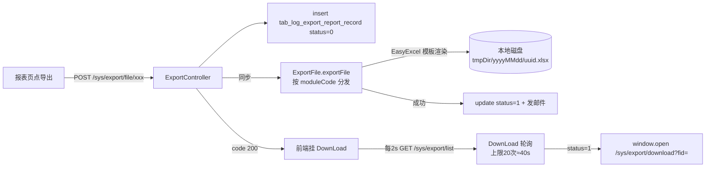

# BWT-VMS 产品功能设计与实现 · 报表与导出域(D08)

> 更新日期:2026-09-04(修改本文档后请同步更新此日期,并到 Dify 知识库重新上传该文件)

> 遵循模板。本域是系统的"查询与出表"中心。

---

## 1. 域概述

| 项 | 内容 |
|---|---|
| 定位 | 提供综合查询、各类业务报表、五张动态报、统一导出(Excel/PDF)能力 |
| 核心价值 | 把清洗/填报/计算数据转化为可查询、可导出的业务报表,支撑运营分析与合规报送 |
| 边界 | 只管"查询与导出";各业务数据由各域生产(油耗→D07、能效→D06、航次→D03) |
| ⚠️ 重要纠偏 | 导出**实际是同步生成**(非异步 Job);文件存**本地磁盘**(非 DB blob/Minio);下载接口**无身份校验** |

---

## 2. 功能点清单

```
F08 报表与导出
├─ F08-1 统一导出机制(ExportController + DownLoad 轮询)
├─ F08-2 五张动态报(午报/航志/轮机日志/燃润料/MRV-DCS)
├─ F08-3 综合查询与快捷查询(IntegratedQueryController)
├─ F08-4 报警统计(AlarmStatisticsController + 定时预聚合)
└─ F08-5 事故报警(AccidentAlarmController)
```

---

## 3. 逐功能点详述

### F08-1 统一导出机制

**(1) ⚠️ 纠偏**:代码注释/字段名(`STATUS_EXPORTING`/`exportJobCron`)暗示异步 Job,但**当前是同步**——`saveExportRecord` 末尾直接在请求线程内调 `exportFile.exportFile()` 生成文件并置状态 1/2。`exportJobCron` 是死代码(无 @Scheduled 引用)。

**(2) 端到端流程**:


**(3) 文件存储**:**本地文件系统** `{tmpDir}/{yyyyMMdd}/{uuid}{suffix}`,后缀 .xlsx(绝大多数)/.pdf(仅 MRV-DCS)/.json(配置导出含图片)。CleanJob(`@Scheduled clean-job-cron`)按 expiredHours 物理删过期文件(DB 记录不删,列表查询过滤)。

**(4) ExportController 接口**(统一前缀 `/export`,~42 提交接口,按 moduleCode 区分):提交类 `POST /file/{xxx}`(综合查询 ZHCX/SJCX/SJDB、报警 BJTJ/BJZTCX、航次 DCHX/HCGL、油水 YSGL/YSXHDB/YSYCJK/ZHYSCX/YSCLCX、动态报 ZWB/HXRZB/LJRZB/RRLXHB/MRVDCS、能效 HSYH/ZJXNFX/ZJFHFX/NHFBFX/NXBGYHBB/PYWD/FJFX/PFBG、设备 SBYXSJ、碳强度 TQD*、配置 CE/ENGINECONFIG);查询类 `GET /list`、`GET /download?fid=`。

**(5) ⚠️ 已知问题**:下载接口仅靠 fid(uuid)寻址**无身份校验**;前端 `window.open` 不带 token(绕过 ask.js);ExportFile.java 4104 行单类 ~40 方法注入几乎所有 Service(重构热点)。

**(6) 前端**:DownLoad 组件递归 setTimeout 2s/次轮询 `/sys/export/list`(上限 20 次);ReportCommon 组件统一封装"图表+表格+导出"(exportInfo={getUrl,exportParam})。**反例**:SearchAll 复制了 ReportCommon 逻辑未复用;碳报告同步下载无轮询(fid 取不到静默失败)。

**(7) 已知问题**:DIAG-P0-S-02(下载无鉴权)、DIAG-P2-M-06(导出逻辑重复)。

---

### F08-2 五张动态报

**(1) 设计**:采用统一 **「值表 + 模型表」** 双表结构,字段配置化(每船可不同)。模型表 type:0 文本/1 日期/2 文本域/3 下拉/4 日期范围/5 24h时间范围。

**(2) 五张报**:

| 报表 | Controller | 数据来源 | 模板 | 导出 moduleCode |
|---|---|---|---|---|
| 正午报 NoonReport | `/noonReport` | 人工填报 | noonReport_cn/en.xlsx | ZWB |
| 航行日志 SailLog | `/sailLog` | 人工填报 | sailLog_*.xlsx | HXRZB |
| 轮机日志 EngineLog | `/engineLog` | 人工填报 | 同上 | LJRZB |
| 燃润料消耗 FuelConsumption | `/fuelConsumption` | 人工填报+油水 | 同上 | RRLXHB |
| MRV/DCS 年度排放 | (ExportFile 内) | 系统计算聚合 | mrv_dcs.xlsx→PDF | MRVDCS |

**(3) 通用接口**(以正午报为例):`GET /list`、`GET /menu`(模型树+是否已填)、`GET /detail`、`POST /add`、`POST /edit`(轮机/航行/油耗有)。

**(4) 数据表**:tab_noon_report(+_model)、tab_sail_log(+_model)、tab_engine_log(+_model)、tab_fuel_consumption(+_model)。值表字段:uuid/group_uuid/ship_id/param_uuid/param_value/sort;模型表:name/unit/father_uuid(树)/type/select_param/required。

---

### F08-3 综合查询与快捷查询

**(1) 功能**:按工况点/通道、时间区间、航行状态、图表类型(折线/柱/饼)、单/多船查询传感器高频数据;支持保存快捷查询。

**(2) 接口**(IntegratedQueryController `/integrated/query/*`):
- `GET /list`(综合/快捷查询数据:shipId/searchShip/chartType/sailStatus/queryParam 工况点串/startTime/endTime)
- `GET /operating/condition`(24h 单通道折线)、`/compare`
- `GET /shortCut/list`、`POST /shortCut/save`、`GET /shortCut/delete`

**(3) ⚠️ 已知问题**:featureId(1传感器/2健康/3油水)**被硬编码成传感器**(健康/油水分类未启用)。

**(4) 导出**:综合/快捷/24h 对比**共用** `/export/file/report`,moduleCode 区分(ZHCX/SJCX/SJDB)。

**(5) 数据表**:tab_integrated_query_shortcut(name/chart_type/ship_id/device_keys)。

---

### F08-4 报警统计

**(1) 功能**:按设备/时间聚合报警,每日定时预聚合。

**(2) 机制**:StatisticsJob `@Scheduled cron="0 30 0 * * ?"` 每天 00:30 遍历所有船调 `saveAlarmStatisticsNew` 写 `tab_alarm_statistics`;`POST /alarm/statistics` 手动补偿触发。同 Job 含 `engineStatisticsJob`(每小时,主机性能);gasTemperatureJob 已注释。

**(3) 数据表**:tab_alarm_statistics(ship_id/year/month/father_id/total_alarm_number/timeout_alarm_number/device_key/statistical_time/father_device_key 设备树聚合)。

**(4) 报警查询/导出**:在 ResStatusController(`BJZTCX`)与 ExportController `/file/alarm`(`BJTJ`),支持 queryType 1 时间/2 航次/3 时间+等级/4 统计。

---

### F08-5 事故报警

**(1) 接口**(AccidentAlarmController `/accident/*`):`GET /alarm/list`(分页模糊)、`/alarm/detail`、`/alarm/timeRange`(近 48h 所有事故,供大屏/地图标点)。

**(2) 数据表**:tab_accident_alarm(ship_id/mmsi/accident_title/location/reason/analysis/type/accident_time/lon/lat)。

**(3) ⚠️ 事故报警无独立导出接口**(不在 ExportModuleCode 枚举)。

---

## 4. 数据表

| 表 | 用途 |
|---|---|
| tab_log_export_report_record | 导出任务(user_id/module_code/params JSON/export_status 0/1/2/uuid/file_title) |
| tab_noon_report(+_model) 等 4 组 | 动态报值/模型 |
| tab_alarm_statistics | 报警每日聚合 |
| tab_accident_alarm | 事故报警 |
| tab_integrated_query_shortcut | 综合查询快捷条件 |

---

## 5. 风险与改造建议

| 问题 | 诊断 ID | 建议 |
|---|---|---|
| 下载无鉴权 | DIAG-P0-S-02 | download 接口加身份校验 |
| 导出同步阻塞 | —(性能) | 改真异步(消息+Job 扫 status=0) |
| ExportFile 4104 行单类 | —(可维护性) | 按 moduleCode 拆分策略类 |
| SearchAll 未复用 ReportCommon | DIAG-P2-M-06 | 统一导出交互组件 |
| 综合查询 featureId 硬编码 | —(功能) | 启用健康/油水分类或删配置 |
| 表注释缺 status=2 | —(文档) | 更新 tab_log_export_report_record 注释 |
