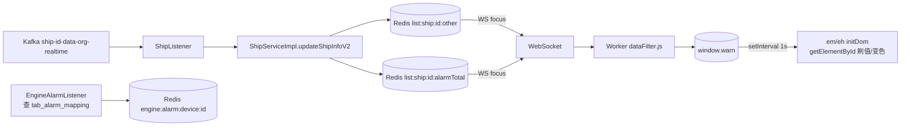

# BWT-VMS 产品功能设计与实现 · 机舱监控域(D04)

> 更新日期:2026-09-04(修改本文档后请同步更新此日期,并到 Dify 知识库重新上传该文件)

> 遵循模板。本域是系统可视化的门面:用 SVG 机舱图实时展示工况与报警。

---

## 1. 域概述

| 项 | 内容 |
|---|---|
| 定位 | 以 SVG 机舱模拟图(mimic)实时展示机舱各子系统工况与报警,支持图元配置与模板管理 |
| 核心价值 | 轮机长直观掌握机舱运行状态,故障一目了然 |
| 边界 | 只管"机舱工况展示与配置";健康分/AI 诊断在 D05;能效指标在 D06;工况采集清洗在 D02 |
| 两大菜单 | EM 机舱监控(menuType=1)/ EH 机舱健康(menuType=2),共用 SVG 底座 |
| 实时性 | WebSocket focus 订阅 → Worker → window.warn → 页面 setInterval(1s)刷新 SVG DOM |

---

## 2. 功能点清单

```
F04 机舱监控
├─ F04-1 SVG 机舱可视化机制(三套方案 + EM/EH + device_key 绑定 + 报警变色)
├─ F04-2 mimic 模板管理(MimicFileController)
├─ F04-3 机舱图配置(ShipEngineConfigController 16 接口)
├─ F04-4 工况点实时刷新链路(WS→Worker→window.warn→SVG DOM)
├─ F04-5 设备状态与报警(查表归一化 0=正常)
└─ F04-6 engine_config 前端配置体系
```

---

## 3. 逐功能点详述

### F04-1 SVG 机舱可视化机制

**(1) ⚠️ 重要纠偏**:本工程**不使用 react-svg / @iconfu/svg-inject**(grep 无引用)。实际用 `axios.get` 拉 SVG 文本 → `new DOMParser().parseFromString` → `append` 进 div → `document.getElementById().setAttribute()` 直接操 DOM。

**(2) 三套 SVG 渲染方案并存**:

| 方案 | 场景 | 实现 |
|---|---|---|
| A 外部 SVG + DOMParser | EM/EH 总览、mimic 子页 | axios 拉 SVG → DOMParser → append → getElementById 操控 |
| B 内联 JSX-SVG | EM svgOldNew=0 旧子页 | SVG 写在 render,`{db[key]?(db[key]*1).toFixed(2):'--'}` 绑定 |
| C 编辑器注入 | svgOldNew=2 + 管理员 + edit | React svg 画布 + `dangerouslySetInnerHTML` |

**(3) EM vs EH**:

| 维度 | EM 机舱监控 | EH 机舱健康 |
|---|---|---|
| menuType | 1 | 2 |
| 容器 | `engineMonitor/index.jsx` | `engineHealth/index.jsx` |
| 子页 | 按 svgOldNew 动态分发(0→EMPage 内联/1→EMPartPage/2→EMPartPageSvg 或 DefinePage 编辑器) | 统一 EHSystem + EHOverview,按 EngineUuids 树层级展开(最多 4 层) |
| 值结构 | `db[key]`(直接数值) | `db[key].value`(对象,含 value+fault_lists) |

**(4) device_key 与 SVG 元素绑定**:
- 方案 A 总览:SVG 元素 `id` = `device.identification`,按 id 找 image 改 xlink:href 切报警图标
- 方案 A EH 子系统:SVG 元素 `id` = `componentKey`,配两个 tspan([0]数值/[1]名称)
- 方案 B 内联:无 DOM id,直接 `db[key]` 索引,engineConfig.js 按 subsystem 分组 key 数组

**(5) 报警三档颜色**(EH):≥70 绿(normal)/60-70 黄(preAlarm)/<60 红(alarm);EM 总览用报警 PNG 转 base64 写 image。

**(6) 已知问题**:DIAG-P1-F-01(window.warn 全局变量)、多处重复 WS 订阅(onmessage 后挂覆盖前者)、SVG 直接操 DOM 绕过 React 易不一致。

---

### F04-2 mimic 模板管理(MimicFileController `/mimic/file/*`)

**(1) 功能设计**:上传/下载/管理 SVG 机舱模板与按船定制的实例。

**(2) 接口**:

| method | path | 用途 |
|---|---|---|
| POST | `/mimic/file/template/upload` | 上传通用 SVG/JS 模板(files+name+language+classify) |
| POST | `/mimic/file/template/delete` | 删模板(id) |
| GET | `/mimic/file/template/list` | 模板列表 |
| GET | `/mimic/file/template/download` | 下载模板(image/svg+xml 或 text/javascript) |
| POST | `/mimic/file/upload` | 上传按船实例(files+shipId+identification+group+menuType) |
| GET | `/mimic/file/download` | 下载实例 |

**(3) 模板 vs 实例**:

| 维度 | template(模板) | mimic(实例) |
|---|---|---|
| 定位 | 系统级通用,所有船共用 | 按船+菜单定制 |
| 表 | tab_mimic_template_file | tab_mimic_file |
| 维度 | display_name/language/classify | ship_id/identification/group/menu_type/language |
| 扩展名 | .svg + .js | 仅 .svg |
| 上传语义 | 逐条 insert | 先按五维全删再插(覆盖) |

**(4) ⚠️ 文件存储**:存 **MySQL mediumblob 字段**,非本地磁盘/OSS/Minio(ServiceImpl 注释写"Minio"是历史命名误导)。

**(5) 已知问题**:文件存 DB blob 撑大表;mimic 侧无 list 接口;先删后插非幂等并发互覆盖;实体未加 @TableName。

---

### F04-3 机舱图配置(ShipEngineConfigController `/config/visual/engine/*`,16 接口)

**(1) 功能设计**:配置机舱菜单树、工况点后端属性、换算公式、采集参数(AMS/Modbus)。

**(2) 接口分组**:

| 组 | 代表接口 | 用途 |
|---|---|---|
| 菜单 | GET `/menu/query`、POST `/menu/save`、POST `/menu/health/update` | 机舱菜单树(EM/EH),健康菜单同步 mmha_component |
| 工况点后端 | GET `/backend/list`、`/allList`、POST `/backend/save`、`/save2`、`/delete` | 工况点 CRUD(deviceKey/type/限值/公式) |
| 公式样式 | POST `/backend/more/save`、GET `/statistics/type/list` | transData 公式 + stateData 状态量样式 |
| 采集(仅船端) | GET `/datacap/list`、`/ams/list`、`/ams/dataType`、POST `/datacap/save`、`/one/save`、`/delete` | AMS Modbus 通道/orderId 映射 |
| 导入 | POST `/upload` | xlsx 导入(仅船端) |

**(3) mimic 图配置**(不在本 Controller,在 `ConfigController`):`POST /config/visual/menu/mimic/save`、`GET /config/visual/menu/mimic`。

**(4) 前端配置页**(ConfigurationManagement):EngineParamMenu(菜单树)、IcommanderConfig(工况点+公式可视化)、CollectConfig(采集 AMS,仅船端)。

---

### F04-4 工况点实时刷新链路

**(1) 端到端**:


**(2) 关键**:
- WS 单例 `window.WS`,token 走 subprotocol
- Worker(dataFilter.js)仅做时间戳过滤
- `window.warn[shipId]` 结构含 other/alarmTotal/navigation/jcjk 等
- **setInterval 1s 是节拍器**(把已有 db 刷视图),WS onmessage 异步写 db
- 多页面各自挂 onmessage,后挂覆盖前者(单回调)

---

### F04-5 设备状态与报警(⚠️ 查表归一化)

**(1) ⚠️ 重要纠偏**:报警判定**不是 low/high 区间比较**。`tab_engine_param` 的 low/low_low/high/high_high 是**展示用视觉档位**(SVG 颜色分档/量表刻度),**不是触发条件**。

**(2) 真正报警逻辑**(`EngineAlarmListener.monitorEngineAlarm`):
- 查 `tab_alarm_mapping`:`dds_value → consistency_value`
- **归一化值 == 0 → 正常;非 0 → 报警**
- Redis hash `engine:alarm:device:{shipId}`:field=deviceKey,value=EngineParam JSON

**(3) Redis key**:

| key | 类型 | 内容 |
|---|---|---|
| list:ship:{id}:other | String(JSON) | Map<deviceKey,value> 工况实时值 |
| list:ship:{id}:alarmTotal | String | 报警计数(Header 红角标) |
| engine:alarm:device:{id} | Hash | 报警明细(field=deviceKey) |

**(4) 前端报警展示**:alarmTotal 红角标;工况点变色靠 SVG 配置 `status{<值>:{background,txt}}` 查表 + other[deviceKey] 本地判定。

---

### F04-6 engine_config 前端配置体系

**(1) 三个文件**:
- `engineConfig.js`:种子数据(默认配置 + conning 驾驶台 key 映射)
- `12.js`:船 ID=12 的完整配置(3906 行,字段最全)
- `default.js`:兜底模板(682 行)

**(2) 注入链路**:index.html 依次 script 加载 → `window.EngineConfig` → `localStorage.EngineConfigs`;App.js 每次渲染刷新。

**(3) ⚠️ 与后端关系**:**100% 离线静态文件**,无回写。`EngineStore.getConfigs()` 调后端的代码已注释,只读 localStorage。管 SVG 布局/分组/缸号映射;不管实时值(实时值走 WS)。

**(4) 配置项无报警阈值**:device_key 只是 ID,绑 SVG 元素;报警阈值在后端 tab_alarm_mapping。

---

## 4. 数据表

| 表 | 用途 | 关键字段 |
|---|---|---|
| tab_engine_param | 工况点(核心) | device_key(全局键)、device_type(0传感/1模拟/2报警)、order_id、trans_data(公式)、min/max/low/high(展示用)、svg_old_new、menu_type |
| tab_engine_param_menu_config | 机舱菜单树 | menu_id(层级编码)、device_id(UUID)、identification、action_path、svg_old_new |
| tab_engine_param_menu_mimic_config | mimic 图配置 | mimic_config(JSON 串)、identification、language、menu_type |
| tab_mimic_file | mimic 实例(SVG blob) | ship_id、identification、group、menu_type、language、file(blob) |
| tab_mimic_template_file | mimic 模板(SVG/JS blob) | display_name、language、classify、file(blob) |
| tab_alarm_mapping | **报警归一化映射(报警真正来源)** | dds_value→consistency_value(0=正常) |
| tab_engine_state_quantity_cfg | 状态量样式 | stateData JSON(value→{statusCn,color}) |
| hld_key_map | orderId↔deviceKey(船端采集) | — |

---

## 5. 风险与改造建议

| 问题 | 诊断 ID | 建议 |
|---|---|---|
| window.warn 全局变量 | DIAG-P1-F-01 | 纳入状态管理 |
| 多处重复 WS 订阅互覆盖 | —(可维护性) | 单一 onmessage + 订阅器列表 |
| SVG 直接操 DOM 绕过 React | —(可维护性) | 评估 react-svg 重构 |
| mimic 存 DB blob | —(性能) | 迁移到对象存储(Minio/OSS) |
| 报警语义特殊易误解 | —(文档) | 配置页对 low/high 标注"仅展示用" |
| EM 12 子页 Route 已注释 | —(清理) | 删未使用的 EMAirSystem/EMBoilerFuel 等遗留组件 |
| engine_config 离线 | —(扩展) | 若需后端化,打通 /config/visual/engine 拉取覆盖 localStorage |
