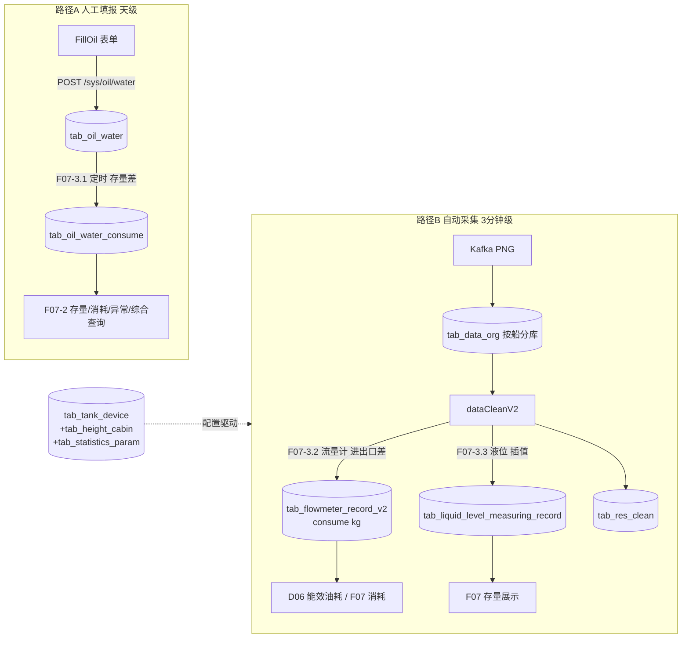

# BWT-VMS 产品功能设计与实现 · 油水管理域(D07)

> 更新日期:2026-09-04(修改本文档后请同步更新此日期,并到 Dify 知识库重新上传该文件)

> 遵循《BWT-VMS-00-文档索引与功能域划分.md》模板。油水的数据库表结构详表与"手动填库指南+示例 SQL"已在前端架构库第 12 节给出,本文件聚焦**功能设计与实现**,表结构按需引用。

---

## 1. 域概述

| 项 | 内容 |
|---|---|
| 定位 | 管理船舶燃油/润滑油/水舱的**人工填报**与**自动采集统计**,覆盖填报、存量、消耗、异常、综合查询,是能耗与成本核算的数据源 |
| 核心价值 | 油水是船舶最大运营成本,准确掌握存量/消耗才能做能效分析与合规 |
| 边界 | 管油水舱的"量"(存量/加量/消耗);**能效指标**(SFOC/能耗分布)在 D06;机舱工况原始采集在 D02;过闸在 D03 |
| 数据来源双轨 | ① 人工填报(天级,FillOil)② 自动采集(3 分钟级,流量计/液位经 dataCleanV2) |
| 关键概念 | 主舱(分类 tab_tank_device_menu)+ 子舱(设备 tab_tank_device)两层;油种编码(1淡水/2轻油/3重油/4压载/5滑油/9 LNG/15低硫);时间统一 UTC 秒 |

---

## 2. 功能点清单

```
F07 油水管理
├─ F07-1 油水填报
│  ├─ F07-1.1 油水填报(FillOil)
│  ├─ F07-1.2 航次填报(FillVoyage)
│  ├─ F07-1.3 标准里程填报(StandardMileage)
│  └─ F07-1.4 油水附件上传/下载
├─ F07-2 油水查询与分析
│  ├─ F07-2.1 油水存量查询(OilStock)
│  ├─ F07-2.2 油水消耗对比(OilWaterCons)
│  ├─ F07-2.3 综合查询(OilWaterIntegratedQuery)
│  └─ F07-2.4 油水异常监控(OilWaterAbnormalMonitor)
└─ F07-3 油水消耗计算(后台)
   ├─ F07-3.1 人工填报消耗计算(定时,存量差法)
   ├─ F07-3.2 流量计自动统计(dataCleanV2,进出口差)
   └─ F07-3.3 液位遥测舱容计算(dataCleanV2,高度→体积插值)
```

---

## 3. 逐功能点详述

### F07-1.1 油水填报(FillOil)

**(1) 功能设计**:船端轮机长每日填报各油水舱的加量(补油)与存量,系统校验上限与正数,支持当日有限次修改。表单是"父子两层舱":主舱(轻油舱/重油舱/淡水舱/滑油舱)填加量+粘度/密度/热值/型号,子舱填存量。

**(2) 业务规则**:
- 时间取当天零点(UTC 秒),作为业务主时间轴
- 加量/存量必须正数(正则 `^[+]?(\d+|\d+\.\d+)$`),非数字标红
- 存量超过 `tab_tank_device.maximum` 标红,禁提交
- 当日修改次数受 `modify_count` 限制(查 `OilResidue` 剩余次数,耗尽则只读)
- 未填项:弹"用昨天默认值"或"清空加量提交"二选一

**(3) 前端实现**:`src/containers/fillForm/fillOil/index.js`(注意是 `.js`);`hanlderBlur` 校验、`oilWaterJudge` 提交守门;antd 表单。

**(4) 接口**:

| 前端 name | method | url | 用途 |
|---|---|---|---|
| Oilwater | GET | `/sys/oil/water` | 取今日待填模板(舱列表+昨日值) |
| AddOil | POST | `/sys/oil/water` | 新增填报(写 tab_oil_water) |
| EditOil | PUT | `/sys/oil/water` | 修改(modify_count++) |
| OilWaterList | GET | `/sys/oil/water/list` | 历史汇总列表 |
| OilHistory | POST | `/sys/oil/water/history` | 某日详情(+附件) |
| OilWaterSaved | GET | `/sys/oil/water/isSaved` | 当日是否已填 |
| OilResidue | GET | `/sys/oil/water/residue` | 剩余修改次数 |
| getOilWaterData | GET | `/sys/oil/water/sum` | 昨日增量/存量(默认值) |

提交体:`{oilWaterList:[{oilCompartmentId,add,stock,child[]}], shipId, time}`。

**(5) 数据**:`tab_oil_water`(主表,关键字段 tank_id/add/stock/time/unit/density/viscosity/calorific/oil_signal/modify_count);`tab_tank_device`(舱配置+maximum 校验);`tab_tank_device_menu`(主舱分类)。

**(6) 已知问题**:DIAG-P2-M-06(前端 uploadfile name 指向 /sys/shipConfig/upload 船配置导入,真正附件上传在子组件调 /file/upload,易误解)。

---

### F07-1.2 航次填报(FillVoyage)

**(1) 功能设计**:填报航次信息(起止港/时间/载货量/航程等),作为能效与运输功计算的输入。
**(2) 前端**:`src/containers/fillForm/FillVoyage/`。
**(3) 接口**:见 `reportApi.js` 航次填报相关;落航次表。

---

### F07-1.3 标准里程填报(StandardMileage)

**(1) 功能设计**:填报各航段标准里程,用于航速油耗/滑失率计算的基准对照。
**(2) 前端**:`src/containers/fillForm/StandardMileage/`。

---

### F07-1.4 油水附件上传/下载

**(1) 功能设计**:为每日油水填报上传凭证附件(照片/文档),支持列表/下载/删除。

**(2) 后端**:`FileController /file/*`(`bwt-vms-system/.../controller/navigation/FileController.java`):
- `POST /file/upload`(multipart file[] + shipId + date 精确天)→ 写 `tab_oil_water_file`
- `GET /file/download?fileId=`、`GET /file/list?date=&shipId=`、`GET /file/delete?fileId=`(改 status)

**(3) 数据**:`tab_oil_water_file`(file_id UUID / file_name / date / binding / download_url / status)。

---

### F07-2.1 油水存量查询(OilStock)

**(1) 功能设计**:查询指定时段各舱/各油种的存量变化,折线/柱状展示。
**(2) 前端**:`src/containers/analyticalStatement/OilStock/`。
**(3) 接口**:`GET /sys/oil/stocks?shipId&queryType&params&tankType`;或 `/sys/oil/water/sum`。
**(4) 数据**:读 `tab_oil_water`(人工)+ `tab_liquid_level_measuring_record`(遥测)。

---

### F07-2.2 油水消耗对比(OilWaterCons)

**(1) 功能设计**:对比不同时段/油种的消耗量,识别异常消耗。
**(2) 接口**:`GET /sys/consume?shipId&timeType(1年2季3月)&time`;`POST /sys/consume/flight`(航次维度)。
**(3) 数据**:`tab_oil_water_consume`(由 F07-3.1 计算)。

---

### F07-2.3 综合查询(OilWaterIntegratedQuery)

**(1) 功能设计**:按航次/日期/油种多维综合查询油水数据,支持分页与导出。
**(2) 接口**:`GET /sys/oil/comprehensive?shipId&queryType(1航次2日期)&params&tankType&pageNum&pageSize`;`GET /sys/oil/comprehensive/download`;`GET /sys/oilType`(油种下拉)。

---

### F07-2.4 油水异常监控(OilWaterAbnormalMonitor)

**(1) 功能设计**:监控油水数据异常(如存量突变、消耗为负、超上限),辅助发现泄漏或偷油。
**(2) 接口**:`GET /sys/exception?shipId&startTime&endTime`(UTC 秒)。

---

### F07-3.1 人工填报消耗计算(后台,存量差法)

**(1) 功能设计**:定时任务基于人工填报的存量差计算每日各舱消耗。

**(2) 算法**:
```
consume(当日某舱) = stock(昨日该舱) - stock(当日该舱) - add(当日该舱加量)
```
即:昨日存量 + 今日加量 - 今日存量 = 今日消耗(正值消耗,负值异常)。

**(3) 触发**:`GET /sys/consume/oilWaterConsumeJobRefresh?dateTime=yyyy-MM-dd` 手动触发,或定时任务次日执行。

**(4) 后端**:`OilWaterConsumeService.oilWaterConsumeJobRefresh` → 写 `tab_oil_water_consume`(ship_id/tank_id/consume/time/tank_device_type/density/unit)。

**(5) 数据**:`tab_oil_water`(输入)+ `tab_oil_water_consume`(输出)。

---

### F07-3.2 流量计自动统计(dataCleanV2,进出口差法)

**(1) 功能设计**:每 3 分钟基于流量计读数自动计算各设备(主机/发电机/锅炉)的油耗,这是 D06 能效油耗数据的**主要来源**。

**(2) 算法**(`FlowmeterRecordStatisticsServiceImpl`,`@Scheduled cron="0 2/3 * * * ?"`):
1. 从 `tab_statistics_param` 读 device_type=41(流量计)+ 40(密度)的 device_key
2. 按 `group_desc`(`{设备}_{编号}_{油种}_{IN/OUT}`)解析设备类型/编号/油种/进出口
3. 从 Redis 取该 device_key 原始序列 → splitData(突变分段)→ mergeAnalog 统计 → TabResClean
4. **消耗 = Σ进口流量 − Σ出口流量**
   - 累计式流量计:consume = max − min
   - 瞬时式流量计:consume = avg × 时长
   - 体积式需 × 密度换算到 **kg**
5. 油种判定:density ≥ HEAVY_OIL_DENSITY_MIN_VALUE → 3 重油,否则 2 轻油

**(3) 数据**:
- 输入:Redis 实时序列(源自 `tab_data_org` PNG 解析)
- 输出:`tab_flowmeter_record_v2`(consume **kg**/start_utc/end_utc/oil_type/device_type/device_num)+ Redis `energy:{shipId}:device_consume`(实时能耗分布)

**(4) 配置依赖**:`tab_statistics_param` 的 group_desc 格式必须严格(`mainframe_1_2_IN`),否则 `split("_")` 解析抛 NumberFormatException。

**(5) 已知问题**:DIAG-P0-D-01(dataCleanV2 先提交 offset 后处理,流量计原始数据可能丢,直接影响油耗统计)。

---

### F07-3.3 液位遥测舱容计算(dataCleanV2,高度→体积插值)

**(1) 功能设计**:对带液位遥测的舱,每 3 分钟把液位高度读数通过"高度-舱容对照表"插值换算为体积(m³/L),得到存量。

**(2) 算法**(`LiquidRecordStatisticsServiceImpl`,`@Scheduled cron="0 0/3 * * * ?"`):
1. 从 `tab_statistics_param` 读液位相关 device_key
2. 清洗统计 → TabResClean(min/max/avg)
3. 调 Feign `GET /calCabin/byLiquidLevel?shipId=&deviceId=&high=` → 查 `tab_height_cabin` 做**分段线性插值**:`cabin = cabinLow + (h − heightLow) × (cabinUp − cabinLow) / (heightUp − heightLow)`
4. 体积换算:cube(m³)× 1000 = liter(L)

**(3) 数据**:
- 输入:`tab_tank_device`(液位设备配置)+ `tab_height_cabin`(高度↔舱容曲线)
- 输出:`tab_liquid_level_measuring_record`(liquid_level_height m / _cube m³ / _liter L / min/max/avg/cnt/quality)

**(4) 已知问题**:液位遥测仅对配了 `tab_height_cabin` 曲线的舱有效;无曲线的舱走人工填报(F07-1)。

---

## 4. 域级端到端数据流



**两条数据路径并存**:
- **人工填报(路径 A)**:船端轮机长每日填 → tab_oil_water → 次日定时算存量差 → tab_oil_water_consume → 查询展示
- **自动采集(路径 B)**:流量计/液位工况点 → PNG → tab_data_org → dataCleanV2 清洗统计 → tab_flowmeter_record_v2 / tab_liquid_level_measuring_record → 能效与存量展示

---

## 5. 与其他域的依赖

| 依赖方向 | 域 | 说明 |
|---|---|---|
| 依赖 | D02 采集清洗 | 提供 tab_data_org/PNG 解析、dataCleanV2 的 F07-3.2/3.3 计算 |
| 依赖 | D16 系统配置 | tab_tank_device/tab_tank_device_menu/tab_height_cabin/tab_statistics_param 的配置(舱/设备/曲线/信号路由) |
| 被依赖 | D06 能效 | tab_flowmeter_record_v2 是 D06 油耗数据主源 |
| 被依赖 | D08 报表 | 油水各类导出走 ExportController |

---

## 6. 风险与改造建议

| 问题 | 诊断 ID | 影响 | 建议方向 |
|---|---|---|---|
| 流量计原始数据可能丢 | DIAG-P0-D-01 | acknowledge 先提交后处理,异常丢数据 → 油耗统计偏低 | 改至少一次 + 死信队列 |
| 新老油水表并存 | DIAG-P2-DB-02 | tab_oil_water(新)与 tab_oilwater(老)共存,entity 多份拷贝易错 | 确认无引用后 drop 老表,统一 entity |
| 附件上传接口混淆 | DIAG-P2-M-06 | FillOil 里 uploadfile 指向 /sys/shipConfig/upload(船配置导入) | 前端接口名语义化,统一到 /file/upload |
| tab_res_clean 分区 | DIAG-P1-DB-01 | 清洗结果(液位/流量计中间态)插超范围失败 | 自动 ADD PARTITION |
| 人工与自动口径不一致 | —(设计特性) | 人工存量差 vs 流量计进出口差,两者可能对不上 | 增加对账报表 + 差异说明 |

> **数据库填写指南**:手动补油水数据的完整字段表 + 示例 INSERT,见《BWT-VMS前端架构知识库.md》第 12.3~12.5 节。
