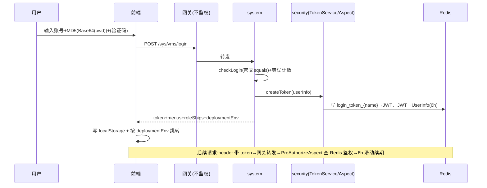

# BWT-VMS 产品功能设计与实现 · 登录与权限管理域(D01)

> 更新日期:2026-09-04(修改本文档后请同步更新此日期,并到 Dify 知识库重新上传该文件)

> 遵循《BWT-VMS-00-文档索引与功能域划分.md》模板。鉴权机制技术细节见后端架构库第 5/11 节;本文件聚焦功能设计。

---

## 1. 域概述

| 项 | 内容 |
|---|---|
| 定位 | 系统的入口与安全基座:负责用户登录、会话管理、权限树下发、菜单/路由/按钮的动态显隐、运行时鉴权、用户/角色/船员管理 |
| 核心价值 | 一套代码同时服务船端(shipSide)与岸端(shoreSide),按角色与船舶细粒度授权 |
| 边界 | 只管"身份与权限";业务数据的权限过滤在各业务域内按 shipId 做 |
| 机制 | 自研 JWT(票据)+ Redis(会话)+ @PreAuthorize AOP(授权),**未用 Spring Security** |
| 权限级别 | 0 spadmin / 1 admin / 2 系统 / 3 岸基 / 4 船端 |

---

## 2. 功能点清单

```
F01 登录与权限管理
├─ F01-1 登录(账号密码 + 条件验证码 + 跳转分流)
├─ F01-2 会话与 Token(创建/滑动过期/单设备/永久 Token/登出)
├─ F01-3 权限树与动态菜单(permissionMenu / roleListALL / 4 级级联)
├─ F01-4 用户管理(17 接口)
├─ F01-5 角色管理(11 接口)
├─ F01-6 船员管理(13 接口,含批量导入)
├─ F01-7 运行时权限校验(PreAuthorizeAspect)
├─ F01-8 权限变更实时通知(getState 3s 轮询)
└─ F01-9 部署环境(deploymentEnv 船/岸切换)
```

---

## 3. 逐功能点详述

### F01-1 登录

**(1) 功能设计**:用户名/邮箱/手机号登录;首次勾选用户协议;**错误次数 ≥ 3 强制图形验证码**;密码前端三层加密;登录成功按 deploymentEnv 跳转。

**(2) 密码前端加密**(`Login/index.jsx`):
```
明文 → UTF8.parse → Base64.stringify → MD5 → toString
```
即 `MD5(Base64(UTF8(明文)))`,后端直接密文 equals 比对(spadmin 内置账号再走 `MD5(Base64(passwd))`)。

**(3) 验证码条件触发**:登录前 `GET /sys/vms/refresh/captcha?loginName=` 查 Redis `login_count_{loginName}`,错误次数 ≥ 3 才返回 captchaId+base64 图片;验证码 Redis `login_captcha_{captchaId}` TTL 3 分钟,忽略大小写;字符集排除易混 0/O/1/I。

**(4) 接口**:

| method | path | 用途 |
|---|---|---|
| GET | `/sys/vms/checkUserLicense` | 用户协议状态(0 未读/1 已读) |
| GET | `/sys/vms/refresh/captcha` | 条件式取验证码(≥3 次错误) |
| GET | `/sys/vms/renewal/captcha` | 强制刷新验证码 |
| POST | `/sys/vms/login` | 登录(入参 LoginUserInfoVo) |
| GET | `/sys/vms/exit` | 登出 |

**(5) 登录返回**:`{token, roleShips[], menus{roleId:[TabResource]}, userInfo(密码已置空), deploymentEnv}`。

**(6) 登录成功写 localStorage**:`localStorage.clear()` 后写 token/USERINFO/menus/roleShips/roleShips2/shipId='all'/privilegeLevel/deploymentEnv/i18nextLng/loginName/d1/d2/d3/options3/shoplist 等。

**(7) 跳转分流**:shoreSide → `/FleetKanBan`;shipSide → `/Conning`。

---

### F01-2 会话与 Token

**(1) 功能设计**:JWT 作票据、Redis 作会话存储;6 小时滑动过期;同账号新登录踢旧会话;提供永久 Token 给系统对接/大屏。

**(2) createToken 流程**(`TokenService`):
1. `clearPreRedisToken` 清旧 token(单设备登录)
2. `createJWT`(HS256 + 硬编码 SIGNKEY,claims 含 id/username/password;**ttlMillis=0,JWT 永不过期**)
3. Redis 写两条:`login_token_{loginName}→JWT`、`{JWT}→UserInfo`,TTL 6h

**(3) 滑动过期**:`getLoginUser` 命中即 `refreshToken` 重置 6h。

**(4) 单设备登录**:`clearPreRedisToken` 删旧 token;前端登录前若新旧 token 不同,调 `exitTwo(oldtoken)`(ask.js 第三参覆盖 header token)→ `GET /sys/vms/exit`。

**(5) 永久 Token**:`tab_user_permanent_token`(status=1)由 `@PostConstruct` + `@Scheduled(每分钟)` 刷入 Redis,为对接账号提供绕过登录的永久会话。

**(6) 登出**:`exitSys` 删 `login_token_{loginName/mobile/email}` + `{token}` 四个 key。

**(7) 已知问题**:DIAG-P0-S-01(SIGNKEY 硬编码+claims 含 password)、DIAG-P0-S-02(网关不校验)、DIAG-P1-D-04(单设备/6h 策略需复核)。

---

### F01-3 权限树与动态菜单

**(1) 功能设计**:后端按 roleId 下发菜单树,前端按 identification 驱动菜单/路由/按钮显隐;4 级级联导航(船队→船→模块→设备)。

**(2) permissionMenu 接口**:`GET /sys/vms/permissionMenu` 返回 `menus = Map<roleId, List<TabResource>>`。

**(3) TabResource 节点关键字段**:id、resourceName(En)、parentId、**actionPath**(路由)、**resourceType**(0 菜单/1 按钮/2 接口)、**identification**(权限编码)、isShow、status、**permission**(该用户是否拥有)、children。

**(4) 菜单树构建**(`ActionResourceServiceImpl.menuList`):递归查 → 查角色已分配资源 ID → 标记 permission → 建树 → **过滤 permission=false 节点**。

**(5) 前端 roleListALL**(非接口,是 `utils.getTransRoleListAll()` 从 localStorage 的 roleShips+menus 实时算):`{[shipId]: [扁平 TabResource]}`。三个判断函数:
- `isShowModel0(id)` 默认 false(严格,路由用)
- `isShowModel(id)` 默认 true(宽松)
- `isShowModel2(id, shipId)`

**(6) 4 级级联**(Header):d1 船队/d2 船/d3 模块/d4 设备,选中项持久化 localStorage,按 identification 过滤可见船舶。

---

### F01-4 用户管理(`/user/*`,17 接口)

核心:详情/分页查询/唯一性校验(loginName/email/mobile)/新增/修改/启用禁用(禁自身拦截)/管理员重置密码/用户自改密码/语言偏好。策略模式按 privilegeLevel 分派(SystemUser/ShoreUser 等)。

### F01-5 角色管理(`/role/*`,11 接口)

核心:角色分页/下拉/名称校验/详情/**批量分配权限**(RoleResourceRequestVO)/修改角色-资源/启停角色。角色 user_type:0 spadmin/1 admin/2 系统/3 岸基。

### F01-6 船员管理(`/sailor/*`,13 接口)

核心:船员分页/详情/增改/启停/重置密码/身份证唯一性/**Excel 模板下载+批量导入**(含错误结果下载)。扩展表 tab_ship_user_info 关联 tab_user_info,含适任证/健康证有效期、到离职、船员类型(自有/劳务)。

### F01-7 运行时权限校验(PreAuthorizeAspect)

**(1) 功能设计**:业务方法标 `@PreAuthorize(hasPermi="x:y:z")`,AOP 环绕切面校验身份与权限。

**(2) 逻辑**:
- 注解为 null → 放行
- `getLoginUser()` null → **401**(AUTH_FAILED)
- hasPermi/hasAnyPermi/hasRole/hasAnyRoles 校验 → 不满足 **402**(PERMISSIONDENIED)
- 四参皆空 `@PreAuthorize()` → 仅身份认证
- 通配 `*:*:*`;角色 admin/spadmin 直通

**(3) 前端处理**(ask.js):仅拦截 `data.code===401` 跳 /login 清 token;**402 未特殊处理**(业务层自判)。

**(4) 已知问题**:DIAG-P0-S-02(网关不校验,漏加注解即裸奔)。

### F01-8 权限变更实时通知

**(1) 功能设计**:管理员改了某用户权限/角色/船舶,该用户前端 3 秒内弹窗提示并处理。

**(2) 机制**:
- 管理员操作时 `promptService.savePromptToRedis` 写 Redis `prompt:user:{userId}`
- 前端 Header `pollFn` 每 3 秒(`window.getStateTime=3000`)调 `GET /sys/prompt/permission/change`
- 返回 `flag=true` → 弹不可关闭 Modal + 停轮询
- 用户确认 → `GET /sys/prompt/confirm` → `loginOut=true` 跳登录,否则重启轮询

### F01-9 部署环境(deploymentEnv)

`@Value("${deployment.env}")` 从 Nacos 注入;`UpdateDeploymentEnvServiceImpl` 通过 Nacos API 切换 shipSide↔shoreSide;前端据返回值跳转分流与 UI 差异。

---

## 4. 域级数据流



---

## 5. 数据表

| 表 | 用途 | 关键字段 |
|---|---|---|
| tab_user_info | 用户主表 | id、login_name、passwd(MD5(Base64)密文)、privilege_level(0-4)、user_license、status |
| tab_user_permanent_token | 永久 token | login_name、token、status |
| tab_role_info | 角色 | role_name(En)、user_type(0-3)、home_page、status |
| tab_resource | 权限资源/菜单 | action_path(路由)、resource_type(0菜单/1按钮/2接口)、identification、is_show、status |
| tab_role_resource | 角色-资源 | role_id、resource_id |
| tab_user_role | 用户-角色-船舶 | user_id、ship_id、role_id、def(1 默认角色) |
| tab_ship_user_info | 船员扩展 | user_id、id_card、competency/health_certificate + validity、on_duty/resignation_time、ship_user_type |

---

## 6. 风险与改造建议

| 问题 | 诊断 ID | 建议 |
|---|---|---|
| JWT 密钥硬编码+claims 含 password | DIAG-P0-S-01 | SIGNKEY 移 Nacos+轮换;claims 去 password |
| 网关不校验 token | DIAG-P0-S-02 | 网关统一校验,业务层只做细粒度授权 |
| 402 前端未处理 | —(体验) | ask.js 补 402 提示"权限不足" |
| 永久 token 绕过登录 | —(审计) | 审计 tab_user_permanent_token 使用,加白名单与过期 |
| JWT 永不过期靠 Redis | —(设计) | 加 JWT exp 双保险;Redis 不可用时拒绝放行(非放行) |
