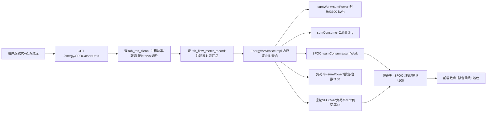
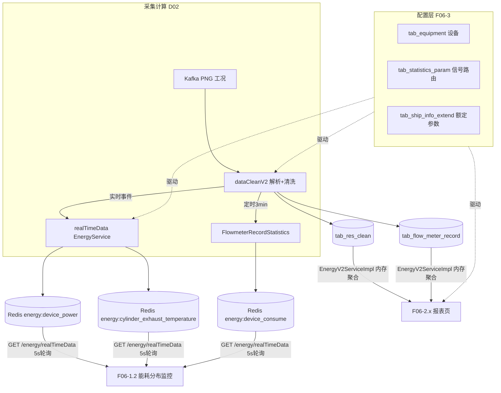

# BWT-VMS 产品功能设计与实现 · 能效分析与监控域(D06)

> 更新日期:2026-09-04(修改本文档后请同步更新此日期,并到 Dify 知识库重新上传该文件)

> 本文件遵循《BWT-VMS-00-文档索引与功能域划分.md》的模板。配套:后端架构库、前端架构库、问题诊断清单(引用 `DIAG-xxx`)。
>
> 能效域是系统最有技术深度、最具产品价值的业务域之一,涉及实时计算、历史聚合、数学模型(螺旋桨定律、SFOC、CII)与法规合规(MRV/DCS)。

---

## 1. 域概述

| 项 | 内容 |
|---|---|
| 定位 | 对船舶机舱能效做**实时监控**与**历史分析**,涵盖主机油耗率(SFOC)、能耗分布、航速-油耗关系、辅机、排放、排温、主机性能,支撑降油耗与 IMO 碳排放合规 |
| 核心价值 | 降低燃油消耗、优化主机运行工况、满足 MRV/DCS/CII 法规报送 |
| 边界 | 只管"能效分析与监控";油水存量/填报→D07;机舱工况原始采集与清洗→D02;机舱健康度→D05;航行里程/航次→D03 |
| 用户角色 | 岸端能效管理者(看报表、下结论)、船端轮机长(实时监控)、能效工程师(配置设备与参数) |
| 实时性 | 仅 2 个页面是实时的(EnergyMonitor 走 WS;能耗分布监控走 5s 轮询),其余均为用户触发的报表查询 |
| 关键依赖 | `tab_statistics_param`(信号路由)、`tab_equipment`(设备)、`tab_ship_info_extend`(额定参数)——配置不全则算不出 |

---

## 2. 功能点清单

```
F06 能效分析与监控
├─ F06-1 能效实时监控
│  ├─ F06-1.1 能效监控概览(EnergyMonitor,SVG 实时)
│  └─ F06-1.2 能耗分布实时监控(5s 轮询,4 图块)
├─ F06-2 能效分析报表(用户触发)
│  ├─ F06-2.1 主机负荷分析(SFOC)
│  ├─ F06-2.2 航速油耗分析
│  ├─ F06-2.3 主机性能分析(热力图)
│  ├─ F06-2.4 能耗分布分析(趋势+利用率)
│  ├─ F06-2.5 辅机分析(发电机/锅炉)
│  ├─ F06-2.6 主机排烟温度分析
│  ├─ F06-2.7 能效报告(油耗/运输功/滑失)
│  ├─ F06-2.8 排放报告(CII/EEXI/EEOD)
│  └─ F06-2.9 能耗分析(MRV/DCS 导出)
└─ F06-3 能效配置
   ├─ F06-3.1 能效设备配置(主机/发电机/锅炉+工况点)
   └─ F06-3.2 特殊参数配置(SOG deviceKey / SFOC a,b,c)
```

---

## 3. 逐功能点详述

### F06-1.1 能效监控概览(EnergyMonitor)

**(1) 功能设计**:以 SVG 机舱概览图实时展示主机/发电机/锅炉的运行状态与关键工况(功率、转速、油耗、排温),设备图标按报警/正常切换颜色。是船端轮机长的主要监控页。

**(2) 前端实现**:
- 组件:`src/containers/energyMonitor/index.js` + `FMOverview/`(SVG 概览)+ `FuelRob/`(油舱液位)
- **唯一用 WebSocket 的能效页**:`componentDidMount` 订阅 `{a:'subscribe', t:'focus', p:{shipIDs:[shipId]}}`;`WS.onmessage` → `postMessage` 给 Web Worker 解码 → `setInterval(...,1000)` 每秒把最新 `db` 写入 state 渲染
- `FMOverview` 基于 iframe 内嵌 SVG,根据 `localStorage.EngineConfigs` + 实时数据切换设备图标
- `FuelRob`:`ask('xxx')` → `GET /sys/liquidLevel/trend` 取近 30 天油舱液位趋势

**(3) 后端实现**:实时数据由 realTimeData/dataCleanV2 写 Redis(见域级数据流)。液位趋势查 `tab_liquid_level_measuring_record`。

**(4) 接口**:`GET /sys/liquidLevel/trend`(FuelRob)。实时值不经接口,走 WS。

**(5) 数据**:Redis `list:ship:{shipId}:other`(工况实时值);表 `tab_liquid_level_measuring_record`。

**(6) 配置依赖**:`EngineConfig`(每船机舱工况点配置)+ `tab_statistics_param` 信号路由。

**(7) 已知问题**:DIAG-P0-D-03(WS 不重连)、DIAG-P1-F-01(window.warn 数据流难追踪)。

---

### F06-1.2 能耗分布实时监控

**(1) 功能设计**:4 个图块实时展示全船能耗分布——① 各设备油耗占比饼图 ② 气缸排烟温度柱图(按均值变色)③ 设备能量利用率环形图 ④ 发电机负荷饼图。每 5 秒刷新。

**(2) 前端实现**:
- 组件:`src/containers/analyticalStatement/energyDistributionMonitor/index.js`
- `setInterval(getChartData, 5000)`(组件卸载清理)
- `ask('xxx')` → `GET /sys/energy/realTimeData`,一次返回 4 块数据

**(3) 后端实现**:`EnergyController.realTimeData` → `EnergyV2ServiceImpl.energyRealtimeData()`(L763)直接 `redisService.getList` 读 4 个 `energy:*` key 组装 VO。**纯读 Redis,不查 DB**。

**(4) 接口**:`GET /sys/energy/realTimeData?shipId=X` → `EnergyRealtimeDataVO`(deviceConsumptionDistribution / cylinderExhaustTemperature / energyEfficiencyDistribution / dynamoLoad)。

**(5) 数据**(Redis,由 realTimeData `EnergyServiceImpl` 计算):
- `energy:{shipId}:device_power`(updateDevicePower:主机/发电机/轴发/锅炉功率+负荷率)
- `energy:{shipId}:cylinder_exhaust_temperature`(updateExhaustGasTempareture:各缸排温+均值+告警)
- `energy:{shipId}:device_consume`(updateDeviceConsume:油耗占比)
- `energy:{shipId}:dynamo_running_time`(发电机运行时间)

**(6) 已知问题**:DIAG-P1-A-01(realTimeData/dataCleanV2 双写覆盖)。

---

### F06-2.1 主机负荷分析(SFOC)

**(1) 功能设计**:对选定航次(最多 4 个对比)计算**主机燃油消耗率 SFOC(g/kWh)**与**主机负荷率**,以散点+二次拟合曲线展示,按偏差率着色,评估主机是否在高效区运行。

**(2) 业务流程**:


**(3) 后端核心算法**(`EnergyV2ServiceImpl` L449-757):
- 主机功率优先取 `me_power`(tab_statistics_param type=1);**无功率时按螺旋桨定律用转速估算**:`P = P_rated × (rpm/rpm_rated)³`(P_rated/rpm_rated 来自 tab_ship_info_extend param_id=27/28)
- `SFOC = sumConsume(g) / sumWork(kWh)`
- 理论 SFOC:`sfocTheory = a × meLoadRatio² + b × meLoadRatio + c`(a,b,c 来自 tab_ship_info_extend param_id=104)
- 异常剔除:图表 meLoadRatio>100 或 |偏差|>10 跳过;列表 sfoc≤170 或 ≥250 跳过

**(4) 前端实现**:`src/containers/analyticalStatement/LoadAnalyse/index.js`;ECharts scatter + 二次拟合(前端用 parameter[0]*i²+parameter[1]*i+parameter[2] 实时画);散点按偏差率 getColor:<1 绿 / 1-5 浅绿 / 5-10 红 / =10 深红;yAxis 范围用后端 displaySfocMin/Max。

**(5) 接口**:`GET /sys/energy/SFOC/chartData`、`GET /sys/energy/SFOC/list`(表格);导出 `POST /sys/export/file/loadAnalysis`(moduleCode=ZJFHFX)。

**(6) 数据**:表 `tab_res_clean`(功率/转速)、`tab_flow_meter_record`(油耗)、`tab_ship_info_extend`(额定参数)。

**(7) 配置依赖**:tab_statistics_param 必须配 type=1(主机功率)或 type=2(主机转速);tab_ship_info_extend 必须配 param_id=27/28(额定功率/转速)+ 104(SFOC a,b,c)。**缺任一项,功率算不出或偏差率无意义**。

**(8) 已知问题**:DIAG-P1-P-01(内存聚合瓶颈)、DIAG-P2-M-05(SFOC 算法无单测)。

---

### F06-2.2 航速油耗分析

**(1) 功能设计**:分析航速与油耗的关系,展示航迹(按航速/油耗着色)与航速-油耗散点,评估不同航速下的能效,辅助经济航速决策。

**(2) 前端实现**:`src/containers/analyticalStatement/SpeedFuelAnalyse/index.js`;轨迹图 `Guiji` + 折线散点。

**(3) 后端**:`EnergyV2ServiceImpl.querySpeedFuelAnalyze`;结合航程(D03 的 tab_ais_distance_record)+ 流量计油耗,按航速分箱聚合。

**(4) 接口**:`GET /sys/energy/speedFuelAnalyze/chart`、`/table`;`GET /sys/singleShip/history`(航次历史轨迹);导出 `POST /sys/export/file/spdConsumptionAnalysis`(HSYHFX)。

**(5) 数据**:`tab_res_clean`(航速 SOG)、`tab_flow_meter_record`(油耗)、`tab_ais_distance_record`(航程)。

---

### F06-2.3 主机性能分析

**(1) 功能设计**:以散点热力图展示主机在各工况(功率×转速)下的运行频次/油耗分布,识别主机常工况区是否高效。

**(2) 前端实现**:`src/containers/analyticalStatement/preformance/index.jsx`;`HotChart` 热力图。

**(3) 后端**:`StatisticsController`;`GET /sys/statistics/engine/performance`;导出 `POST /sys/export/file/pmfreport`(ZJXNFX)。

**(4) 数据**:`tab_res_clean` / `tab_engine_statistics`。

---

### F06-2.4 能耗分布分析

**(1) 功能设计**:历史维度展示各设备(主机/发电机/锅炉)的能量消耗趋势与能量利用率(outputWork/inputWork),对比不同时段。

**(2) 后端算法**:`EnergyV2ServiceImpl` L1967-2236;`inputWork = ratedPower × runningTime / 3600`;`outputWork = averagePower × runningTime / 3600`;`energyEfficiency = outputWork / inputWork × 100`。

**(3) 接口**:`GET /sys/energy/consumeDistribution/chart`、`/list`;导出 `POST /sys/export/file/consumptionDistribution`(NHFBFX)。

**(4) 前端**:`src/containers/analyticalStatement/energyDistributionAnalysis/index.js`;折线(油耗趋势)+ 折线(利用率)。

---

### F06-2.5 辅机分析

**(1) 功能设计**:分析发电机/锅炉/主机负荷的运行与能耗,多系列折线展示。

**(2) 前端**:`src/containers/analyticalStatement/AuxiliaryEquipmentAnalysis/index.js`;多系列折线(发电机)+ 双折线(锅炉)+ 单折线(主机负荷)。

**(3) 接口**:`GET /sys/energy/auxiliaryEnginesAnalyze/chartData`、`/list`;导出 `POST /sys/export/file/auxiliaryAnalysis`(FJFX)。

---

### F06-2.6 主机排烟温度分析

**(1) 功能设计**:展示主机各气缸排烟温度随时间变化(每缸一条折线),叠加维修保养计划虚线与报警阈值线,识别异常缸。

**(2) 前端**:`src/containers/analyticalStatement/SmokeAnalysis/index.jsx`;双 X 轴(实线实际/虚线拟合);markLine `yAxis:450` 报警;按季度查询(value=2)。

**(3) 接口**:`GET /sys/statistics/gasTemperature/list`;导出 `POST /sys/export/file/gastemperature`(PYWD)。

**(4) 数据**:`tab_gas_temp_statistics` / `tab_res_clean`(排温工况点)。

---

### F06-2.7 能效报告

**(1) 功能设计**:汇总油耗、每运输功油耗(g/T·nm)、航速滑失率等核心能效指标,柱状/折线展示,支持明细导出。

**(2) 后端算法**:每运输功油耗 = consume(g) / (distance(nm) × cargo(T));滑失率 = (理论航程 - 实际航程) / 理论航程 × 100(理论航程由 pitch × Σ(rpm×时长) 算)。

**(3) 接口**:`GET /sys/energy/energyEfficiencyReport/chartData`、`/list`;导出 `POST /sys/export/file/energyEfficiencyOilConReport`(NXBGYHBB)与 `...DetailReport`(NXBGXXSJ)。

**(4) 前端**:`src/containers/analyticalStatement/energyEfficiencyReport/index.js`;柱状(多系列油耗)+ 折线(阈值标线)+ 双轴折线。

---

### F06-2.8 排放报告(CII/EEXI)

**(1) 功能设计**:按 IMO 法规计算排放趋势与每运输功排放,给出 **Attained EEXI** 与 **CII 评级(A-F)**,支撑合规报送。

**(2) 后端算法**:`Attained EEXI = (主机推进油耗 + 辅机油耗) / (载运量 × 参考航速 × 修正系数)`;`CII 评级` 按 `emissionScore = attainedCII / requiredCII` 与 D1-D4 阈值比较分 A/B/C/D/F。

**(3) 接口**:`GET /sys/energy/emissionReport/chartData`、`/tableData`(含 EEOD);导出 `POST /sys/export/file/emissionReport`(PFBG)。

**(4) 前端**:`src/containers/analyticalStatement/EmissionReport/index.js`;折线(排放趋势)+ 折线(每运输功排放)。

---

### F06-2.9 能耗分析(MRV/DCS)

**(1) 功能设计**:导出年度 MRV/DCS 能效报告(法规要求的数据收集与报送格式)。

**(2) 前端**:`src/containers/EnergyEfficiencyAnalysis/index.jsx`(导航页,触发导出)。

**(3) 接口**:`POST /sys/export/file/mrvDcsReport`。

---

### F06-3 能效配置

**(1) 功能设计**:能效工程师配置能效设备(主机/发电机/锅炉 + 关联工况点)与特殊参数(SOG 的 deviceKey、SFOC 的 a,b,c),配置正确是所有能效计算的前提。

**(2) 前端**:可视化配置 → 能效设备配置页,调 `/config/visual/energyefficiency/*`。

**(3) 后端**:`EnergyEfficiencyConfigController`(`bwt-vms-system/.../controller/config/`):
- `POST /device`(setDeviceConfig):校验设备类型/名称必填、同类型编号唯一、同类型工况点编号唯一;拆解写入 `tab_equipment` + `tab_statistics_param`
- `GET /device`:查设备配置
- `GET/POST /config`:查/配 SOG deviceKey 与 SFOC 三参数(SFOC 必须逗号分隔 3 个数字如 `1,2,3`);写入 `tab_statistics_param` / `tab_ship_info_extend`

**(4) 配置驱动逻辑**(关键):见下表。**任一缺失,对应能效指标算不出或降级**。

| 配置项 | 表/字段 | 缺失影响 |
|---|---|---|
| 主机功率通道 | tab_statistics_param type=1 | 功率算不出(降级走转速推算) |
| 主机转速通道 | tab_statistics_param type=2 | 无法降级推算功率 |
| SOG 航速通道 | tab_statistics_param(type 配 SOG) | 航速油耗/滑失算不出 |
| 流量计通道 | tab_statistics_param type=41 + 40(密度) | 油耗算不出 |
| 主机额定功率/转速 | tab_ship_info_extend param_id=27/28 | 转速推算无基准 |
| SFOC POPT a,b,c | tab_ship_info_extend param_id=104 | 理论曲线/偏差率无意义 |
| 发电机/轴发额定功率 | tab_ship_info_extend param_id=70/107 | 辅机分析算不出 |
| 设计航速/DWT | tab_ship_info_extend param_id=15/98 | EEXI/CII 算不出 |

---

## 4. 域级端到端数据流



**两条数据链路**(重要认知):
- **实时链路**:Kafka(PNG)→ dataCleanV2/realTimeData 计算 → Redis `energy:*` → 前端 5s 轮询(仅 F06-1.2)+ WS(仅 F06-1.1 概览)
- **历史链路**:清洗落 `tab_res_clean`/`tab_flow_meter_record` → 报表查询时在 `EnergyV2ServiceImpl`(3868 行)内**内存按 interval 聚合**(无预聚合表)

---

## 5. 与其他域的依赖

| 依赖方向 | 域 | 说明 |
|---|---|---|
| 依赖 | D02 采集清洗 | 提供 tab_res_clean、tab_flow_meter_record、Redis 实时值 |
| 依赖 | D03 航行监控 | 提供航程(tab_ais_distance_record)、航次、SOG |
| 依赖 | D07 油水 | tab_flow_meter_record 的流量计原始来源(与油水存量互补) |
| 依赖 | D16 系统配置 | 能效设备/参数配置(F06-3 接口属配置域,功能上归本域) |
| 被依赖 | D08 报表导出 | 能效各页导出走统一 ExportController |

---

## 6. 风险与改造建议

| 问题 | 诊断 ID | 影响 | 建议方向 |
|---|---|---|---|
| 实时双链路互相覆盖 | DIAG-P1-A-01 | Redis 能效值被 realTimeData/dataCleanV2 互相覆盖,数值跳变 | 明确主线(建议 dataCleanV2),下线另一条 |
| 报表无预聚合 | DIAG-P1-P-01 | EnergyV2ServiceImpl 3868 行内存聚合,大数据量报表慢 | 引入小时/天/航次预聚合表 + 定时物化;拆分 Service |
| 能效独立 baseURL 硬编码 | DIAG-P2-M-04 | `192.168.7.209:18888` 改环境要改代码 | 纳入网关或 Nacos |
| 计算逻辑无测试 | DIAG-P2-M-05 | SFOC/CII/EEXI 改动无回归保护 | 对核心算法补单测(给定输入断言输出) |
| WS 不重连 | DIAG-P0-D-03 | 船端网络波动后 F06-1.1 概览变空白 | 实现指数退避重连 |
| 配置驱动强 | —(设计特性) | 配置缺失即算不出,新人难定位 | 配置校验接口 + 缺失诊断提示(见 F06-3 配置表) |

> 改造详细方案(步骤/工作量/验收)见后续《BWT-VMS-改造优化方案.md》。
