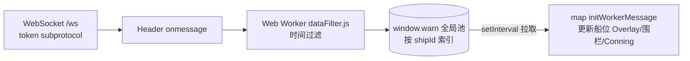
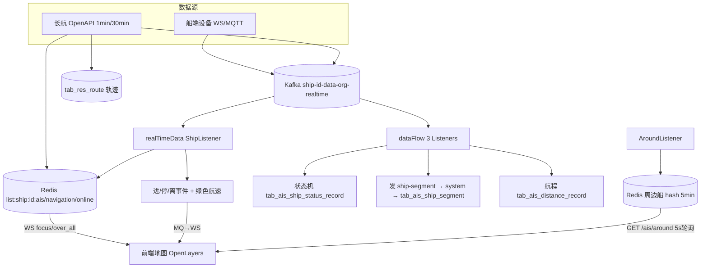

# BWT-VMS 产品功能设计与实现 · 航行监控域(D03)

> 更新日期:2026-09-04(修改本文档后请同步更新此日期,并到 Dify 知识库重新上传该文件)

> 遵循模板。技术细节见后端/前端架构库;本文件聚焦功能设计。

---

## 1. 域概述

| 项 | 内容 |
|---|---|
| 定位 | 在地图上实时监控船舶位置、航迹、航行状态,管理航次/航线/航段/电子围栏,提供绿色航速报警与周边船舶感知 |
| 核心价值 | 实时掌握船位与航行状态,保障安全与合规(绿色航速、ECA) |
| 边界 | 只管"航行相关";机舱工况在 D04;能效指标在 D06;AIS 数据采集在 D15;航速油耗分析在 D06 |
| 实时性 | 地图船位走 WebSocket(秒级),状态判定走 Kafka 实时分析 |
| 数据来源双轨 | 船端设备(WS/MQTT)+ 长航 AIS OpenAPI(1min/30min) |

---

## 2. 功能点清单

```
F03 航行监控
├─ F03-1 地图与实时船位(OpenLayers + WS + Worker)
├─ F03-2 Conning 罗经界面
├─ F03-3 航次管理(/flight/*)
├─ F03-4 航线管理与 RTZ 导入(/route/*)
├─ F03-5 航段管理(/segment/*)
├─ F03-6 电子围栏(CRUD + 状态机 + 进/停/离事件)
├─ F03-7 绿色航速检测
├─ F03-8 周边船舶(/ais/around)
├─ F03-9 航行日报(/daily/*,当前停用)
└─ F03-10 AIS 数据采集与分发(长航 OpenAPI)
```

---

## 3. 逐功能点详述

### F03-1 地图与实时船位

**(1) 功能设计**:OpenLayers 地图实时展示船位(Overlay 标注)、航迹、拟合/历史航线、电子围栏图层、周边船;支持海图模式(EPSG:3395)与默认 Web 墨卡托(3857)切换;跨日期变更线连续显示。

**(2) 前端实现**:`src/containers/map/index.jsx`(岸端,5732 行)/ `map/ShipMonitor/`(船端精简);路由 `/NavigateMonitor` 按权限 `containMap` 在两者间切。

**(3) 实时数据链路**(核心范式):

- 订阅模式:`t:'topic'`(按船+数据类型)/`over_all`(全关注)/`focus`(单船)
- Worker 过滤超时(>3s)数据;`window.warn` 是全局实时池
- 船位 Overlay 按经度做 ±360° 偏移支持环球连续显示

**(4) 已知问题**:DIAG-P0-D-03(WS 不重连)、DIAG-P1-F-01(window.warn 数据流难追踪)。

---

### F03-2 Conning 罗经界面

**(1) 功能设计**:船端驾控台,集中展示航行关键仪表。

**(2) 展示项**:
- 左栏:龙骨下水深 UKC、真/相对风速风向、主机转速 M/E RPM(支持单/双主机)、主机负荷 M/E LOAD(0-100%)
- 右栏:横倾 HQ、纵倾 ZQ(或艏艉吃水差)、舵角 DJ1-DJ4(1-4 个舵)、罗盘标尺

**(3) 主机负荷估算**(无直读时):`(转速/额定转速)³ × 额定功率`(AN-1222 螺旋桨定律),额定参数 paramId 27/28。

**(4) 交互**:开启时禁用 DragPan,每 5 秒 animate 地图中心到本船。

---

### F03-3 航次管理

**(1) 功能设计**:航次 CRUD、编号唯一性校验、航次船员、概要、起止港在港时间/准点率。

**(2) 接口**(`/flight/*`):`POST /flight/number`(创建)、`/update`、`GET /check`、`/detail`、`/list`、`/summary`、`/startPort`、`/endPort`、`POST /sailingAnalysis`。

**(3) 航次状态机**(由 dataFlow 自动判定,见 F03-6):启航 SAILING(0)/锚泊 MOORING(1)/靠泊 BERTHING(5)。

---

### F03-4 航线管理与 RTZ 导入

**(1) 功能设计**:查询拟合航线(按起止港)、历史航线;导入 RTZ(IEC 61174-2 航线交换格式 XML)。

**(2) 拟合航线跳变处理**:相邻经度差 > `fit.route.jump`(默认 200°)断段,返回 `List<List<TabResFitRoute>>`。

**(3) 接口**(`/route/*`):`GET /route/fit`、`/history/summary`、`/history`、`POST /uploadRTZ`(导入前删该船旧 RTZ)。

---

### F03-5 航段管理

**(1) 功能设计**:基于状态变更事件自动生成航段(起止港 ATD/ATA、航段距离),支持手动刷新。

**(2) 触发**:
- 自动:dataFlow 状态变更 → 发 Kafka `ship-segment.production-topic` → system `AisShipSegmentListener` → `generateAisShipSegment(shipId,1)`
- 手动:`GET /segment/refreshSegment` → type=2

**(3) 航程来源**:VoyageController 按 `vms.distance.cycle`(默认 5min)聚合写 `tab_ais_distance_record`。

**(4) 接口**(`/segment/*`):`GET /current`、`/list`、`/history/berthing`、`refreshSegment`。

---

### F03-6 电子围栏(⚠️ 三个同名 Controller)

**(1) 功能设计**:地理围栏(PORT 港口/ANCHORAGE 锚地/THREE_GORGES_DAM 三峡葛洲坝),做 CRUD + 船舶状态机判定 + 进/停/离事件。圆形(有 radius)/多边形(射线法);Haversine 距离;多围栏命中按 grade 取。

**(2) 三个 Controller 分工**(易混淆):

| Controller(模块) | 职责 |
|---|---|
| `report/ElectricFenceController`(system) | 围栏 **CRUD**(add/delete/query/list/getEcaList/image 瓦片代理) |
| `controller/ais/ElectricFenceController`(dataFlow) | **船舶状态机**(窗口平均航速判定启航/锚泊靠泊)→ tab_ais_ship_status_record + 发 ship-segment |
| `controller/ElectricFenceController`(realTimeData) | **进/停/离事件** + **绿色航速** + reload |

**(3) 状态机判定**(dataFlow):每船滑动 Window(N 条),窗口满算平均航速:
- 上次锚泊/靠泊 → 当前航行 且 avgSog > sailingSogThreshold → **启航**
- 上次航行 → 当前锚泊/靠泊 且 avgSog < mooringOrBerthingThreshold → **锚泊/靠泊**(围栏类型 PORT→靠泊,ANCHORAGE→锚泊)
- 仅 PORT/ANCHORAGE/三峡 入库

**(4) 进/停/离事件**(realTimeData):取 Redis 上次状态(剔离开)→ 当前匹配 → 既有又新=STAY、有旧无新=LEAVE、无旧有新=ENTRY → 发 MQ → WS 推前端。

---

### F03-7 绿色航速检测

**(1) 功能设计**:船在围栏内时,若航速 ≥ 该船限速(GreenSpeedConfig)则违规报警。

**(2) 实现**(realTimeData ElectricFenceController):围栏内 `sog ≥ speedLimit` → 工况点 key `1103101` 置 0(违规)+ alarmTotal+1 写 Redis;否则置 1(合规);状态变化写 `tab_res_status`。

---

### F03-8 周边船舶

**(1) 功能设计**:查询本船周围 AIS 船舶,5 分钟过期。

**(2) 链路**:realTimeData `AroundListener` 监听 Kafka around topic → 写 Redis Hash `vms.ship.key-around:{shipId}`(field=mmsi,value=AisAroundBo,expireTime=now+5min)→ 前端 `GET /ais/around` 每 5 秒轮询,过期 field hdel 清理。

**(3) 渲染**:按 status(0航行/1锚泊/5靠泊/404离线)切换图标,rotation=hdg 表船头方向。

---

### F03-9 航行日报(⚠️ 当前停用)

`GET /daily/record` 逻辑已被注释,**返回空列表**;`/daily/info`、`/download`、`/annexDownload` 仍在。功能半停用,产品文档需标注。

---

### F03-10 AIS 数据采集与分发(长航 OpenAPI)

**(1) 功能设计**:定时从长航(招商局 cmft)OpenAPI 拉船位,作为岸端 AIS 数据源(船端设备是另一源)。

**(2) 定时任务**(thirdPartyCall `ChangHangServiceJob`):
- `shipPositionInterface` cron(~1min):`/sp/ships/position/latest` 批量取船位(100 条并行)→ 发 Kafka `ship-{id}-data-org-realtime` + 写 Redis + 批量插 `tab_res_route`(resource=changhang)
- `shipAisStatusInfoInterface` cron `0 0/30 * * * ?`:取 AIS 静态信息 + 位置 → 批量插 `tab_ais_ship_status_record`

**(3) 数据分发**:
- realTimeData `ShipListener`(消费 org-realtime)→ 时效校验 → ShipInfoController(写 Redis 给前端)+ ElectricFenceController(围栏/绿色航速)
- dataFlow 三 Listener(ElectricFence/Voyage/AisAttribute,seekToEnd)→ 状态机/航程/属性变化

**(4) 已知问题**:DIAG-P1-A-04(AIS 三套代码并存:SOAP 注释/Boloomo 弃用/长航主用)、DIAG-P0-S-05(长航凭证硬编码)。

---

## 4. 域级数据流



---

## 5. 数据与配置

**表**:tab_ais_ship_status_record(状态事件)、tab_ais_ship_segment(航段)、tab_ais_distance_record(航程)、tab_res_route(轨迹)、tab_res_fit_route(拟合航线)、tab_ais_electric_fence(+Info/Extend)、tab_record_ais_persist(补齐源)、tab_ais_attribute_record(属性变化)。

**Redis**:list:ship:{id}:ais/navigation/online/utc、vms.ship.key-around:{id}(周边 hash)、list:ship:{id}:electricFence(围栏触发)。

**关键配置**:ship-status.window-size、sog-threshold.sailing/mooringOrBerthing、earth-radius、fit.route.jump、distance.cycle、cmft.open-api.url/key、各 reload-electric-fence-corn。

---

## 6. 风险与改造建议

| 问题 | 诊断 ID | 建议 |
|---|---|---|
| WS 不重连 | DIAG-P0-D-03 | 指数退避重连 + onclose 触发 |
| 三个同名 ElectricFenceController | —(可维护性) | 重命名/合并,加包注释区分职责 |
| 前端 map/index.jsx 5732 行 | —(可维护性) | 按图层/功能拆分组件 |
| 日报停用 | —(功能) | 确认是否废弃,废弃则删接口 |
| AIS 三套代码 | DIAG-P1-A-04 | 删 SOAP/Boloomo 死代码 |
| 长航凭证硬编码 | DIAG-P0-S-05 | 移 Nacos + 轮换 |
| 状态机内存 Window 无持久化 | DIAG-P0-D-02 | 关键状态落 Redis |
