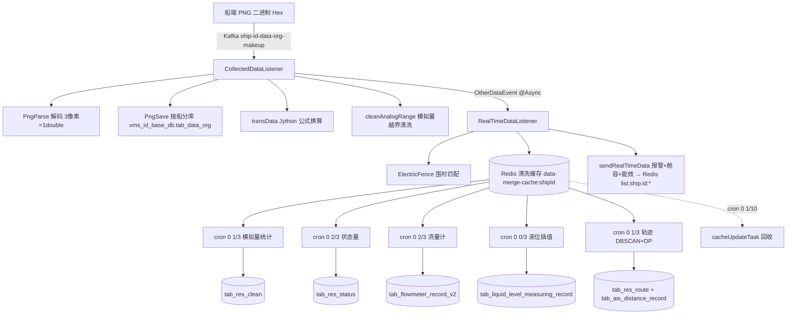

# BWT-VMS 产品功能设计与实现 · 数据采集与清洗链路域(D02)

> 更新日期:2026-09-04(修改本文档后请同步更新此日期,并到 Dify 知识库重新上传该文件)

> 遵循模板。本域是系统的**数据基座**:把船端 PNG 二进制工况解码、清洗、统计,产出实时 Redis 值与历史落库数据,供 D04~D09 各业务域消费。技术细节见后端架构库第 6 节。

---

## 1. 域概述

| 项 | 内容 |
|---|---|
| 定位 | 后台数据处理管道:PNG 解码 → 实时清洗 → 5 分钟统计 → 落库/写 Redis;是所有机舱工况/油耗/液位/航迹数据的唯一生产者 |
| 核心价值 | 把船端异构传感器数据(编码进 PNG)转成结构化、可信、可分析的数据 |
| 边界 | 只做"采集与清洗生产";业务分析在 D04~D09;AIS 分析在 D03;第三方数据在 D15 |
| 最独特设计 | 船端把所有传感器数据**编码进 PNG 图片二进制**(每 3 像素=1 个 IEEE754 double)传输 |
| 三模块分工 | dataCleanV2(PNG 解码+清洗+统计,主线)、dataFlow(AIS 分析)、realTimeData(实时加工写 Redis) |

---

## 2. 功能点清单

```
F02 数据采集与清洗链路
├─ F02-1 PNG 二进制解码(3 像素=1 double)
├─ F02-2 实时数据转换(Jython 公式)
├─ F02-3 模拟量清洗(实时越界 + 5min 统计)
├─ F02-4 状态量变化检测
├─ F02-5 流量计油耗统计(进出口差,3min)
├─ F02-6 液位遥测舱容计算(高度→体积插值,3min)
├─ F02-7 导航轨迹清洗(DBSCAN 去噪 + Douglas-Peucker 抽稀)
├─ F02-8 电子围栏实时匹配(见 D03)
├─ F02-9 多数据源(自研 AOP + ThreadLocal)
├─ F02-10 原始数据按船分库(vms_{shipId}_base_db)
└─ F02-11 事件流(OtherDataEvent + @Async 监听)
```

---

## 3. 逐功能点详述

### F02-1 PNG 二进制解码

**(1) 功能设计**:消费 Kafka `ship-{shipId}-data-org-makeup` 的 PNG 二进制(Hex),反编码为工况数值 Map。是系统所有工况数据的**唯一入口**。

**(2) 解码规则**(`PngParseServiceImpl`):每 **3 个像素(9 字节 RGB)= 1 个 IEEE754 double**;按 `tab_engine_param.order_id` 从图片对应像素位置取值;orderId<0=字符串(底部 ASCII)、=0=UTC long、>0=double。

**(3) 入口监听器**:`CollectedDataListener`(`bwt-vms-dataCleanV2/.../mq/`),容器工厂 MANUAL_IMMEDIATE。

**(4) ⚠️ 已知问题**:DIAG-P0-D-01(`acknowledge()` 在方法首行先提交 offset,处理异常丢数据)。

---

### F02-2 实时数据转换(Jython 公式)

**(1) 功能设计**:对原始工况值按 `tab_engine_param.trans_data` 表达式做换算(如 `x*0.1` 单位转换、`{keyA}*0.5+{keyB}` 派生工况)。

**(2) 实现**(`RealTimeDataServiceImpl.transData`):用 **Jython(PythonInterpreter)** 执行表达式,支持引用其他工况 key。

---

### F02-3 模拟量清洗(实时越界 + 5min 统计)

**(1) 功能设计**:对 device_type="1" 模拟量做实时越界清洗(超 tab_engine_param min/max 置 null)+ 每 5 分钟窗口统计。

**(2) 统计产出**(`AnalogProcessServiceImpl`,`@Scheduled cron="0 1/3 * * * ?"`):min/max/avg/分位数(quant_25/50/75)/cnt/quality_value → `tab_res_clean`。

**(3) 窗口**:`MERGE_TIME_RANGE=300`(5 分钟对齐)。

---

### F02-4 状态量变化检测

**(1) 功能设计**:对 device_type in ("0","2") 状态量/报警量做变化检测。

**(2) 实现**(`StatusProcessServiceImpl`,`@Scheduled cron="0 2/3 * * * ?"`):状态变化落 `tab_res_status`(含绿色航速状态,见 D03 F03-7)。

---

### F02-5 流量计油耗统计(进出口差)

**(1) 功能设计**:每 3 分钟基于流量计读数算各设备油耗(供 D06 能效 + D07 油水)。

**(2) 算法**(`FlowmeterRecordStatisticsServiceImpl`,cron `0 2/3`):
1. 从 tab_statistics_param 读 device_type=41(流量计)+ 40(密度)
2. 按 group_desc(`{设备}_{编号}_{油种}_{IN/OUT}`)解析
3. **消耗 = Σ进口 − Σ出口**;累计式 max−min,瞬时式 avg×时长;体积式 ×密度换算到 kg
4. 油种判定:density ≥ 阈值 → 3 重油,否则 2 轻油

**(3) 产出**:`tab_flowmeter_record_v2`(consume kg)+ Redis `energy:{shipId}:device_consume`。

---

### F02-6 液位遥测舱容计算

**(1) 功能设计**:每 3 分钟把液位高度读数经高度-舱容曲线插值为体积。

**(2) 算法**(`LiquidRecordStatisticsServiceImpl`,cron `0 0/3`):调 Feign `/calCabin/byLiquidLevel` 查 tab_height_cabin 做**分段线性插值**;cube(m³)×1000=liter(L)。

**(3) 产出**:`tab_liquid_level_measuring_record`(height m / cube m³ / liter L)。

---

### F02-7 导航轨迹清洗

**(1) 功能设计**:对 AIS 轨迹做去噪+抽稀,产出可信航迹。算法最复杂。

**(2) 5 步清洗**(`NavigationDataServiceImpl`,cron `0 1/3`):
1. 过滤无经纬度
2. thresholdCheck(经纬度超限清洗)
3. **DBSCAN 密度聚类**(自适应 epsilon,离群点剔除)
4. multiplePointsSogCheck(航速打分,样本缓存 100,得分>0.8 保留)
5. **Douglas-Peucker 轨迹抽稀压缩**

**(3) 产出**:`tab_res_route`(压缩轨迹)+ `tab_ais_distance_record`(逐段距离累加)。

---

### F02-9 多数据源(自研)

**(1) 功能设计**:Spring AOP + ThreadLocal + AbstractRoutingDataSource,按 Mapper 包路径自动切库。

**(2) 机制**:`DataSourceAspect`(@Order(-1))拦截 mapper.db1.*→db1、mapper.db2.*→db2;`MultipleDataSource` 继承 AbstractRoutingDataSource;`DataSourceContextHolder` 用 InheritableThreadLocal。

**(3) 现状**:三模块所有 Mapper 都在 db1 包,db2 预留未用(health 除外)。DIAG-P2-A-06。

---

### F02-10 原始数据按船分库

**(1) 功能设计**:PNG 原始二进制按船独立库存。

**(2) 实现**(`JdbcDataSourceManager`):按 shipId 动态建连,库名 `vms_{shipId}_base_db`,直写 `tab_data_org(utc_time, bin_value longblob)`(不经 MyBatis)。

---

### F02-11 事件流

**(1) 功能设计**:用 Spring ApplicationEvent 解耦"实时处理"与"清洗统计"。

**(2) 事件**:`OtherDataEvent`(shipId/utc/data Map)由 CollectedDataListener 发布 → `RealTimeDataListener`(`@Async("taskExecutor")`)监听 → parseNavigation + ElectricFence + 写 Redis 清洗缓存 + sendRealTimeData。

**(3) 状态**:另有 CollectedDataReceivedEvent、NavigationDataEvent 无人发布(预留);CleanDataListener 整类注释(并入 RealTimeDataListener)。

---

## 4. 域级端到端数据流



---

## 5. 与其他域的依赖

| 方向 | 域 | 说明 |
|---|---|---|
| 被依赖 | D03 航行监控 | tab_res_route/tab_ais_distance_record + Redis 实时船位 |
| 被依赖 | D04 机舱监控 | Redis list:ship:id:other 实时工况 |
| 被依赖 | D06 能效 | tab_res_clean/tab_flowmeter_record + energy:* Redis |
| 被依赖 | D07 油水 | tab_flowmeter_record_v2/tab_liquid_level_measuring_record |
| 依赖 | D16 系统配置 | tab_engine_param/tab_statistics_param/tab_tank_device/tab_height_cabin |

---

## 6. 风险与改造建议

| 问题 | 诊断 ID | 建议 |
|---|---|---|
| 先提交 offset 后处理,异常丢数据 | DIAG-P0-D-01 | 改至少一次 + 死信队列 |
| 补齐链路禁用 + 内存状态无持久化 | DIAG-P0-D-02 | 状态落 Redis,重做补齐 |
| 双链路并存覆盖 | DIAG-P1-A-01 | 明确 dataCleanV2 主线,下线 realTimeData 重复部分 |
| tab_res_clean 分区手动 | DIAG-P1-DB-01 | 自动 ADD PARTITION |
| Jython 公式引擎性能/安全 | —(评估) | 评估改用表达式引擎(aviator/spel)+ 预编译 |
| 事件预留未实现 | —(清理) | 删 CollectedDataReceivedEvent/NavigationDataEvent 死代码 |
