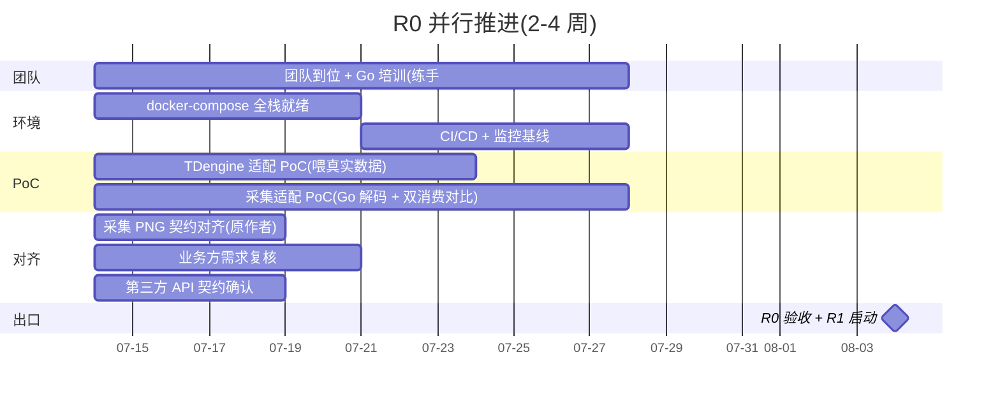

# BWT-VMS 新系统重构 · R0 筹备清单与启动计划

> 本文件用于 R0(立项与准备期)的资源筹备与启动管控。可发团队、跟上头申请人员/资源直接用。
>
> 前置决策(已拍板):① 全面重构,新系统并行重建;② 后端 **Go**;③ 部署 **docker-compose**(不上 K8s);④ 采集程序不重构(兼容 PNG 输出);⑤ 可视化配置中心(图元拖拽组态);⑥ 技术栈全面换代;⑦ **迁移暂时推后**,R0/R1 并行推进其余工作。
>
> 配套文档:架构 v2、配置中心详细设计、核心编辑器详细设计、图元组态 PoC 方案、20 份现状文档。

---

## 1. 背景与目标

**R0 目标(2-4 周)**:把"纸面设计"变成"可以开干"——团队就位、环境就绪、最高风险点(TDengine 适配 / 采集适配)通过 PoC 验证、需求与契约对齐,为 R1(数据平台与核心域)扫清障碍。

**就绪标准(R0 出口)**:
- 团队到位 + Go 培训完成
- docker-compose 全栈环境本地/测试服可跑
- TDengine 适配 PoC 通过(工况/航迹写入查询性能达标)
- 采集适配 PoC 通过(Go 解码 PNG 与旧系统结果一致)
- 业务方需求复核完成、采集原作者 PNG 契约对齐、第三方 API 契约确认

---

## 2. 已就绪(设计底气)

| 类别 | 内容 |
|---|---|
| 现状文档 | 后端/前端架构库 + 16 域功能设计 + 问题诊断清单(20 份) |
| 新系统设计 | 架构 v2 + 配置中心详细设计 + 核心编辑器详设 + 图元组态 PoC 方案 |
| PoC 脚手架 | 图元组态编辑器(react-konva)可运行,验证可视化方案可行 |
| 关键决策 | 见文首 7 条 |

设计层面无需再补,R0 是把设计落地到"人/环境/PoC"。

---

## 3. 筹备清单(六类)

### 3.1 团队(人)

| 角色 | 人数 | 技能要求 | 职责 |
|---|---|---|---|
| 架构师 / 数据平台 | 1 | Go + 微服务 + 流处理,懂 TDengine 更佳 | 整体架构 + R1 数据平台开发 |
| 后端 Go | 2-3 | Go(Java 背景 OK,留 1-2 周上手) | 1 人采集适配/实时流;1-2 人业务域 |
| 前端 | 1-2 | React 18 + TS,Canvas/组态经验优先 | 配置中心编辑器(图元/曲线/树)+ 业务页 |
| SRE / DBA | 1 | Docker Compose + TDengine + PG | 起 docker-compose 全栈;迁移推后但起库要 |
| 测试 | 1 | 接口/契约/性能 | 初期可由开发兼,R3 前补齐 |

**合计 6-8 人**。Go 培训见第 5 节。

### 3.2 服务器与环境

| 项 | 规格 | 用途 | 优先级 |
|---|---|---|---|
| 开发机 | 每人 1 台,跑 Docker + Go 1.22 + Node 18 | 日常开发 | 高 |
| 岸端测试服 | 1-2 台,**8C 16G 起** | docker-compose 全栈(TDengine+PG+Redis+MinIO+NATS+业务) | 高 |
| 船端测试服 | 1 台,**4C 8G 起** | 模拟船端(采集适配+本地库+同步) | 中(R1 末需要) |
| 内网/VPN | 能访问 *.hbluewhale.com | 前期读旧 Nacos/Kafka/DB 参考 | 高 |

### 3.3 账号与权限

| 项 | 权限 | 用途 |
|---|---|---|
| Git 仓库 | 新建后端 Go + 前端 React 仓库(或合并 monorepo),团队读写 + GitLab CI | 代码库 |
| 旧系统 | 旧 MySQL/PG 读 + Nacos 读 + Kafka 消费 | 读样本数据/旧配置/双消费对比 |
| 新中间件 | TDengine / PostgreSQL / Redis / MinIO / NATS 实例(测试服 docker 起) | 新系统底座 |
| 第三方 API | 长航 OpenAPI(cmft)、海康 artemis、通义千问 的 key/配额 | 第三方采集/AI 诊断 |

### 3.4 数据与样本(PoC 必须,最易卡的一步)

**选一艘数据完整的船**,导出:
- `tab_engine_param`(工况点配置)
- `tab_res_clean`(清洗结果,近 1 月样本)
- `tab_res_route`(航迹)
- `tab_oil_water` / `tab_flowmeter_record_v2`(油水)
- `tab_ship_info_extend`(额定参数)
- `tab_statistics_param` / `tab_tank_device` / `tab_height_cabin`(配置类)

**采集 PNG 样本**:几条真实 Kafka 消息(`ship-{id}-data-org-makeup` 的 PNG 二进制 + 对应期望解码值),采集适配 PoC 拿来验证解码一致性。**必须找采集原作者要**。

**现有 SVG / engine_config**:存一份(后续配置中心迁移用,先备着)。

### 3.5 外部对接(三个关键人)

1. **采集原作者**(最高优先):对齐 PNG 契约(格式 / order_id 映射 / 异常处理 / 版本兼容)——采集适配 PoC 的前置
2. **业务方/产品**:复核 16 域功能设计是否全覆盖、有无遗漏/新需求
3. **第三方接口负责**:长航/海康/通义 契约 + key 配额

### 3.6 工具软件

Go 1.22+ / Node 18+ / Docker + Docker Compose / IDE(GoLand 或 VSCode)/ TDengine(docker 起)/ GitLab CI(确认现有可用)。

---

## 4. R0 同步推进路线(并行)

迁移推后,其余五条线并行,互不阻塞:

**最先该动的两个外部动作**(不推进则两个 PoC 跑不起来):
1. 找采集原作者聊 PNG 契约
2. 导一艘船的真实数据样本

---

## 5. 团队分工与 Go 培训

### 5.1 Go 培训(若团队 Java 为主)
- **第 1 周**:Go 基础(语法/goroutine/channel/接口/错误处理)+ 项目结构搭建;推荐用 [A Tour of Go] + [Effective Go],配合内部串讲
- **第 2 周**:练手项目——**直接拿"采集适配 PoC"当实战**(解码 PNG + 写时序库),边学边产出真东西
- 考核:能独立完成一个采集适配模块 + 单测

### 5.2 R0 期间分工建议
| 人 | R0 任务 |
|---|---|
| 架构师 | 整体架构把关 + TDengine 适配 PoC 主力 + Go 培训串讲 |
| 后端 A | 采集适配 PoC(兼 Go 练手)+ 采集契约对齐 |
| 后端 B | docker-compose 环境 + 数据接入骨架 |
| 前端 | 图元组态编辑器 PoC 验收 + 通用编辑器组件(曲线/树/公式)起步 |
| SRE/DBA | 测试服 + docker-compose 全栈 + TDengine/PG 部署 + CI/CD |
| 测试 | PoC 验证脚本(双消费对比/数据一致性校验) |

---

## 6. PoC 验收标准

### 6.1 TDengine 适配 PoC
- 一艘船的工况/航迹数据导入 TDengine(替代 MySQL tab_res_clean/tab_res_route)
- 超表 + 子表设计合理(按船/工况点建表)
- 查询性能:某船某工况点近 1 月趋势 < 200ms;降采样查询(1 分钟/1 小时)< 500ms
- 数据压缩比对比 MySQL 显著优势
- 通过 → R1 数据平台用 TDengine 定稿;不通过 → 评估 InfluxDB 或保留 MySQL+优化

### 6.2 采集适配 PoC
- Go 实现的 PNG 解码(移植自旧 PngParseServiceImpl)输出与旧系统一致(同输入对比 device_key→value)
- 消费 Kafka `ship-{id}-data-org-makeup`,与旧系统**双消费并行**,结果 diff = 0
- 解码后链路"至少一次 + 死信队列"验证(模拟异常不丢数据)
- 采集程序**零改动**(新系统只消费)
- 通过 → 采集兼容方案定稿;不通过 → 与原作者再对齐契约或调整解码逻辑

---

## 7. 风险与对策

| 风险 | 概率 | 影响 | 对策 |
|---|---|---|---|
| Go 学习曲线拖慢 | 高 | 中 | R0 两周培训 + 练手 PoC;岸端业务初期可考虑混合(见下) |
| 数据样本拿不到 | 中 | 高 | 尽早找 DBA + 业务方;采集样本找原作者 |
| 采集 PNG 契约理解偏差 | 中 | 高 | R0 头一周与原作者面对面对齐;双消费对比兜底 |
| TDengine 不满足需求 | 低 | 高 | PoC 早验证;InfluxDB 备选 |
| 业务需求有遗漏 | 中 | 中 | R0 业务方复核;20 份文档兜底 |
| 团队招不齐 | 中 | 高 | 关键岗(架构师/前端组态)优先,其余可分阶段到位 |

**Go 学习曲线的妥协方案**(若团队 Java 为主且招 Go 难):船端边缘服务(Go,资源敏感必须用 Go)+ 岸端业务服务先 Java 21(Spring Boot 3,团队熟悉)过渡,后续视情况统一切 Go。R0 拍板时定。

---

## 8. R0 启动检查清单(go/no-go)

进 R1 前逐项确认:

- [ ] 团队 6-8 人到位,关键岗(架构师/前端组态/SRE)就位
- [ ] Go 培训完成(每人能独立写模块 + 单测)
- [ ] docker-compose 全栈本地/测试服可跑(TDengine+PG+Redis+MinIO+NATS)
- [ ] GitLab CI 接入,自动构建跑通
- [ ] TDengine 适配 PoC 通过(性能达标)
- [ ] 采集适配 PoC 通过(双消费 diff=0)
- [ ] 采集原作者 PNG 契约对齐(有文档)
- [ ] 业务方需求复核完成(16 域 + 新需求清单)
- [ ] 第三方 API 契约 + key 配额确认
- [ ] 一艘船的真实数据样本已导出可用
- [ ] 监控基线(Prometheus/Grafana)能采指标

全部 ✅ → 进 R1(数据平台 + 配置中心 + 核心域);部分未过 → 针对性补,不阻塞已过项的推进。

---

## 附:里程碑

| 里程碑 | 时间 | 标志 |
|---|---|---|
| M0 R0 启动 | 第 0 周 | 团队到位、环境开搭、PoC 启动 |
| M1 R0 完成 | 第 4 周 | 上述检查清单全绿,进 R1 |
| M2 数据平台 + 配置中心基座 | 第 8 周 | 采集适配上线、实时平台、配置中心通用能力 |
| M3 核心域 | 第 12 周 | IAM/航行/能效/油水 + 配置中心编辑器 |
| ... | ... | (见《新系统架构与重建方案》执行计划) |

> 本清单随 R0 推进迭代更新,每项完成打勾,作为 R1 启动依据。
