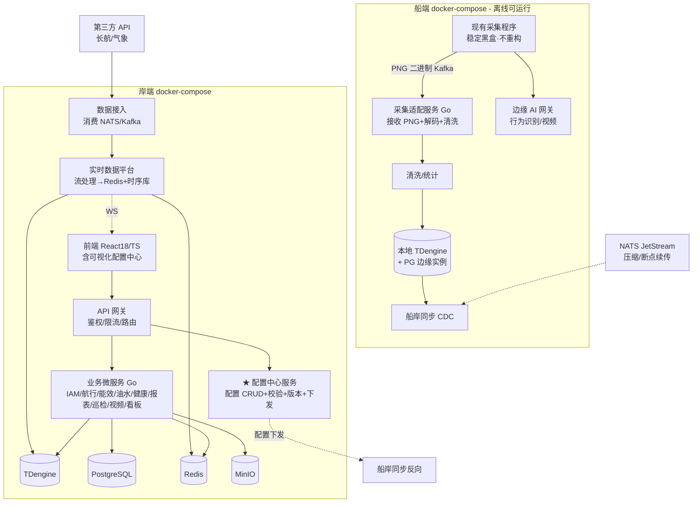

# BWT-VMS 新系统架构设计与全面重建方案(v2)

> 本文件是全面重构的顶层设计:新建一套系统与旧系统并行,数据迁移后灰度切换,旧系统退役。技术栈全面换代。
>
> **v2 修订(基于团队约束)**:① 采集程序不重构(公司大佬开发的稳定黑盒),新系统**兼容 PNG 输出**;② 部署用 **docker-compose**(不上 K8s/K3s);③ **可视化配置中心**作为核心交付,机舱/健康/航行/能效等配置全部图形化,告别手改 SQL。
>
> 基于已交付的 20 份文档(16 域功能设计 + 诊断清单 + 架构库)。专项小组 5-8 人 + 可灰度,周期 12-18 个月。

---

## 目录

1. [愿景与目标](#1-愿景与目标)
2. [设计原则](#2-设计原则)
3. [技术栈选型](#3-技术栈选型)
4. [领域重划(DDD)](#4-领域重划ddd)
5. [系统架构](#5-系统架构)
6. [采集兼容方案(关键)](#6-采集兼容方案关键)
7. [数据架构](#7-数据架构)
8. [可视化配置中心(核心交付)](#8-可视化配置中心核心交付)
9. [前端架构](#9-前端架构)
10. [部署架构(docker-compose)](#10-部署架构docker-compose)
11. [安全 / 可观测](#11-安全--可观测)
12. [数据迁移与并行切换](#12-数据迁移与并行切换)
13. [执行计划](#13-执行计划)
14. [团队 / 风险 / 取舍](#14-团队--风险--取舍)

---

## 1. 愿景与目标

**新系统愿景**:领域清晰、实时高效、配置可视化、类型安全、可观测的现代船舶管理平台。**不动采集程序**,在其输出之上重建处理与分析层。

**量化目标**:能效报表 P95 < 1s;工况采集零丢失(在 PNG 解码之后链路);前端实时数据流单一可追踪;核心测试覆盖 > 70%;配置全图形化(0 手改 SQL);配置缺失显式报错。

---

## 2. 设计原则

1. **领域驱动(DDD)**:按业务领域划分服务边界,消除 dataClean/dataFlow/realTimeData 三模块重叠。
2. **采集兼容**:现有采集程序(PNG 输出)是稳定黑盒,新系统提供适配层接收解码,不改造它。
3. **边缘-云协同**:船端 docker-compose 独立可运行(离线)+ 双向同步;岸端集中分析。
4. **时序与关系分离**:工况/航迹进时序库,业务实体进关系库,文件进对象存储。
5. **配置即数据 + 可视化**:所有配置图形化编辑、版本化、校验,告别手改 SQL。
6. **实时通道单一**:WS → 状态管理 → 响应式组件,废弃 window.warn。
7. **类型安全端到端**:TypeScript + Protobuf/OpenAPI 契约。
8. **简单部署**:docker-compose(岸/船各一套),不引入 K8s 编排复杂度。

---

## 3. 技术栈选型

| 层 | 选型 | 替代现状 | 理由 |
|---|---|---|---|
| 后端语言/框架 | **Go**(gin/echo + ent/gorm) | Java 8 + Spring Boot 2.1 | 资源低、单二进制、并发适合数据流。**备选**:岸端业务层 Java 21 + Spring Boot 3 |
| 时序数据库 | **TDengine** | MySQL 存工况 | 时序查询数量级提升 + 降采样 + 压缩 |
| 关系数据库 | **PostgreSQL 16** | MySQL | 业务实体,更强 SQL |
| 缓存 | **Redis 7** | Redis | 实时值/会话 |
| 消息 | **NATS JetStream**(船端轻量)+ **Kafka**(岸端,保留兼容) | Kafka | NATS 单二进制船端友好 |
| 对象存储 | **MinIO** | DB blob/本地磁盘 | 图片/SVG/导出/附件 |
| 注册/配置 | 岸端轻量注册或直连;船端**本地配置 + Git** | Nacos | 减少依赖 |
| 数据契约 | **Protobuf + OpenAPI** | 无 | 端到端强类型 |
| 前端 | **React 18 + TypeScript + Vite** | React 17 + JS + Webpack 3 | 类型安全,构建快 |
| 前端 UI/状态 | **antd 5 / Arco + Zustand + React Query** | antd 3 + MobX | 现代 UI + 可预测状态 |
| 地图/图表 | OpenLayers 8 + ECharts 5 | 同 | 成熟 |
| **部署** | **docker-compose**(岸端 + 船端各一套) | 裸机 | **团队约束:不上 K8s**,compose 简单可控 |
| CI/CD | **GitLab CI** | 无 | 自动构建 + 镜像 |
| 可观测 | **Prometheus + Grafana + OpenTelemetry + Loki**(均 compose 部署) | 无 | 指标/日志/链路 |

**Go vs Java 21**:全 Go 求一致;岸端业务保 Java 21 兼顾团队。船端边缘服务(Go,资源敏感)。最终团队决策。

---

## 4. 领域重划(DDD)

| 新领域 | 职责 | 对应旧域 |
|---|---|---|
| **IAM 身份与访问** | 登录/权限/用户/角色/船员/组织 | D01 |
| **船舶与组织** | 船舶/公司/船队/船舶参数 | D03/D16 |
| **采集适配(Edge)** | **接收采集程序 PNG + 解码 + 清洗**(不改造采集程序) | D02 |
| **实时数据平台** | 实时流处理 + WS 推送 + Redis 实时值 | D02/D03 |
| **航行与 AIS** | 航次/航线/航段/围栏/AIS | D03 |
| **能效与分析** | SFOC/能耗/CII/EEXI 计算 + 报表 | D06/D13 |
| **油水与物资** | 填报/存量/消耗/液位/舱容 | D07 |
| **机舱可视化** | SVG mimic + 工况绑定 + 报警展示 | D04 |
| **健康与诊断** | 健康分 + AI 缺陷诊断 | D05 |
| **报表与合规** | 综合查询/导出/动态报/MRV | D08 |
| **视频与 AI** | CCTV/行为识别/信息发布 | D10/D11 |
| **巡检** | 巡视点位/状态机/告警 | D12 |
| **看板与大屏** | 船队/单船看板 | D09 |
| **集成与同步** | 船岸 CDC + 第三方采集 | D14/D15 |
| **★ 配置中心** | **全配置可视化编辑/版本/校验/下发**(第 8 节专述) | D16 |

---

## 5. 系统架构



---

## 6. 采集兼容方案(关键)

**约束**:现有采集程序(公司大佬开发)是稳定黑盒,继续按原方式产出 PNG 二进制发 Kafka。新系统**不改造它**,只做兼容接收。

**采集适配服务(Edge Adapter)职责**:
1. **接收**:订阅采集程序现有的 Kafka topic(`ship-{id}-data-org-makeup`,PNG Hex 二进制),协议与格式完全兼容,采集程序无感。
2. **解码**:沿用现有"3 像素 = 1 IEEE754 double,按 order_id 取值"的 PNG 解码逻辑(从 dataCleanV2 PngParseServiceImpl 移植到 Go),输出工况值 Map。
3. **清洗**:解码后走新的清洗流程(模拟量范围/状态量/流量计/液位/航迹 DBSCAN-Douglas-Peucker),写本地时序库。
4. **不丢失**:解码之后的链路改"至少一次 + 死信队列"(解决旧 dataCleanV2 先提交 offset 后处理的丢数据问题 DIAG-P0-D-01)。**采集程序本身的可靠性由原作者保障,新系统在其输出之后兜底**。

**与采集程序的契约边界**:
- 输入契约:Kafka topic + PNG 格式(保持现状)
- 新系统只消费,不反向控制采集程序
- 如未来采集程序要升级(由原作者),通过 Kafka 契约解耦,新系统适配即可

**收益**:保留了稳定组件,新系统专注处理与分析层,责任清晰,风险可控。

---

## 7. 数据架构

| 数据类型 | 存储 | 内容 | 保留 |
|---|---|---|---|
| 时序数据 | TDengine | 工况/清洗结果/航迹/油耗/功率/排温/液位 | 原始 7 天,降采样 1min/1h 永久 |
| 业务实体 | PostgreSQL | 船舶/用户/航次/油水/围栏/**所有配置** | 永久 + 版本 |
| 实时值 | Redis | 当前工况/AIS/在线/能效实时/会话 | TTL/滑动 |
| 文件 | MinIO | SVG mimic/附件/行为识别图片/导出 | 按类型 |

**采集兼容说明**:旧 `tab_data_org`(PNG 原始二进制按船分库)在过渡期保留(采集程序仍写),新系统解码后进 TDengine;旧系统退役后 `tab_data_org` 可归档。**PNG 作为采集程序输出保留**,不再视其为"怪异设计"——它是稳定输入。

---

## 8. 可视化配置中心(核心交付)

**目标**:把当前所有"必须手改 SQL"的配置,全部做成**按船 + 按域的图形化编辑器**,带版本/校验/下发/导入导出。这是 D16 痛点的根治。

### 8.1 配置中心总览

| 项 | 设计 |
|---|---|
| 入口 | 前端"配置中心"一级菜单,按船切换,按域分 Tab(机舱/健康/航行/能效/油水/视频/巡检/船舶) |
| 编辑模式 | 每类配置一个**可视化编辑器**(表格/树/图形/曲线/地图) |
| 保存即版本 | 每次保存生成版本快照,可回滚、可 diff 对比 |
| 校验 | 保存时完整性 + 一致性校验,缺失/冲突显式报错(不静默) |
| 下发 | 岸端配置 → 通过同步链路下发到船端;船端配置变更回传 |
| 权限 | 配置操作独立权限 + 操作审计 |
| 导入导出 | 模板化(新船基于模板),Excel/JSON 导入导出 |

### 8.2 各域可视化配置器

**① 工况点配置(基础,所有域依赖)**
- 表格化编辑:device_key/device_name(中英)/type(传感/模拟/报警)/unit/min-max 量程/low-low/high-high 报警档/order_id
- **公式可视化编辑器**:trans_data 用表达式编辑器(变量拖入 + 运算符 + 预览),替代手写 `x*0.1`
- 报警映射:dds_value→consistency_value 表格编辑(0=正常的规则提示)

**② 机舱工况可视化(D04 痛点)— 图元拖拽组态**
- **预制图元拖拽组态**(react-konva):开源工业图标包起步 + 实施上传客户底图,拖拽组合绑工况点
- 图元库可扩充(公司所有船复用);报警变色/动画;实时预览
- 按船 + 菜单 + 语言管理;**实施/配置人员自助,无需 UI 工程师**
- **替代**当前"手写 SVG + 前端 engine_config JS",改图不再回流开发

**③ 健康部件树(D05)**
- **树形拖拽编辑器**:部件结构树(parent/leaf),拖拽组织层级
- 叶子节点:绑定工况点 + 计算模型(线性/非线性)参数编辑(normal/max/min → 分值)
- 非叶子:汇总方式(MAX/MIN/AVG/WEIGHT/RADAR)选择 + 权重
- 运行条件公式:可视化条件编辑器(`{deviceKey}>0 && {key2}<100`)
- **AI 辅助**:保留通义千问一键生成结构树/建议,人工在编辑器里调整确认

**④ 能效配置(D06)**
- 能效设备表(主机/发电机/锅炉)编辑 + 工况点绑定(信号路由 device_type)
- **SFOC 参数曲线编辑器**:a/b/c 二次多项式,图表化拖点编辑理论曲线
- 船舶额定参数(paramId):表单 + 枚举化(27 额定功率/28 额定转速/104 SFOC POPT 等)

**⑤ 油舱与舱容(D07)**
- 舱位树(主舱 menu + 子舱 device)编辑
- **高度-舱容曲线编辑器**:图表化拖点画曲线(height↔cabin),替代手填 tab_height_cabin 行
- 油种编码下拉(字典驱动)

**⑥ 航行围栏与航段(D03)**
- **围栏地图编辑器**:地图画多边形/圆形,设类型(港口/锚地/三峡)与 grade
- 绿色航速限速配置
- 航段/航次参数

**⑦ 报警规则 / 巡检 / 视频 / 行为识别**
- 报警阈值与归一化映射
- 巡视点位/顺序/超时阈值(D12)
- 摄像头树/区域(对接 CCTV)
- 行为识别违规类型字典 + 推送开关

### 8.3 配置校验引擎(告别静默失败)

保存时自动跑校验规则,报错示例:
- "机舱 mimic 绑定了工况点 `me_fuel_flow_in_1`,但该工况点未配置(trans_data 缺失)"
- "油舱 1001 的舱容曲线只有 2 个点,至少需要 5 个"
- "健康部件 `主机` 的叶子节点未绑定任何工况点"
- "能效 SFOC 参数未配,主机负荷分析将无法计算理论曲线"
- "tab_statistics_param 的 group_desc `mainframe_1_2_IN` 格式正确,但油种 2 未在字典"

校验规则可扩展,新增性规则加配置即可。

### 8.4 配置版本与回滚
- 每次保存生成 `(shipId, domain, version, snapshot, operator, time)`
- 任意版本可回滚;任意两版本可 diff
- 审计:谁在何时改了什么

### 8.5 配置模板与复用
- 同型船可导出模板,新船一键应用后微调
- 跨船对比(同型船配置差异)

**这个配置中心是新系统对使用者最大的体验提升**,也是降低接手/运维难度的关键。

---

## 9. 前端架构

| 维度 | 新方案 | 替代 |
|---|---|---|
| 框架 | React 18 + TypeScript + Vite | React 17 + JS + Webpack 3 |
| 状态 | Zustand + React Query | MobX + window.warn |
| UI | antd 5 / Arco | antd 3 |
| 实时通道 | WS 客户端 → Zustand → 响应式组件 | window.WS + Worker + warn + setInterval |
| 契约 | OpenAPI 生成 TS 类型 | 手写 |
| 模块化 | pnpm monorepo(按领域) | 单仓散落 |
| **配置中心** | **专用 SPA 区域,集成各配置编辑器** | ConfigurationManagement 单页 |

**实时通道重设计**(根治 window.warn):单连接 WS 管理器(自动重连/心跳)→ topic 分发到 Zustand store → 组件 selector 订阅响应式。废弃全局变量与 setInterval 拉取。

**机舱可视化(图元拖拽组态)**:react-konva 组态编辑器(预制图元库 + 实施上传底图 + 拖拽绑工况点,实施自助、无需 UI 工程师);运行时只读渲染 + store 订阅工况值响应式刷新,废弃 DOMParser 操 DOM 与手画 SVG。

---

## 10. 部署架构(docker-compose)

**不上 K8s/K3s,岸端与船端各一套 docker-compose**。

### 10.1 岸端 compose
```
services:
  gateway        # API 网关(鉴权/限流/路由)
  iam ship org   # 业务服务(IAM/船舶/组织)
  sailing energy oilwater health report patrol video dashboard
  config-center  # ★ 配置中心服务
  realtime-platform  # 实时数据平台(流处理 + WS)
  ingest         # 数据接入(消费 NATS/Kafka + 第三方)
  sync-shore     # 船岸同步(岸端侧)
  postgres tdengine redis minio
  prometheus grafana loki tempo  # 可观测(可选,轻量)
  nginx          # 前端静态 + 反代
```

### 10.2 船端 compose
```
services:
  edge-adapter    # ★ 采集适配(接收 PNG 解码清洗)
  edge-ai         # 边缘 AI(行为识别/视频)
  sync-ship       # 船岸同步(船端侧,CDC)
  tdengine-local  # 本地时序库
  postgres-local  # 本地业务(可选)
  redis-local
  nginx           # 船端前端(离线可用)
```

### 10.3 运维
- `docker-compose up -d` 一键起;`.env` 管理环境变量
- 升级:`docker-compose pull && up -d`(滚动,船端逐船)
- 备份:PG/TDengine 定时备份脚本
- 监控:Prometheus(可选 compose 起)或轻量 node-exporter + 告警

**优势**:团队熟悉、运维简单、资源占用低、离线可跑;不引入 K8s 学习与运维成本。

---

## 11. 安全 / 可观测

**安全**:JWT(RS256 非对称)+ refresh;网关统一鉴权 + 业务细粒度 RBAC + 接口鉴权扫描门禁;全链路 HTTPS/WSS + 船岸 mTLS;凭证 Vault/Nacos 加密 + 轮换;船岸同步结构化事件 + 参数化 + 白名单;下载签名 URL。解决 DIAG-P0-S-01/02/04/05。

**可观测**(均 compose 部署):Prometheus 指标 + Loki 日志 + OpenTelemetry/Tempo 链路 + Grafana 大盘 + 告警(数据丢失/双写差异/服务异常)。

---

## 12. 数据迁移与并行切换

### 12.1 双系统并行期
旧系统(Java + MySQL)正常跑;新系统(Go + PG + TDengine)并行构建。采集程序输出**同时供新旧消费**(新旧都订阅 PNG topic,互不影响)。

### 12.2 迁移步骤
1. **存量迁移**:旧 MySQL → 新 PG(业务实体 + 配置,字段映射);旧 tab_res_clean/tab_data_org → TDengine(按船分批)。试点一艘船验证。
2. **增量同步**:旧库 binlog CDC → 转换 → 新库;采集 PNG 双消费。
3. **配置迁移**:旧配置导入配置中心,人工用可视化编辑器核对补全(校验引擎提示缺失)。
4. **读切换**:前端读切新系统(灰度按船/功能)。
5. **写切换**:写切新系统,旧转只读。
6. **采集程序保持**:新旧系统都消费 PNG 直到旧系统退役;旧退役后采集程序不变(新系统独享)。
7. **旧系统退役**:观察 ≥1 月后下线旧服务,旧库冷备。

### 12.3 灰度
影子模式 → 按船 → 按比例 → 全量;feature flag 秒级回退;双写对比 Job 差异报警。

---

## 13. 执行计划(12-18 个月)

| 阶段 | 周期 | 目标 | 产出 |
|---|---|---|---|
| **R0 架构与立项** | 1-2 月 | 定稿 + 选型 + 团队培训(Go/TS)+ PoC | 架构文档 + 数据平台 PoC + 配置中心原型 |
| **R1 基础设施与数据平台** | 2-3 月 | compose 集群 + TDengine/PG/Redis/MinIO + 采集适配(兼容 PNG)+ 实时平台 + 可观测 | 数据贯通(采集→解码→清洗→时序库→前端) |
| **R2 配置中心 + 核心域** | 3-4 月 | ★ 配置中心(工况点/机舱/油舱/能效,含校验引擎)+ IAM + 船舶 + 航行 + 能效 + 油水 | 配置可视化可用,核心域可演示 |
| **R3 扩展域** | 2-3 月 | 机舱可视化 + 健康 + 报表合规 + 视频 AI + 巡检 + 看板 | 全域对齐旧系统 |
| **R4 集成与同步** | 1-2 月 | 船岸 CDC(新)+ 第三方采集 + 配置下发船端 | 船岸协同 |
| **R5 迁移与灰度切换** | 2-3 月 | 存量+增量迁移 + 配置迁移核对 + 读/写切换 + 旧退役 | 新系统全量 |
| **持续** | 持续 | 可观测优化 + 配置中心增强 + 文档 | — |

**里程碑**:M0 架构定稿(2 月)→ M1 数据平台 + 采集适配就绪(5 月)→ M2 配置中心 + 核心域(9 月)→ M3 全域对齐(12 月)→ M4 全量切换(16 月)→ M5 旧退役(18 月)。

**配置中心前置**:R2 优先做配置中心(工况点/机舱/油舱/能效),因为后续域依赖配置,且这是最大体验提升点。

---

## 14. 团队 / 风险 / 取舍

### 14.1 团队(5-8 人)
架构师 1 / 后端 2-3(Go:边缘适配/实时/业务域/配置中心)/ 前端 1-2(React18/TS + 配置中心编辑器是大头)/ SRE-DBA 1(compose/数据库/迁移)/ 测试 1。

### 14.2 风险

| 风险 | 概率 | 影响 | 对策 |
|---|---|---|---|
| Go/TS 学习曲线 | 高 | 高 | R0 培训 + PoC;岸端业务保 Java 21 作降风险妥协 |
| 双系统并行维护 | 高 | 中 | 旧系统冷冻新需求;并行期 ≤6 月 |
| 数据迁移丢失 | 中 | 高 | 分批 + CDC + 多重校验(行数/校验和/抽样) |
| 采集程序 PNG 契约理解偏差 | 中 | 高 | 与采集原作者对齐 PNG 格式;适配层严格按原解码逻辑;双消费对比 |
| 配置中心工程量大 | 高 | 中 | 分域渐进(R2 先核心域);编辑器组件复用 |
| 周期超预期 | 高 | 中 | 阶段交付,核心域优先,扩展域可延后 |
| docker-compose 运维(无编排) | 中 | 中 | 备份/监控脚本化;单机或双机热备 |

### 14.3 取舍

- **采集程序不动**:兼容 PNG,新系统适配。**不追求"理想化"的 Protobuf 重构**,尊重稳定组件。
- **docker-compose 不上 K8s**:牺牲自动编排/自愈,换运维简单。适合团队规模。
- **Go vs Java**:全 Go 求一致,岸端保 Java 21 是降风险。
- **配置中心渐进**:R2 先核心域(工况点/机舱/油舱/能效),其他域配置在对应 R3 域交付时补齐编辑器。

### 14.4 不做
- 不重构采集程序
- 不上 K8s/服务网格
- 不在重构期承接新业务(走旧系统或冻结)
- 不删旧系统直到新系统稳定 ≥1 月

---

## 下一步

1. **R0 立即启动**:架构定稿 + Go/TS PoC + 与采集原作者对齐 PNG 契约 + 配置中心原型
2. **配置中心详细设计**:把第 8 节展开成《配置中心详细设计》(每个编辑器的交互/数据模型/校验规则/API)
3. **采集适配详细设计**:PNG 解码移植 + 双消费对比方案
4. **迁移详细方案**:旧 MySQL→PG/TDengine 映射 + 配置导入核对流程

> 本方案基于当前代码与团队约束(采集不动/部署 compose/配置可视化)。R0 与业务方 + 采集原作者深度对齐后迭代。
