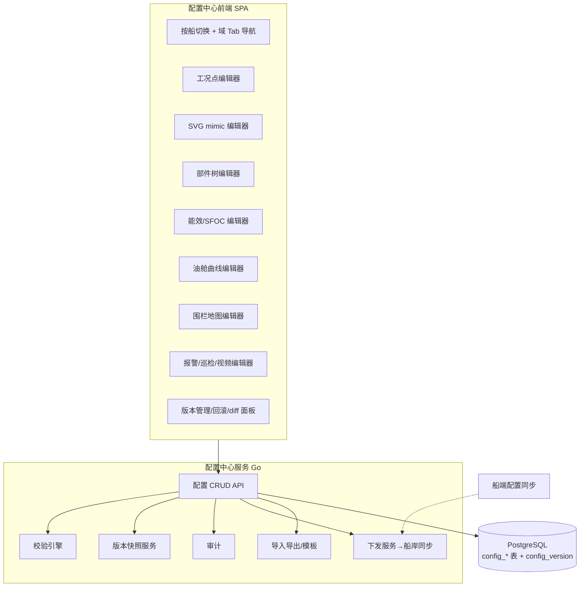
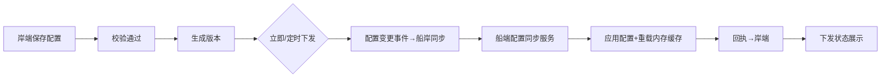

# BWT-VMS 配置中心详细设计

> 本文件把《新系统架构与重建方案 v2》第 8 节的"可视化配置中心"展开成可执行设计。目标:**告别手改 SQL**,把机舱/健康/航行/能效/油水等所有配置做成图形化编辑,带校验/版本/下发/模板。
>
> 基于已交付的 D04/D05/D06/D07/D16 功能设计(配置表与字段均已梳理)。

---

## 目录

1. [概述](#1-概述)
2. [总体架构](#2-总体架构)
3. [统一数据模型(版本化)](#3-统一数据模型版本化)
4. [通用能力](#4-通用能力版本校验下发权限导入导出模板)
5. [编辑器一:工况点配置](#5-编辑器一工况点配置基础)
6. [编辑器二:机舱 mimic SVG 可视化](#6-编辑器二机舱-mimic-svg-可视化)
7. [编辑器三:机舱健康部件树](#7-编辑器三机舱健康部件树)
8. [编辑器四:能效配置(SFOC 曲线)](#8-编辑器四能效配置sfoc-曲线)
9. [编辑器五:油舱与舱容曲线](#9-编辑器五油舱与舱容曲线)
10. [编辑器六:电子围栏(地图)](#10-编辑器六电子围栏地图)
11. [编辑器七:报警/巡检/视频/行为配置](#11-编辑器七报警巡检视频行为配置)
12. [校验引擎详设](#12-校验引擎详设)
13. [配置下发(船岸同步)](#13-配置下发船岸同步)
14. [API 清单](#14-api-清单)
15. [前端组件架构](#15-前端组件架构)
16. [实施路线](#16-实施路线)

---

## 1. 概述

**目标用户**:能效工程师、轮机长、系统管理员(配置人员),无需数据库知识。

**设计原则**:
- **所见即所得**:SVG/曲线/树/地图均图形化编辑,实时预览
- **保存即版本**:每次保存生成快照,可回滚、可 diff
- **校验前置**:保存时跑校验引擎,错误显式提示(不静默)
- **配置即数据**:所有配置进 PG,版本化,可审计
- **船岸一致**:岸端配置下发船端,版本对齐
- **模板复用**:同型船一键套模板

**范围(7 类编辑器 + 通用能力)**:工况点、机舱 mimic、健康部件树、能效、油舱舱容、围栏、报警/巡检/视频;版本、校验、下发、权限、导入导出、模板。

---

## 2. 总体架构

**配置中心服务**独立部署(岸端 compose 一个服务),被 API 网关路由 `/config/*`。前端配置中心是主 SPA 的一个模块(`/configuration`),按权限进入。

---

## 3. 统一数据模型(版本化)

### 3.1 设计思路
- 各配置实体表存"当前生效版本"(业务服务读这些表,高性能)
- 单独 `config_version` 表存"历史快照"(JSON),支持回滚与 diff
- 配置实体表加 `version`(当前版本号)+ `last_operator`/`last_update`

### 3.2 核心表

**config_version(配置版本快照,统一)**
| 列 | 类型 | 说明 |
|---|---|---|
| id | bigint PK | |
| ship_id | int | 船舶 |
| domain | varchar(32) | 域:engine_param/mimic/health/energy/oil_tank/fence/alarm/patrol/video |
| version | int | 版本号(域内自增) |
| snapshot | jsonb | 该域当时完整配置快照 |
| operator_id | int | 操作人 |
| operator_name | varchar | |
| operate_time | timestamp | |
| comment | varchar | 版本说明(可选) |
| parent_version | int | 基于哪个版本改的(支持分支) |

**config_change_log(变更明细审计)**
| 列 | 说明 |
|---|---|
| ship_id/domain/version/table/pk/before(jsonb)/after(jsonb)/operator/time | 逐行变更 |

### 3.3 各域配置实体表(沿用已知表名,字段对齐)

| 域 | 表 | 关键字段(已知) |
|---|---|---|
| 工况点 | tab_engine_param | device_key/type/unit/min-max/low-low-high-high/order_id/trans_data |
| 报警映射 | tab_alarm_mapping | dds_value→consistency_value(0=正常) |
| mimic 模板 | tab_mimic_file / tab_mimic_template_file | ship_id/identification/group/menu_type/language/file(MinIO URL) |
| mimic 配置 | tab_engine_param_menu_config / tab_engine_param_menu_mimic_config | menu_id/identification/action_path/svg_old_new/mimic_config(JSON) |
| 健康部件 | mmha_component / _device_relation / _model_info | component_key/parent/leaf/model_type_code/normal-max-min/operating_condition_eval |
| 能效设备 | tab_equipment / tab_statistics_param | type(mainframe/dynamo/boiler)/device_key/device_type(1-16 信号路由)/group_desc |
| 船舶额定参数 | tab_ship_info_extend | param_id(27/28/70/104/15/98...)/value |
| 油舱 | tab_tank_device / tab_tank_device_menu / tab_height_cabin | tank_id/tank_device_type/device_key/maximum/height/cabin |
| 围栏 | tab_ais_electric_fence / _info / _extend | type(PORT/ANCHORAGE/三峡)/grade/坐标/radius |
| 巡检 | tab_patrol_position / tab_patrol_order / tab_patrol_config | device_id/arrive_alert_mins/proc_alert_mins/model_value |
| 视频 | (对接 CCTV) | camera 树/区域 |

> 实体表加 `version`/`last_operator`/`last_update` 三列;新建表用 PG jsonb 存复杂结构(如 mimic_config、部件树节点)。

---

## 4. 通用能力(版本/校验/下发/权限/导入导出/模板)

### 4.1 版本与回滚
- **保存即快照**:每次保存某域配置,`config_version` 插一条(整域 JSON 快照),version++
- **版本列表**:按 ship+domain 展示历史版本(操作人/时间/说明)
- **回滚**:选某版本 → 把 snapshot 写回当前实体表 → 生成新版本(回滚也是新版本,不丢历史)
- **diff**:任意两版本 JSON diff,高亮增/删/改(前端用 json-diff 组件)

### 4.2 校验引擎(第 12 节详述)
保存前同步跑校验规则集,错误/警告列表返回前端;有 Error 阻止保存,Warning 允许但记录。

### 4.3 配置下发(第 13 节详述)
配置保存并校验通过后,可选"立即下发船端"或"定时下发";经船岸同步链路;船端确认回执。

### 4.4 权限与审计
- 权限:`config:engine_param:edit` / `config:mimic:edit` ... 每域独立权限(接 IAM)
- 审计:所有增删改进 config_change_log;可查"谁在何时改了哪艘船的什么"

### 4.5 导入导出
- Excel 导入(工况点/油舱/巡检点位等表格类):下载模板 → 填 → 上传 → 校验 → 预览 → 入库
- JSON 导入导出(整域或全船配置):用于备份/迁移/跨环境

### 4.6 模板复用
- 同型船配置导出为"模板"(脱敏,去掉船特定项如 shipId/MMSI)
- 新船:选模板 → 应用 → 微调 → 校验 → 保存
- 跨船对比:两同型船配置 diff(找出差异项)

---

## 5. 编辑器一:工况点配置(基础)

**对应表**:tab_engine_param + tab_alarm_mapping。所有域依赖,优先级最高。

### 5.1 交互
- 左侧:菜单树(EM 监控 / EH 健康,按 node_type 父子)
- 右侧表格:该菜单下工况点列表,列=device_key/中英文名/type/单位/量程(min-max)/报警档(low/low_low/high/high_high)/order_id/关注等级/状态
- 行内编辑 + 批量编辑 + 拖拽排序(order_id)
- 顶部:新增/删除/导入导出/公式编辑器/报警映射

### 5.2 公式可视化编辑器(trans_data)
- 左:可用变量(其他工况点 device_key,拖入)
- 中:表达式画布 `x*0.1` / `{keyA}*0.5+{keyB}` / if-else 转换
- 提供运算符按钮(+−×÷括号)+ 常用函数(round/abs)
- 右:用示例输入预览输出,验证公式正确
- 生成表达式字符串存 trans_data

### 5.3 报警映射编辑
- 表格:dds_value → consistency_value(提示"0=正常,非 0 报警")
- 按设备批量编辑

### 5.4 校验
- device_key 全船唯一
- order_id 唯一(且 >100)
- min < max
- trans_data 语法可解析 + 预览不报错
- 报警 type(2)的工况点有 alarm_mapping

### 5.5 API
`GET/POST /config/engine-param/{shipId}`、`/menu`、`/formula/preview`、`/alarm-mapping`、`POST /import`、`GET /export`

---

## 6. 编辑器二:机舱工况可视化(图元拖拽组态)

**理念**:**不画图,搭图**——拖拽预制图元组合 + 绑工况点,实施/配置人员自助完成,**无需 UI 工程师**。替代当前"手画 SVG + engine_config JS"。

**对应表**:config_layout(图元布局 JSON,新)+ config_element_library(图元库,新)+ tab_engine_param_menu_config(菜单)+ tab_engine_param(工况点绑定);底图存 MinIO。

### 6.1 交互(react-konva 画布)
- **菜单树**:EM/EH 菜单(identification/action_path)
- **画布**(核心):
  - **底图**:实施可上传客户给的图(PNG/JPG,存 MinIO)作背景,或选纯色/网格背景;底图可缩放/平铺
  - **左侧图元库面板**:分类(设备图标/容器管路/数据展示/媒体)展示,拖拽到画布
  - **画布操作**:图元拖拽移动、缩放、旋转、对齐、图层(z-index)、复制、删除、成组
  - **右侧属性面板**(选中图元后配):
    - 绑定工况点(device_key 从工况点配置下拉选)
    - 显示格式(精度/单位/前缀后缀)
    - 报警变色规则(值区间→颜色/图标:正常/预警/报警三档)
    - 动画(可选:阀门旋转/液位填充/闪烁)
    - 文本/样式(字体/颜色/边框)
  - **实时预览**:填模拟工况值,看图元实时刷新(文本/颜色/动画)
- **运行时模式**:编辑用编辑器;业务页只读渲染(读布局 JSON + store 工况值响应式刷新)
- 多语言:中/英版本分别编辑(按 language 存)
- 保存:布局 JSON 存库(图元列表 + 位置 + 绑定),底图存 MinIO

### 6.2 图元库(开源图标包起步,可扩充)
- **起步用开源工业图标包**(iconfont/icons8/开源组态图标集),覆盖:主机/发电机/锅炉/轴发/油舱/水舱/流量计/液位计/温度计/压力表/阀门/泵/滤器/管路等
- 图元分类:
  - **设备图标**:静态图标,绑工况点显示值/报警色
  - **容器/管路**:矩形分组框、连线(布局用)
  - **数据展示**:数字文本、仪表盘、进度条、状态灯
  - **媒体**:图片图元(可放客户给的设备照片;底图也属此类)
- **图元库可扩充**:实施/开发随时上传新图标(SVG/PNG)入库,全公司所有船复用
- **现有 SVG 资产复用**:当前 `public/config/svg/*.svg` 可作"图片图元"或底图导入,不浪费

### 6.3 数据模型
- **config_layout(新)**:id/ship_id/menu_id/language/background(MinIO url 或颜色)/elements(jsonb 图元数组)/version/last_operator/last_update
  - elements 结构:`[{type, x, y, w, h, rotation, zIndex, bindDeviceKey, displayFormat, alarmRule:{ranges:[{min,max,color,icon}]}, animation, style}]`
- **config_element_library(新)**:id/category/name/icon(MinIO url)/default_size/status — 图元库
- **底图**:存 MinIO,url 存 config_layout.background
- 菜单:沿用 tab_engine_param_menu_config
- 兼容旧:tab_engine_param_menu_mimic_config 保留作迁移源(旧 mimic_config JSON 解析导入新 elements)

### 6.4 校验
- 图元绑定的 deviceKey 在 tab_engine_param 存在(若绑定)
- 报警变色规则引用的图标存在于图元库
- 中英文版本齐全(否则提示缺失语言)
- 图元不超出画布(警告,不阻止)

### 6.5 实现要点
- **前端**:react-konva(React 18/TS 无缝)做 Canvas 编辑器;拖拽/选区/变换/缩放/对齐现成;备选 Fabric.js
- **图元渲染**:设备图标用图片图元(konva Image);文本/仪表/进度条用自定义图元;报警变色改 fill/stroke
- **运行时**:只读渲染器(同 react-konva,不响应编辑),订阅 Zustand store 工况值响应式刷新
- **图元库管理**:独立"图元库管理"页,上传图标 + 分类;全船共享
- **性能**:图元多时 Konva 分层缓存;大图缩放节流
- **旧资产迁移**:脚本把现有 SVG + engine_config.js 绑定关系解析导入 config_layout.elements(每个绑定点变一个文本图元)

### 6.6 API
`GET/POST /config/mimic/{shipId}/menu`、`/layout`(存取布局 JSON)、`/background/upload`(底图上传)、`/element-library`(图元库 CRUD)、`/preview`(传模拟值预览)

> **为什么不用手画 SVG / 3D / 组态软件**:见附《可视化技术选型对比》。本方案选中"图元拖拽组态"是因为:不画图(无 UI 可行)、自由度高(拖拽任意组合)、实施自助(工况点常变/客户随时改,现场拖一拖即发布)、轻量(一个 Canvas 库 + 开源图标)。

---

## 7. 编辑器三:机舱健康部件树

**对应表**:mmha_component + mmha_component_device_relation + mmha_component_model_info。替代手填部件表。

### 7.1 交互
- **部件树画布**(左):树形拖拽组织部件层级(parent/leaf),右键新增子部件/删除/排序
- **节点属性面板**(右):
  - 通用:component_key/component_name(中英)/weight_score/is_leaf
  - 非叶子:汇总方式(MAX/MIN/AVERAGE/WEIGHT/RADAR 下拉)
  - 叶子:绑定工况点(device_key,从工况点表选)+ 计算模型(LINE_MODEL/NON_LINE_MODEL)+ 参数(normal_value/normal_value_max/min → 对应 normalScore/boundaryScore)
  - 运行条件公式:可视化条件编辑器(`{deviceKey}>0 && {key2}<100`,拖 deviceKey + 运算符)
- **AI 辅助**:保留通义千问一键生成结构树/建议(按钮触发,结果进编辑器,人工调整确认)
- SVG 预览:每个部件可关联 SVG(展示位置)

### 7.2 校验
- 树无环(parent 不成环)
- 叶子节点必须绑定至少一个工况点
- 叶子模型参数完整(normal/max/min)
- 非叶子必须有子节点
- RADAR 汇总:子节点数 ≥3
- 运行条件公式语法可解析

### 7.3 API
`GET/POST /config/health/{shipId}/tree`、`/component`、`/ai-generate`(通义)、`/condition/preview`

---

## 8. 编辑器四:能效配置(SFOC 曲线)

**对应表**:tab_equipment + tab_statistics_param + tab_ship_info_extend。替代手填信号路由与额定参数。

### 8.1 交互
- **能效设备表**:主机/发电机/锅炉(type/number/uuid),每个设备绑定工况点(信号路由 device_type 1 主机功率/2 转速/3 SOG/13 发电机功率/16 轴发/40 密度/41 流量计)
- **流量计配置**:device_type=41(流量计)+ 40(密度),group_desc 格式化(`{设备}_{编号}_{油种}_{IN/OUT}`,可视化拼装替代手写)
- **SFOC 曲线编辑器**(核心):
  - 横轴:主机负荷率(0-100%);纵轴:SFOC 理论值
  - 曲线公式 `y = a*load² + b*load + c`
  - **拖点编辑**:在图上拖 2-3 个点,自动拟合 a/b/c;或直接输入 a/b/c 看曲线
  - 显示参考线(额定负荷区间)
  - 保存:写 tab_ship_info_extend param_id=104 的 value="a,b,c"
- **船舶额定参数表单**:paramId 枚举化(27 额定功率/28 额定转速/70 发电机额定功率/107 轴发额定/15 设计航速/98 DWT),表单输入 + 单位提示

### 8.2 校验
- 主机必须绑定功率(type 1)或转速(type 2)工况点(否则提示"功率将无法计算/降级估算")
- 流量计 group_desc 格式正确 + 油种在字典
- SFOC 三参数齐全(param_id 104)
- 额定功率/转速(paramId 27/28)齐全(否则螺旋桨定律估算无基准)
- 设计航速/DWT(15/98)齐全(否则 EEXI/CII 无法算)

### 8.3 API
`GET/POST /config/energy/{shipId}/equipment`、`/statistics-param`、`/sfoc-curve`、`/rated-params`、`/group-desc/preview`

---

## 9. 编辑器五:油舱与舱容曲线

**对应表**:tab_tank_device + tab_tank_device_menu + tab_height_cabin。替代手填舱容行。

### 9.1 交互
- **舱位树**(左):主舱(menu) + 子舱(device),拖拽组织;油种编码下拉(字典:1 淡水/2 轻油/3 重油/5 滑油/9 LNG...)
- **舱属性**(右):tank_name/maximum/minimum/density/unit/device_key(液位遥测舱绑工况点)
- **舱容曲线编辑器**(核心):
  - 横轴:液位高度(m);纵轴:舱容体积(m³)
  - **图表化拖点**:默认空,点击图区添加点,拖动调整;或表格输入 (height, cabin) 对
  - 实时显示线性插值预览(鼠标移到某高度,显示插值体积)
  - 至少 5 个点(校验)
  - 保存:写 tab_height_cabin(每点一行)
- 单位/油种字典驱动

### 9.2 校验
- 舱容曲线点数 ≥5
- height 单调递增
- cabin 在 [0, maximum] 内
- maximum 合理(>0)
- 液位遥测舱(tank_device_type 液位类)必须绑 device_key

### 9.3 API
`GET/POST /config/oil-tank/{shipId}/menu`、`/tank`、`/height-cabin`、`/interpolate/preview`(传高度返回体积)

---

## 10. 编辑器六:电子围栏(地图)

**对应表**:tab_ais_electric_fence + _info + _extend。

### 10.1 交互
- **地图画布**:OpenLayers,点击画多边形(描点)或圆形(中心+半径)
- 围栏列表:选中编辑;按船筛选
- 属性:type(PORT 港口/ANCHORAGE 锚地/THREE_GORGES_DAM 三峡)/grade(优先级)/名称(中英)
- 绿色航速:每船/每围栏限速配置(GreenSpeedConfig)
- 保存:坐标存 tab_ais_electric_fence_info,主表存围栏

### 10.2 校验
- 围栏面积 >0(多边形至少 3 点不共线)
- type 有效
- grade 唯一性提示(多围栏命中按 grade 取)

### 10.3 API
`GET/POST /config/fence/{shipId}`、`/coordinate`、`/green-speed`

---

## 11. 编辑器七:报警/巡检/视频/行为配置

- **报警归一化映射**:tab_alarm_mapping(dds→consistency,0=正常)表格编辑,关联工况点
- **巡检**:tab_patrol_position(点位)/tab_patrol_order(顺序,可视化拖排)/超时阈值(arrive/proc_alert_mins)/模式(航行/靠泊/锚泊)
- **视频**:摄像头树/区域(对接 CCTV 方案,区域名=船名)
- **行为识别**:违规类型字典(tab_behavior_recognition_violation_dict)启用开关 + 推送开关

校验:巡检点位 device_id 存在;违规字典 code 唯一。

---

## 12. 校验引擎详设

### 12.1 架构
- 规则集:每域一组规则,每规则 `{id, level(error/warn), check(shipId, snapshot) → violations[]}`
- 引擎:保存前对 snapshot 跑该域全部规则,聚合返回
- 可扩展:新规则注册即可,无需改前端

### 12.2 规则示例(基于已知配置依赖)

| 规则 ID | 域 | 级别 | 规则 |
|---|---|---|---|
| ENG-01 | 工况点 | error | device_key 全船唯一 |
| ENG-02 | 工况点 | error | order_id 唯一且 >100 |
| ENG-03 | 工况点 | error | min < max |
| ENG-04 | 工况点 | error | trans_data 语法可解析 |
| MIMIC-01 | mimic | error | 绑定的 deviceKey 存在于工况点表 |
| MIMIC-02 | mimic | warn | 中英文版本不齐全 |
| HEALTH-01 | 健康 | error | 叶子节点绑定工况点 |
| HEALTH-02 | 健康 | error | 树无环 |
| HEALTH-03 | 健康 | warn | RADAR 汇总子节点<3 |
| ENERGY-01 | 能效 | warn | 主机未绑功率/转速工况点(将降级估算) |
| ENERGY-02 | 能效 | warn | SFOC param_id 104 缺失(偏差率无意义) |
| ENERGY-03 | 能效 | warn | 额定功率/转速(27/28)缺失 |
| OIL-01 | 油舱 | error | 舱容曲线点数<5 |
| OIL-02 | 油舱 | error | height 非单调 |
| OIL-03 | 油舱 | warn | 液位舱未绑 device_key |
| FENCE-01 | 围栏 | error | 多边形面积≤0 |
| ALARM-01 | 报警 | warn | 报警 type 工况点无 alarm_mapping |

### 12.3 交互
- 保存时弹出校验结果面板:Error(红色,阻止保存)/ Warning(黄色,可确认保存)
- 每条违规可点击定位到对应配置项
- 首页"配置健康度":每船每域通过/警告/错误统计

---

## 13. 配置下发(船岸同步)

### 13.1 流程

### 13.2 设计
- 配置变更发"配置事件"(结构化:shipId/domain/version/变更内容),走船岸同步链路(D14 新版 CDC/同步)
- 船端配置同步服务消费 → 写本地配置表 → 通知船端服务重载内存缓存(如机舱工况点缓存、围栏缓存、健康部件树缓存)
- 回执:船端应用成功/失败回报,岸端配置中心展示"已下发/待回执/失败"
- 版本对齐:船端上报当前配置版本号,岸端可查"船端实际版本 vs 岸端最新版本"
- 断网容忍:船端离线时,配置事件在同步链路排队,船端上线后补发

---

## 14. API 清单

统一前缀 `/config`,按域组织。通用:

| method | path | 用途 |
|---|---|---|
| GET | `/{domain}/{shipId}` | 取某域当前配置 |
| POST | `/{domain}/{shipId}` | 保存(触发校验+版本) |
| POST | `/validate/{domain}/{shipId}` | 仅校验不保存 |
| GET | `/version/{shipId}/{domain}` | 版本列表 |
| POST | `/rollback/{shipId}/{domain}/{version}` | 回滚到版本 |
| GET | `/diff/{shipId}/{domain}?v1=&v2=` | 两版本 diff |
| POST | `/publish/{shipId}/{domain}` | 下发船端 |
| GET | `/publish/status/{shipId}` | 下发状态 |
| POST | `/import/{domain}/{shipId}` | 导入(Excel/JSON) |
| GET | `/export/{domain}/{shipId}` | 导出 |
| GET | `/template/{shipType}` | 取模板 |
| POST | `/apply-template/{shipId}` | 应用模板 |
| GET | `/health-report/{shipId}` | 配置健康度报告 |
| GET | `/audit/{shipId}` | 变更审计 |

域专属 API(如 `/config/mimic/{shipId}/svg/upload`、`/config/energy/{shipId}/sfoc-curve` 等)见各编辑器章节。

---

## 15. 前端组件架构

### 15.1 通用编辑器组件(复用)
- **图元组态编辑器组件**:Canvas 拖拽 + 图元库面板 + 属性面板(基于 react-konva,机舱可视化用)
- **曲线编辑器组件**:拖点 + 插值预览(油舱舱容、SFOC 用)
- **树编辑器组件**:拖拽组织 + 节点属性(健康部件树、菜单树、舱位树用)
- **公式/条件编辑器组件**:变量拖入 + 运算符 + 预览(trans_data、operating_condition_eval 用)
- **地图编辑器组件**:OpenLayers 画多边形/圆(围栏用)
- **表格编辑器组件**:行内编辑 + 批量 + 导入导出(工况点、报警映射、巡检用)
- **版本面板组件**:版本列表 + diff + 回滚(所有域通用)

### 15.2 技术栈
React 18 + TypeScript + antd 5 + Zustand;图元组态用 react-konva;曲线用 ECharts 或自绘 canvas;地图 OpenLayers;公式用自定义 + mathjs 求值。

### 15.3 组织
pnpm monorepo,`packages/config-editors/`(通用组件)+ `apps/config-center/`(配置中心 SPA,集成各编辑器)。

---

## 16. 实施路线

衔接《新系统架构》R2/R3:

| 阶段 | 编辑器 | 说明 |
|---|---|---|
| **R2 配置中心基座** | 通用能力(版本/校验/下发/权限/导入导出/模板)+ 工况点编辑器 + 油舱舱容编辑器 + 能效编辑器 | 基础设施 + 核心域(其他域依赖工况点) |
| **R2 末/R3 初** | 机舱图元组态编辑器(react-konva,开源图标包起步)+ 健康部件树编辑器 | 机舱与健康 |
| **R3 扩展域** | 围栏地图编辑器 + 报警/巡检/视频编辑器 | 随对应域交付 |
| **持续** | 校验规则扩充、模板积累、跨船对比增强 | — |

**优先级理由**:工况点是所有域的基础(先做);油舱/能效配置相对结构化(表格+曲线,见效快);机舱图元组态编辑器工程量较大(react-konva + 图元库起步,单独排期,但比手画 SVG 轻且实施自助);健康部件树依赖工况点;围栏等随域。

**旧配置迁移**:R2 配置中心基座就绪后,写迁移脚本把旧 tab_*配置导入新模型,人工用编辑器 + 校验引擎核对补全(校验引擎会提示缺失项)。

---

## 下一步建议

1. **机舱图元组态编辑器技术 PoC**(建议 R2 前先验证:react-konva 拖拽 + 图元库 + 绑定 + 报警变色 + 运行时渲染 + 底图上传 的可行性与性能)
2. **校验规则全量梳理**(把 D04/D05/D06/D07/D16 已知配置依赖全部转成规则)
3. **配置数据模型 DDL 详设**(各实体表加版本列 + config_version/config_change_log)
4. **旧配置迁移脚本方案**(各 tab_*→新模型映射 + 导入核对流程)
